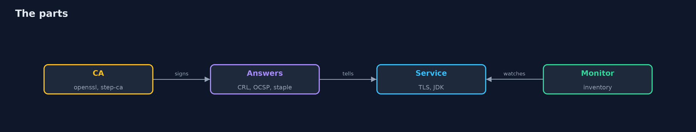

# Certificate Lifecycle

```
src/main/java/com/jk/explore/security/certlife/
├── CertificateLifecycleDemo.java  The life of a certificate in a bank's private PKI: issued by a root and an intermediate (openssl), revoked and checked by CRL, OCSP and stapling, replaced by short-lived certificates that step-ca renews, and the outage when a renewal is missed
├── Chains.java                    Chain building and validation with the JDK's PKIX provider, with a clock we choose and revocation checking we configure
├── Credential.java                A certificate chain (leaf first) with its private key, read from files
├── Crls.java                      The CA database (openssl's index.txt) written directly, to see how big a CRL gets without issuing 100,000 certificates
├── ExpiryWatch.java               An expiry monitor for one live endpoint: it connects like a scanner (it trusts nothing, it only reads the certificate that is presented) and raises an alert when less than a quarter of the certificate's life is left
├── Fleet.java                     An inventory of certificates and the expiry monitor that reads it: buckets by time left, and a day-by-day model of what the monitor saves
├── Load.java                      A client of the service: real TLS handshakes with the JDK's own trust manager (chain, dates and host name checked), counted
├── Openssl.java                   Finds an OpenSSL 3 or 4 command line program (not LibreSSL: its ca and ocsp commands differ)
├── Pki.java                       A private certificate authority made with openssl: a self-signed root that signs an intermediate, and the intermediate that signs the certificates (openssl ca, with its index.txt database)
├── Renewer.java                   Renews the certificate of a service when two thirds of its life are over, asking step-ca for a new one for the same key
├── Responder.java                 The OCSP responder of the lab: a real "openssl ocsp -index" process answers from the CA's database, behind a small relay on 127.0.0.1 that counts the requests and can be switched to answer, to refuse connections (the responder is down), or to accept and never answer (it hangs)
├── Service.java                   A TLS service on 127.0.0.1 whose certificate can be replaced while it runs: the next handshake uses the new one
├── Sh.java                        Runs a program and returns what it printed, whether it worked or not
├── StapleClient.java              A JDK TLS client that asks for a stapled OCSP response and decides about revocation itself: the response the server sent is the only source it is given, unless the policy lets it ask the responder named in the certificate
├── StaplingServer.java            A TLS server that is openssl s_server on 127.0.0.1, with or without a stapled OCSP response
├── StepCa.java                    A real certificate authority, step-ca, running on this machine and driven with the step command line
└── Verdict.java                   Whether a certificate chain was accepted, and the reason in a few words when it was not
```

**A private CA (openssl root and intermediate) issues a bank's certificates; a client that cannot reach the OCSP responder refuses a good certificate (hard fail) or accepts a revoked one (soft fail), a CRL grows from 20 KB at 1,000 entries to 2120 KB at 100,000, and a stapled response answers with 0 requests to the responder. With 12-second certificates that step-ca renews after two thirds of their life, 300 handshakes in 30 seconds see 3 renewals and 0 failures, a 2-second CA outage costs 0 of 200 handshakes, and a CA that stays down past the expiry refuses 100 of 100 handshakes, 2 seconds after an expiry monitor had already alerted; a monitor over 60 certificates finds 4 already expired and prevents 23 of 26 outages with a 7-day alert.**

A certificate has a life: it is issued, trusted, sometimes revoked, renewed and, if nobody looks, it expires in the middle of a working day. This project builds a private CA with **openssl** (a root and an intermediate), reads the certificates in Java (names, key usage, extended key usage, basic constraints, chain building with the PKIX provider), and then follows them through the whole life with real tools: an `openssl ocsp` responder, `openssl ca` CRLs, a stapled response from `openssl s_server`, and **step-ca** issuing and renewing certificates that live 12 seconds. A Java program drives the tools and counts what clients do; the demo is tagged `integration`: `./gradlew integrationTest` (about two minutes; `brew install step openssl@3`).

What it shows:
- **Reading a certificate.** A chain is built to the root with the intermediate; without the intermediate, 31 days later, or a day before issue, it is refused, each for its own reason.
- **OCSP and the dead responder.** Good and revoked certificates against a responder that is up, down or hanging, for a client that fails hard and one that fails soft: the soft client accepts the revoked certificate whenever the answer can be blocked.
- **CRL.** A client holding the old list accepts a certificate revoked after it was published; a list past its next update is refused by a hard-fail client. Size: **20 KB** at 1,000 entries, **2120 KB** at 100,000.
- **Stapling.** The server sends the signed answer in the handshake: **0** requests to the responder, a dead responder does not matter, and a stale staple hides a revocation for as long as it lives.
- **Short lives.** 12-second certificates renewed by step-ca after two thirds of their life: **3** renewals, **0 of 300** handshakes fail; a 2-second CA outage costs **0 of 200**.
- **The missed renewal.** A CA that stays down past the expiry: **100 of 100** handshakes refused, the monitor alerted **2 seconds** earlier.
- **The fleet.** An inventory of **60** certificates: **4** expired, **6** under 7 days, **14** under 30 days, **36** ok; a 7-day alert prevents **23 of 26** outages when the owner needs 3 days and none when the owner needs 10.

**Maps to:** NIST SP 800-57 Part 1 (key and certificate lifetimes) · NIST SP 800-52 Rev. 2 (TLS, certificate status) · RFC 5280 (CRL), RFC 6960 (OCSP), RFC 6066 (stapling) · CA/Browser Forum Baseline Requirements (shortening lifetimes).

## The idea in everyday terms

A passport is valid for ten years, a stolen one is reported to a list at the border, and the officer who cannot reach the list either lets everyone through or stops the queue. A boarding pass is valid for the flight and needs no list at all, but the airline's printer must never break.

## The scenario

A bank's internal services call each other over TLS. The demo builds the bank's private CA, issues certificates, revokes one, takes the revocation service down, switches to certificates that live 12 seconds, breaks the renewal, and scans an inventory of 60 certificates for the ones about to expire.

## Run

```bash
./gradlew run
```

The demo tells the story in 5 acts, each printing exact numbers that the tests check:

| Act | What it shows |
| --- | --- |
| 1. Issue and read | A root signs an intermediate, the intermediate signs a server certificate, and Java reads every field that a client checks. |
| 2. Revocation and a dead responder | A client that cannot reach the OCSP responder refuses a good certificate or accepts a revoked one; a CRL is up to a lifetime old. |
| 3. Stapling | The server sends the signed OCSP answer in the handshake: no request to the responder, and a dead responder does not matter. |
| 4. Short lives and rotation | 12-second certificates renewed by step-ca after two thirds of their life: 3 renewals and 0 of 300 handshakes fail. |
| 5. The missed renewal | A CA that stays down past the expiry refuses 100 of 100 handshakes, after a monitor alerted 2 seconds earlier. |

## Test

```bash
./gradlew test
```

18 tests in `CrlsAndVerdictTest`, `DemoRunsTest`, `FleetTest`, `ScheduleTest`. The expiry buckets, the model, the renewal schedule and the CA database are tested with no tools. The demo runs openssl, step and step-ca (./gradlew integrationTest).

## What the simulation got right, and what it left out

openssl and step-ca are real, and the clients are the JDK's own PKIX and TLS code. The lifetimes are seconds and the clocks are real, so the demo prints counts and yes or no, never serial numbers, ports, paths or times. Where a clock is moved (2 hours or 2 days later) the JDK is asked to validate at that time.

## Technologies and versions

Every version below is pinned in the project's build files and was the latest stable release when the project was built.

| Technology | Version | Used for |
| --- | --- | --- |
| Java | 25 | the language and runtime; a Gradle toolchain finds or downloads the JDK |
| Gradle | 9.8.1 (wrapper) | build and run; nothing to install, the wrapper downloads it |
| tools.jackson.core:jackson-databind | 3.1.5 | library the code uses |
| org.junit.jupiter:junit-jupiter | 6.1.3, set by junit-bom | JUnit 5: the tests (tests only) |
| org.junit.platform:junit-platform-launcher | 6.1.3, set by junit-bom | JUnit platform launcher, which Gradle needs to run the tests (tests only) |
| videokit | repository tool (`tools/videokit`) | the narrated video and animation: Piper `en_US-amy-medium`, speed 0.8, longer pauses (the amy-slow voice) |

## Learning Material

| Document | What it is for |
| --- | --- |
| [Problem statement](docs/problem-statement.md) | the situation and what the project must show |
| [Prerequisites](docs/prerequisites.md) | what you need to know first |
| [Certificate Lifecycle, explained](docs/certificate-lifecycle-explained.md) | the acts in prose |
| [Session guide](docs/session.md) | a one-hour lesson with exercises |
| [Animated walkthrough](docs/animation.html) | the acts step by step, narrated |
| [Threat model](docs/threat-model.md) | what is protected, who could harm it, and how, using STRIDE |
| [Spec](docs/spec.md) | what this project must be true of |
| [Expected output](docs/expected-output.txt) | the golden demo output every test and every port checks against |

### The idea in one picture

A private CA, its answers and the services that use them.



### Where each piece sits

The CA, the checks and the renewal.


### How the data moves

A certificate is renewed before it ends, or an alert is raised.


### Who calls whom, in order


### Video

`video/certificate-lifecycle-explained.mp4` (with `.m4a` audio and `.srt` subtitles) is built by `video/build_video.sh`. Rendered media is not committed.

## What it costs

- **Revocation needs an answer;** with hard fail a dead responder is an outage, with soft fail it is a bypass.
- **A CRL is big and old;** an OCSP answer is small but must be asked for, and a staple is as old as its last refresh.
- **Short lives need automation;** the headroom for a CA outage is a third of the life.
- **A monitor needs an inventory** and an owner who has time to act.
- **The demo runs for about two minutes** because it uses real clocks.

## When this is too much

A handful of long-lived certificates on internal tools can be renewed by a person with a calendar. Automate when there are dozens of certificates, when lifetimes shrink below a year, or when one expiry would stop a payment.

## Where you have already met this

- A certificate that expired on a weekend and took a service down.
- A browser that says the revocation check failed and carries on.
- A CRL download that takes longer than the page load.
- A spreadsheet of certificates and renewal dates.

## Where this sits

This is a project of the [applied-cryptography-and-pki](..) module, with [post-quantum-cryptography](../post-quantum-cryptography), [crypto-agility](../crypto-agility) and [tls-attacks-and-downgrades](../tls-attacks-and-downgrades). Those projects choose algorithms and protocol settings; this one follows the certificates themselves.
