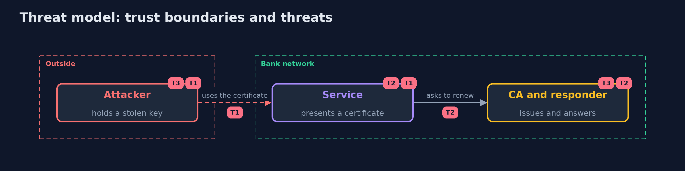

# Threat Model — Certificate Lifecycle

A threat model answers four questions: what are we protecting, who or what could harm it, how, and what do we do about it. This one covers this project's own demo system, not a production deployment. Domain: a bank.

## Scope

Certificates inside a bank's network: issue, revocation checks, renewal and expiry. It does not cover public CAs, browsers or hardware key storage.

## What we protect (assets)

- The private keys of the services.
- The availability of the services.
- The CA keys.

## Who and what acts on the system

- An attacker who holds a stolen key.
- An operator who forgets a renewal.
- A network that blocks the responder.

## Trust boundaries

A trust boundary is a line that data or a request crosses between parts that trust each other differently. Threats cluster where those lines are.

- Between the services and the CA.

Each dashed box is a trust boundary. A rose tag such as T1 shows where the threat of that number, in the table below, applies.

## Threats, using STRIDE

STRIDE is a checklist of six kinds of threat: **Spoofing** (S), **Tampering** (T), **Repudiation** (R), **Information disclosure** (I), **Denial of service** (D), **Elevation of privilege** (E).

| Id | Kind | Threat | Where it shows up | Control in this project | What is left |
| --- | --- | --- | --- | --- | --- |
| T1 | Spoofing | A stolen key is used until it expires | the service | Short lifetimes, revocation with a stated policy | A soft-fail client that accepts when the answer is blocked |
| T2 | Denial of service | A missed renewal refuses every handshake | the service | Renewal at two thirds, headroom, an expiry monitor | A CA outage longer than the headroom |
| T3 | Tampering | A revocation is hidden by a stale CRL or staple | the client | Short CRL and staple lifetimes, OCSP | The window until the next refresh |

## Assumptions

- The root key is kept offline.
- Clocks are close to right.

## Out of scope

- Compromise of the CA key.
- Certificate transparency.

## How the tests check this

- `FleetTest`, `ScheduleTest` and `CrlsAndVerdictTest` check the buckets, the model, the renewal schedule and the database with no tools.
- `DemoRunsTest` runs openssl, step and step-ca and compares the whole demo with the golden output (integrationTest).

## Where this model goes next

The next project in the module is key-management-and-hsm.
