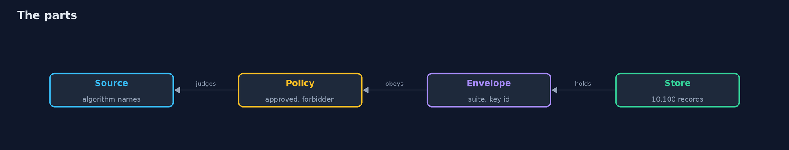
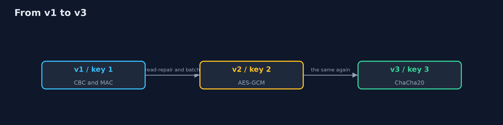

# Crypto Agility

```
src/main/java/com/jk/explore/security/cryptoagility/
├── CryptoAgilityDemo.java  
├── Envelope.java           A stored value with a header that says how it was protected: magic byte, suite version, key id
├── Inventory.java          Finds the algorithm names that source code asks the JDK for: the first step to knowing what has to change
├── KeyRing.java            The keys of the bank, by key id
├── Policy.java             The bank's list of algorithms: the transformations and digests that code may name, and what to do about each
├── Status.java             What the bank's policy says about an algorithm
└── Store.java              The bank's records, sealed in envelopes, and the ways of moving them from one suite and key to another
```

**A scan of a bank's code finds 20 uses of algorithms in 10 files: 11 approved, 5 to migrate and 4 forbidden, in 3 files; 10,000 records written by the old system in AES-CBC with a MAC are read next to new AES-GCM records because every value carries a header that names its suite and key, and a reader that assumes the first suite refuses a new record; reads that rewrite what they read move 2,000 records, a batch moves the other 8,000, and all 10,100 still read back as written; a second rotation to ChaCha20-Poly1305 under a third key moves all 10,100 again; key 1 cannot be retired while 10,000 records depend on it, and after its retirement a backup of 100 records taken before the migration reads 0 of 100; a changed version byte, a record claiming the unauthenticated first suite and a version the policy no longer reads are all refused.**

Every algorithm will be retired one day. **Crypto agility** is being able to do it without losing data or stopping the bank: you know where each algorithm is used, every stored value says how it was protected, and you have practised moving data from one algorithm and key to the next. This project does it with the JDK only: an **inventory** of the algorithm names in a bank's source, a **versioned envelope** (a header with the suite and the key id that is authenticated with the data), and a store of **10,100 records** that is migrated twice. `./gradlew test`, then `./gradlew run`.

What it shows:
- **What the code asks for.** 20 uses in 10 files: **11** approved, **5** to migrate, **4** forbidden (in 3 files).
- **A header that says how.** Old AES-CBC records and new AES-GCM records are read side by side; a reader that assumes one suite **refuses** the new record.
- **Moving the data.** **2,000** reads that rewrite what they read, then a batch of **8,000**: all **10,100** still read back as written. A second rotation to ChaCha20-Poly1305 moves all of them again.
- **Retiring a key.** Key 1 is refused while 10,000 records depend on it; once it is retired, a **backup of 100 records** from before the migration reads **0 of 100**.
- **Tampering and downgrade.** A changed version byte, a record claiming the unauthenticated first suite, and a version the policy no longer reads are all refused.

**Maps to:** NIST CSF 2.0 PR.DS · NIST SP 800-131A (transitions) · NIST IR 8547 (post-quantum migration) · CISA and NSA guidance on cryptographic inventories (CBOM).

## The idea in everyday terms

Changing the locks of a building that people live in. You need a list of every door, a label on every key that says which lock it opens, a night-by-night plan to swap the locks, and one person who checks that nobody is still holding a key to a lock you have thrown away, including the ones in the safe-deposit box.

## The scenario

A bank's customer records are protected with a mix of old and new algorithms. A new standard requires a change, and the records and backups must keep working. The demo scans the code, then moves the data twice.

## Run

```bash
./gradlew run
```

The demo tells the story in 5 acts, each printing exact numbers that the tests check:

| Act | What it shows |
| --- | --- |
| 1. What the code asks for | 20 uses of algorithms in 10 files: 11 approved, 5 to migrate and 4 forbidden. |
| 2. A value that says how it was protected | Old and new records are read side by side because each carries its suite and key; a reader that assumes one suite refuses the new one. |
| 3. Moving the data | 2,000 reads that rewrite what they read and a batch of 8,000 move everything, and all 10,100 records still read back as written. |
| 4. Retiring a key | Key 1 can be retired when no live record uses it, but a backup from before the migration then reads 0 of 100. |
| 5. Tampering and downgrade | A changed version byte, a record claiming the unauthenticated first suite and a version the policy no longer reads are all refused. |

## Test

```bash
./gradlew test
```

15 tests in `DemoRunsTest`, `EnvelopeTest`, `StoreAndInventoryTest`. The envelope, the store, the inventory and the policy are tested with the JDK only. The demo is compared with its golden output.

## What the simulation got right, and what it left out

The cryptography is the JDK's own and the records are real encrypted values. The source files that are scanned are small text fixtures, not compiled. The demo prints counts, never keys or ciphertext.

## Technologies and versions

Every version below is pinned in the project's build files and was the latest stable release when the project was built.

| Technology | Version | Used for |
| --- | --- | --- |
| Java | 25 | the language and runtime; a Gradle toolchain finds or downloads the JDK |
| Gradle | 9.8.1 (wrapper) | build and run; nothing to install, the wrapper downloads it |
| org.junit.jupiter:junit-jupiter | 6.1.3, set by junit-bom | JUnit 5: the tests (tests only) |
| org.junit.platform:junit-platform-launcher | 6.1.3, set by junit-bom | JUnit platform launcher, which Gradle needs to run the tests (tests only) |
| videokit | repository tool (`tools/videokit`) | the narrated video and animation: Piper `en_US-amy-medium`, speed 0.8, longer pauses (the amy-slow voice) |

## Learning Material

| Document | What it is for |
| --- | --- |
| [Problem statement](docs/problem-statement.md) | the situation and what the project must show |
| [Prerequisites](docs/prerequisites.md) | what you need to know first |
| [Crypto Agility, explained](docs/crypto-agility-explained.md) | the acts in prose |
| [Session guide](docs/session.md) | a one-hour lesson with exercises |
| [Animated walkthrough](docs/animation.html) | the acts step by step, narrated |
| [Threat model](docs/threat-model.md) | what is protected, who could harm it, and how, using STRIDE |
| [Spec](docs/spec.md) | what this project must be true of |
| [Expected output](docs/expected-output.txt) | the golden demo output every test and every port checks against |

### The idea in one picture

The header connects a value to its suite and key.



### Where each piece sits

The envelope, the store and the policy.


### How the data moves

Each migration is the same process.



### Who calls whom, in order


### Video

`video/crypto-agility-explained.mp4` (with `.m4a` audio and `.srt` subtitles) is built by `video/build_video.sh`. Rendered media is not committed.

## What it costs

- **A header and a policy add code** to every read and write.
- **A migration is a project;** it needs time, monitoring and a rollback.
- **Backups and replicas hold old versions** for years.
- **Supporting many versions widens the attack surface.**
- **An inventory by name misses algorithms chosen at runtime.**

## When this is too much

A system with one short-lived cache needs no envelope. Use agility where data outlives the algorithm: databases, backups, archives and signatures that must be checked years later.

## Where you have already met this

- A column of ciphertext with no version.
- An algorithm name hard-coded in forty places.
- A key kept forever because a backup needs it.
- A migration script run once, in a hurry, and never again.

## Where this sits

This is a project of the [applied-cryptography-and-pki](..) module, after [post-quantum-cryptography](../post-quantum-cryptography), whose algorithms are the next ones to migrate to.
