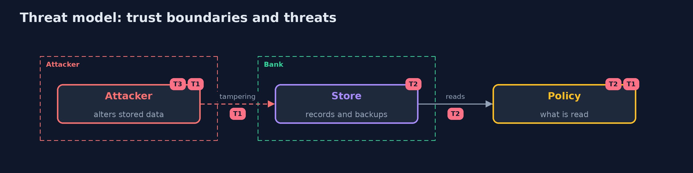

# Threat Model — Crypto Agility

A threat model answers four questions: what are we protecting, who or what could harm it, how, and what do we do about it. This one covers this project's own demo system, not a production deployment. Domain: a bank.

## Scope

How stored data is protected and how the protection can be changed. It does not cover the strength of the algorithms themselves.

## What we protect (assets)

- The customer records.
- The backups.
- The keys.

## Who and what acts on the system

- An attacker who can change stored values.
- A developer who adds a new algorithm name.
- An operator who retires a key.

## Trust boundaries

A trust boundary is a line that data or a request crosses between parts that trust each other differently. Threats cluster where those lines are.

- The store: what is read from it is checked by the envelope.

Each dashed box is a trust boundary. A rose tag such as T1 shows where the threat of that number, in the table below, applies.

## Threats, using STRIDE

STRIDE is a checklist of six kinds of threat: **Spoofing** (S), **Tampering** (T), **Repudiation** (R), **Information disclosure** (I), **Denial of service** (D), **Elevation of privilege** (E).

| Id | Kind | Threat | Where it shows up | Control in this project | What is left |
| --- | --- | --- | --- | --- | --- |
| T1 | Tampering | A stored value is changed to a weaker suite | the store | Authenticate the header with the data and refuse versions the policy does not read | A suite that is weak but still allowed |
| T2 | Denial of service | A key is retired while data still needs it | the key ring | Count the live records and the backups under a key before retiring it | Copies nobody knows about |
| T3 | Information disclosure | A forbidden algorithm stays in the code | the source | Keep an inventory and fail the build on a forbidden name | Names chosen at runtime |

## Assumptions

- The keys are kept safe; the policy is reviewed.

## Out of scope

- Side channels.
- Attacks on the algorithms.

## How the tests check this

- `EnvelopeTest` and `StoreAndInventoryTest` check the suites, the header, the policy, the migration and the inventory with the JDK only.
- `DemoRunsTest` compares the whole demo with the golden output.

## Where this model goes next

The next project in the module is hardware-backed-keys.
