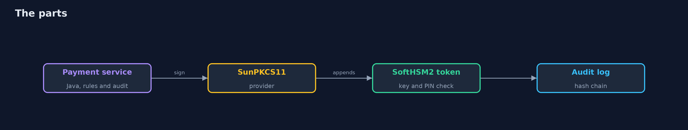
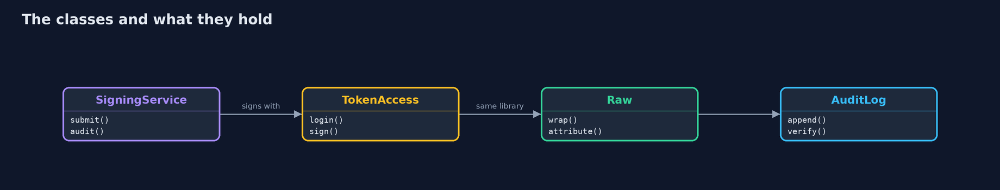
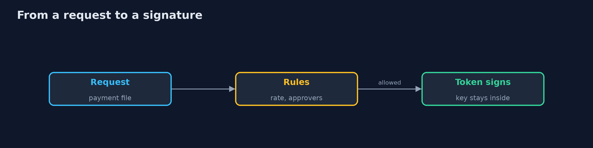
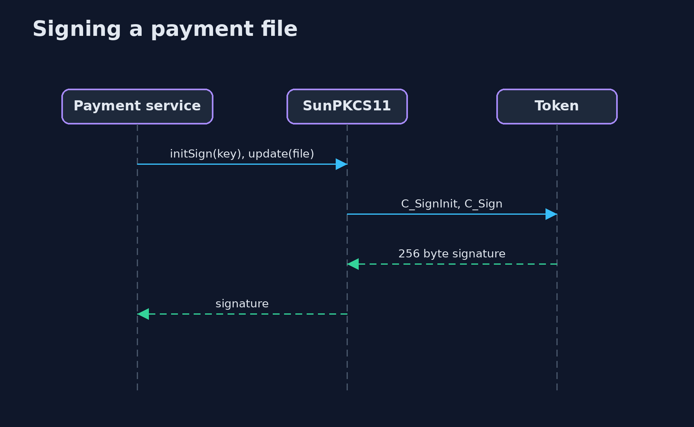

# Hardware-Backed Keys

```
src/main/java/com/jk/explore/security/hsmkeys/
├── Attacker.java                A second process on the same machine (or on a thief's machine with a copy of the token directory)
├── AuditLog.java                A hash-chained record of what was signed: each entry carries the hash of the one before, so an edit or a removed entry breaks the chain
├── Der.java                     A few lines of DER, enough to build a self-signed certificate whose signature is made by someone else (the token)
├── HardwareBackedKeysDemo.java  Keys that never leave a token: a bank's payment-signing key on a SoftHSM2 token, used through PKCS#11, and what that does and does not protect
├── Lab.java                     A scratch directory with a SoftHSM2 configuration, one initialised token, and the SunPKCS11 provider pointed at it
├── Malware.java                 Code that got into the application's process, for example through a poisoned library
├── Native.java                  The one libc call Java does not have: setenv
├── PaymentFile.java             A made-up bank payment file: the thing the key signs
├── PinGuard.java                A lockout kept by the application: after N wrong PINs it stops asking the token
├── Provisioning.java            Key ceremony: the bank's payment-signing key is born on the token with its private half sensitive and not extractable
├── Raw.java                     The PKCS#11 calls the JDK provider does not offer (reading attributes, wrapping a key, unwrapping it again), made straight on the library through the foreign function API
├── Sh.java                      Runs a program and returns what it printed, whether it worked or not
├── SigningService.java          The bank's own rules in front of the key: at most N signatures in a window, and a payment file over a limit needs two approvers who are not the person who asked
├── SoftKey.java                 The contrast: the same signing key as a PKCS12 file protected by a password
└── TokenAccess.java             Logging in to the token through the JDK provider, and signing and verifying with the result
```

**A payment-signing RSA key is born on a SoftHSM2 token as sensitive and not extractable; Java signs 5 payment files through the PKCS11 KeyStore and all 5 verify with the exported public key, while 0 of 5 ways of getting the private key out work (the same key in a file falls to a dictionary at guess 6 of 8). The token refuses 12 of 12 wrong PINs but never locks (SoftHSM2 has no lockout), a copy of the token directory takes 300 guesses with no lock, and code inside the application's process signs 500 of 500 forged files with no PIN, past the rate limit, the approvers and the audit log.**

A key that never leaves a token cannot be copied with the file it lives in. This project creates a **SoftHSM2** token (`brew install softhsm`), generates a bank's payment-signing key on it, and uses it from Java through the **SunPKCS11** provider and through raw PKCS#11 calls made with the foreign function API. SoftHSM is a software token: it behaves like an HSM at the PKCS#11 interface but is a directory of files, and the demo says so where it matters. The demo is tagged `integration`: `./gradlew integrationTest`.

What it shows:
- **Born on the token.** The RSA 2048 key is sensitive, not extractable and never extractable; 5 payment files signed through the KeyStore verify **5 of 5** with the exported public key.
- **Five ways out.** Reading the exponent, `getEncoded()`, wrapping under the bank's key, wrapping under an attacker's key and a PKCS12 export: **0 of 5** work. The same key as a file falls to a dictionary at guess **6 of 8**.
- **The PIN.** No login shows **0** private keys; **12 of 12** wrong PINs are refused but SoftHSM2 never locks, so the application keeps its own lockout, which a direct call to the provider ignores. A copy of the token directory takes **300** guesses with no lock.
- **Backup.** A key made extractable on purpose is wrapped (80 bytes), destroyed and restored; but a logged-in attacker opens it with a wrapping key of their own.
- **The limit.** Code in the application's process signs **500 of 500** forged files, past the rate limit, the approvers and the audit log.

**Maps to:** NIST SP 800-57 key management · FIPS 140-3 · PKCS#11 v2.40 · PCI DSS 4.0 requirement 3.7 · CWE-321, CWE-522.

## The idea in everyday terms

A safe deposit box where the bank signs documents inside the vault and only the signed paper comes out. The signature is good, and nobody can take the stamp home, but anyone the clerk lets into the vault can still stamp whatever they like.

## The scenario

A bank signs its payment files with one key. The demo puts that key on a token, signs, tries to steal the key five ways, compares it with a key in a file, and then acts as an attacker who is already on the host.

## Run

```bash
./gradlew run
```

The demo tells the story in 5 acts, each printing exact numbers that the tests check:

| Act | What it shows |
| --- | --- |
| 1. The key ceremony | The RSA 2048 payment-signing key is generated by the token, sensitive and not extractable. |
| 2. Five ways out | Five attempts to get the private key out fail; 5 payment files signed with it verify. |
| 3. PINs and a file for contrast | 12 of 12 wrong PINs are refused but SoftHSM2 never locks; the same key in a file falls at guess 6 of 8. |
| 4. Rate, approvers and audit | The bank's code signs 8 of 14 requests, refuses 4 for the rate and 2 for approvers, and keeps a hash-chained log of 14. |
| 5. A compromised host | Code in the application's process signs 500 of 500 forged files with no PIN, and an extractable key is lost to a logged-in attacker. |

## Test

```bash
./gradlew test
```

21 tests in `AuditLogTest`, `DemoRunsTest`, `DerAndSoftKeyTest`, `PinGuardTest`, `SigningServiceTest`, `TokenAccessAndRawTest`. The audit log, signing rules, PIN guard, DER and keystore-file code run with no tools. The demo needs SoftHSM2 (./gradlew integrationTest).

## What the simulation got right, and what it left out

SoftHSM2, the JDK SunPKCS11 provider and PKCS#11 are real; the bank, the payment files and the people are made up. The token lives in a scratch directory under build/ that is deleted at the end. The demo prints counts, names of return values and yes or no, never PINs, handles or signatures.

## Technologies and versions

Every version below is pinned in the project's build files and was the latest stable release when the project was built.

| Technology | Version | Used for |
| --- | --- | --- |
| Java | 25 | the language and runtime; a Gradle toolchain finds or downloads the JDK |
| Gradle | 9.8.1 (wrapper) | build and run; nothing to install, the wrapper downloads it |
| org.junit.jupiter:junit-jupiter | 6.1.3, set by junit-bom | JUnit 5: the tests (tests only) |
| org.junit.platform:junit-platform-launcher | 6.1.3, set by junit-bom | JUnit platform launcher, which Gradle needs to run the tests (tests only) |
| videokit | repository tool (`tools/videokit`) | the narrated video and animation: Piper `en_US-amy-medium`, speed 0.8, longer pauses (the amy-slow voice) |

## Learning Material

| Document | What it is for |
| --- | --- |
| [Problem statement](docs/problem-statement.md) | the situation and what the project must show |
| [Prerequisites](docs/prerequisites.md) | what you need to know first |
| [Hardware-Backed Keys, explained](docs/hardware-backed-keys-explained.md) | the acts in prose |
| [Session guide](docs/session.md) | a one-hour lesson with exercises |
| [Animated walkthrough](docs/animation.html) | the acts step by step, narrated |
| [Threat model](docs/threat-model.md) | what is protected, who could harm it, and how, using STRIDE |
| [Spec](docs/spec.md) | what this project must be true of |
| [Expected output](docs/expected-output.txt) | the golden demo output every test and every port checks against |

### The idea in one picture

The application reaches the token only through PKCS#11.



### Where each piece sits

The rules, the token access and the audit log.



### How the data moves

The bank's rules run before the token is asked.



### Who calls whom, in order




### Video

`video/hardware-backed-keys-explained.mp4` (with `.m4a` audio and `.srt` subtitles) is built by `video/build_video.sh`. Rendered media is not committed.

## What it costs

- **A token is a new thing to run:** slots, PINs, a PKCS#11 library and a security officer.
- **Throughput and latency** are bounded by the token.
- **Backup needs wrapping,** and a wrappable key is a weaker key.
- **The PIN is a secret in the application,** and a logged-in process can sign.
- **SoftHSM is not hardware;** it teaches the interface, not the tamper resistance.

## When this is too much

A key that signs a low-value internal token can live in a managed KMS or a protected file. Use a token for keys whose theft costs more than the token, such as payment signing, code release and root CA keys.

## Where you have already met this

- A signing key in a keystore file in the repository.
- A key password in an environment variable on the build server.
- A key copied to a second server as a backup.
- An HSM that the whole application server can use without limits.

## Where this sits

This is a project of the [applied-cryptography-and-pki](..) module, with [crypto-agility](../crypto-agility) and [post-quantum-cryptography](../post-quantum-cryptography). Those show which algorithm to use; this one shows where the private key lives.
