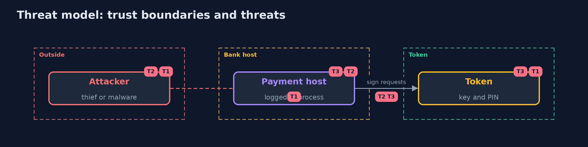

# Threat Model — Hardware-Backed Keys

A threat model answers four questions: what are we protecting, who or what could harm it, how, and what do we do about it. This one covers this project's own demo system, not a production deployment. Domain: a bank.

## Scope

A signing key on a PKCS#11 token used by one application host. It does not cover physical attacks on hardware, the people who hold PINs or the key ceremony.

## What we protect (assets)

- The payment-signing private key.
- The user PIN.
- The backup blob and its wrapping key.

## Who and what acts on the system

- A thief with a copy of a file or a token directory.
- Malware in the application's process.
- An insider with the PIN.

## Trust boundaries

A trust boundary is a line that data or a request crosses between parts that trust each other differently. Threats cluster where those lines are.

- The PKCS#11 interface between the host and the token.

Each dashed box is a trust boundary. A rose tag such as T1 shows where the threat of that number, in the table below, applies.

## Threats, using STRIDE

STRIDE is a checklist of six kinds of threat: **Spoofing** (S), **Tampering** (T), **Repudiation** (R), **Information disclosure** (I), **Denial of service** (D), **Elevation of privilege** (E).

| Id | Kind | Threat | Where it shows up | Control in this project | What is left |
| --- | --- | --- | --- | --- | --- |
| T1 | Information disclosure | The signing key is copied from a file or backup | the key | Generate it on the token as sensitive and not extractable | A SoftHSM token directory can be copied; the PIN is then the only barrier |
| T2 | Elevation of privilege | Code in the logged-in process signs anything | the host | Log in only while signing; keep limits and audit outside the process | Signing during the login window |
| T3 | Repudiation | Signatures are made that nobody logged | the audit log | Hash-chained audit of every decision | Signatures made past the application's log |

## Assumptions

- The token enforces sensitive and non-extractable attributes.

## Out of scope

- Side channels.
- Tamper resistance of real hardware.

## How the tests check this

- `AuditLogTest`, `SigningServiceTest`, `PinGuardTest`, `DerAndSoftKeyTest` and `TokenAccessAndRawTest` need no tools.
- `DemoRunsTest` runs SoftHSM2 and compares the whole demo with the golden output (integrationTest).

## Where this model goes next

The next project in the module is certificate-lifecycle.
