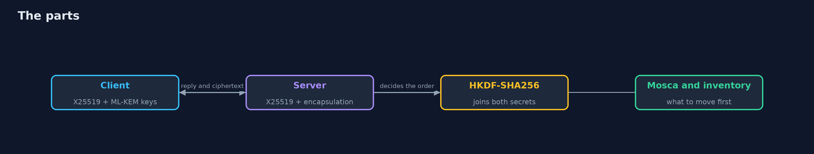
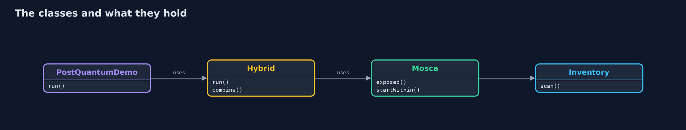
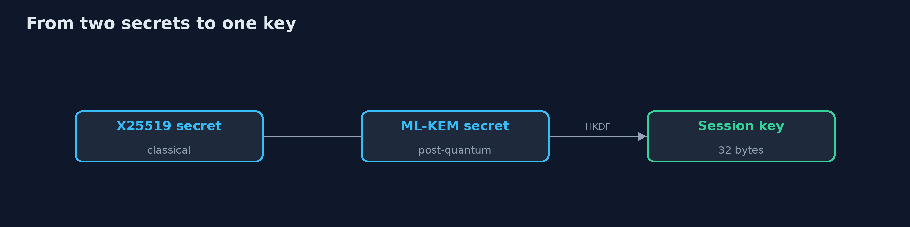
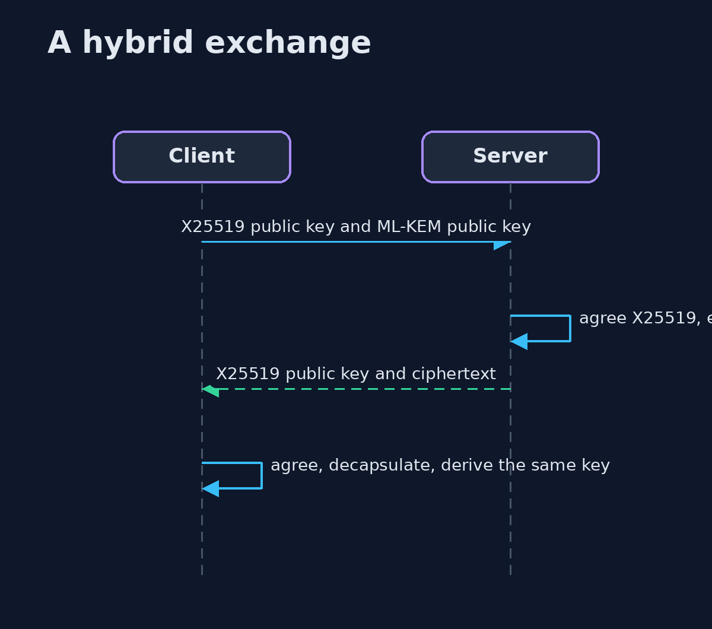

# Post-Quantum Cryptography

```
src/main/java/com/jk/explore/security/pqc/
├── HkdfSteps.java        A teaching class: HKDF-SHA256 (RFC 5869) redone by hand with HMAC, for a 32-byte key and no salt
├── Hybrid.java           A hybrid key exchange: X25519 and ML-KEM-768 side by side, the two secrets joined by HKDF with the whole transcript as context
├── Interop.java          Two independent implementations, the JDK's and Bouncy Castle's, exchanging public keys, ciphertexts and signatures
├── Inventory.java        An inventory of the cryptography in a bank's source files: which algorithm each file names, what it is used for, and so in which order the files have to move to post-quantum algorithms
├── Mosca.java            Mosca's inequality: if the years data must stay secret (x) plus the years a migration takes (y) are more than the years until a quantum computer that breaks the old algorithms exists (z), the data is already exposed to someone who records it today
├── PostQuantumDemo.java  Post-quantum cryptography in the JDK for a bank: sizes, ML-KEM, ML-DSA, a hybrid exchange with X25519, Mosca's inequality and an inventory of a bank's code, each checked against Bouncy Castle where it can be
├── Signatures.java       ML-DSA signing and verifying through the ordinary java.security API
└── Sizes.java            Measures the byte sizes that a protocol has to carry
```

**In the JDK alone an ML-KEM-768 encapsulation succeeds and both sides derive the same 32-byte key, the public key is 1206 bytes against 44 for X25519 (27.4 times) and a signature is 3309 bytes for ML-DSA-65 against 64 for ECDSA P-256; a flipped bit in the ciphertext raises no error and gives a different key, a hybrid key cannot be rebuilt by an attacker who has broken only X25519 or only ML-KEM, HKDF worked by hand gives the JDK's exact hybrid key, Mosca's inequality marks 3 of 5 bank data classes as exposed if the threat is 8 years away, an inventory of 7 of the bank's source files puts 3 key exchange files first, and Bouncy Castle 1.86 agrees with the JDK on public keys, ciphertexts and signatures but not on private key encodings.**

A large quantum computer would break RSA, finite-field Diffie-Hellman and elliptic curves, and anyone can record encrypted traffic today and open it later. The JDK 25 ships the two NIST standards that answer this, **ML-KEM** (FIPS 203, key establishment) and **ML-DSA** (FIPS 204, signatures), in the ordinary `KeyPairGenerator`, `KEM` and `Signature` classes. This project uses them for a bank, measures what they cost in bytes, builds a **hybrid** exchange with X25519, models how long data must stay secret, and orders the migration of a sample of the bank's code. It needs only the JDK; Bouncy Castle 1.86 is used for one cross-check. Run `./gradlew run`.

What it shows:
- **Sizes.** An ML-KEM-768 public key is **1206** bytes against **44** for X25519 (27.4 times); an ML-DSA-65 signature is **3309** bytes against **64** for ECDSA P-256; the keys and signatures of a short certificate chain grow from **374** to **13875** bytes.
- **ML-KEM.** Encapsulation succeeds and both sides derive the same 32-byte key: yes.
- **Implicit rejection.** A flipped bit gives **no error** and a different key; the failure shows at first use, as an AES-GCM tag failure.
- **Hybrid.** X25519 and ML-KEM secrets (32 + 32 bytes) joined by HKDF with the 2409-byte transcript as context, worked by hand to the JDK's exact key: breaking only one part does not give the key.
- **Mosca.** Secrecy years plus migration years against years to the threat, from made-up inputs: **3 of 5** data classes exposed if the threat is 8 years away.
- **Inventory.** **7** of the bank's source files, read as text: **3** key exchange files move first, **3** signature files next, **1** symmetric-only file stays.
- **Two implementations.** The JDK and Bouncy Castle agree on public keys, ciphertexts and signatures, and do not agree on private key encodings.

**Maps to:** NIST FIPS 203 and FIPS 204 · NIST SP 800-227 (KEM recommendations) · NIST IR 8547 (transition to post-quantum) · OWASP Cryptographic Storage · PCI DSS 4.0 requirement 12.3.3 (cryptographic inventory).

## The idea in everyday terms

A bank that knows a better vault door is coming in some years, and that thieves are already photographing today's locks. It does not wait for the new door: it lists every door, replaces the ones guarding things that must stay secret for decades, and fits the new lock next to the old one until it trusts the new one.

## The scenario

A bank protects card messages, online sessions, a statement archive, loan contracts and a settlement file. The demo uses the new algorithms, sizes them, models which data is at risk of being recorded now, and lists which of its code moves first.

## Run

```bash
./gradlew run
```

The demo tells the story in 5 acts, each printing exact numbers that the tests check:

| Act | What it shows |
| --- | --- |
| 1. What has to cross the network | Measured from real keys: an ML-KEM-768 public key is 1206 bytes against 44 for X25519 (27.4 times) and its reply 1088 against 44 (24.7 times); an ML-DSA-65 signature is 3309 bytes against 64 for ECDSA P-256, so one handshake's 2 keys and 3 signatures grow from 374 to 13875 bytes (37.1 times). |
| 2. ML-KEM in the JDK | The sender encapsulates to the bank's ML-KEM-768 key (1206 bytes): a 1088-byte ciphertext and a 32-byte key that the bank recovers exactly. A flipped bit raises no error (implicit rejection): the bank gets a different 32-byte key, and the first use fails the AES-GCM tag check. A 10-byte ciphertext is the only error. Bouncy Castle 1.86 agrees in both directions. |
| 3. ML-DSA in the JDK | A bank statement is signed with ML-DSA-65: a 1974-byte public key and a 3309-byte signature. It verifies; a one-bit change, another bank's key and an ML-DSA-44 signature checked with an ML-DSA-65 key do not; a second signature is different and also verifies (hedged signing). Bouncy Castle 1.86 verifies the JDK's signature and the other way round, but the JDK does not read its private key encoding. |
| 4. A hybrid key exchange: X25519 and ML-KEM-768 | The client sends 44 + 1206 = 1250 bytes and the server 44 + 1088 = 1132. HKDF-SHA256 joins the two 32-byte secrets (64 bytes) with a 2409-byte context, worked by hand to the JDK's exact key. An attacker who breaks only X25519, or only ML-KEM, cannot rebuild the key, though an X25519-only key would fall; a context missing one byte gives another key. |
| 5. Planning the migration | Mosca's inequality with made-up inputs: data is exposed when secrecy years plus migration years exceed the years to the threat; if the threat is 8 years away, 3 of 5 data classes recorded today are already exposed (the statement archive by 5 years), and 1 of 5 at 15 or 25. An inventory of 7 of the bank's source files puts 3 key exchange files first, 3 signature files next, and keeps the 1 symmetric-only file. |

## Test

```bash
./gradlew test
```

19 tests in `DemoRunsTest`, `HybridTest`, `InteropTest`, `InventoryTest`, `MoscaTest`, `SignaturesTest`, `SizesTest`. The demo needs only the JDK and Bouncy Castle and runs in seconds, so the golden-file test runs with ./gradlew test.

## What the simulation got right, and what it left out

Nothing is simulated except the attacker of the hybrid exchange, who is handed one broken secret (what a quantum computer would produce) and tries to rebuild the key. The inputs of Mosca's inequality are made up and labelled so. The demo prints sizes, counts and yes or no answers, never keys or timings.

## Technologies and versions

Every version below is pinned in the project's build files and was the latest stable release when the project was built.

| Technology | Version | Used for |
| --- | --- | --- |
| Java | 25 | the language and runtime; a Gradle toolchain finds or downloads the JDK |
| Gradle | 9.8.1 (wrapper) | build and run; nothing to install, the wrapper downloads it |
| org.bouncycastle:bcprov-jdk18on | 1.86 | Bouncy Castle: algorithms and providers the JDK lacks |
| org.junit.jupiter:junit-jupiter | 6.1.3, set by junit-bom | JUnit 5: the tests (tests only) |
| org.junit.platform:junit-platform-launcher | 6.1.3, set by junit-bom | JUnit platform launcher, which Gradle needs to run the tests (tests only) |
| videokit | repository tool (`tools/videokit`) | the narrated video and animation: Piper `en_US-amy-medium`, speed 0.8, longer pauses (the amy-slow voice) |

## Learning Material

| Document | What it is for |
| --- | --- |
| [Problem statement](docs/problem-statement.md) | the situation and what the project must show |
| [Prerequisites](docs/prerequisites.md) | what you need to know first |
| [Post-Quantum Cryptography, explained](docs/post-quantum-cryptography-explained.md) | the acts in prose |
| [Session guide](docs/session.md) | a one-hour lesson with exercises |
| [Animated walkthrough](docs/animation.html) | the acts step by step, narrated |
| [Threat model](docs/threat-model.md) | what is protected, who could harm it, and how, using STRIDE |
| [Spec](docs/spec.md) | what this project must be true of |
| [Expected output](docs/expected-output.txt) | the golden demo output every test and every port checks against |

### The idea in one picture

A bank client and server exchange a hybrid key; the model and the inventory sit beside them.



### Where each piece sits

The demo, the hybrid exchange, the model and the inventory.



### How the data moves

Both secrets and the transcript go into one derivation.



### Who calls whom, in order




### Video

`video/post-quantum-cryptography-explained.mp4` (with `.m4a` audio and `.srt` subtitles) is built by `video/build_video.sh`. Rendered media is not committed.

## What it costs

- **Bytes.** Keys, ciphertexts and signatures are 10 to 50 times larger, which costs bandwidth and can split a handshake across packets.
- **Young algorithms.** Hybrid keeps today's security if a flaw is found in the new one.
- **The threat date is unknown,** so the model is an illustration, not a forecast.
- **Inventory is work.** A name in the source is not proof of use, and keys also hide in hardware, vendors and certificates.
- **Private key formats differ** between libraries.

## When this is too much

A system whose data is worthless in a year and that is rebuilt every two years can wait and watch. Anything that must stay secret for ten years, or that signs things that must stay valid for decades, should plan now.

## Where you have already met this

- Waiting for a quantum computer to exist before planning.
- Replacing RSA with a larger RSA key.
- A migration with no list of where the old algorithms are.
- A new algorithm used alone on day one.

## Where this sits

This is a project of the [applied-cryptography-and-pki](..) module. The inventory reads a fixed sample of a bank's source files, so its answer is the same on every run.
