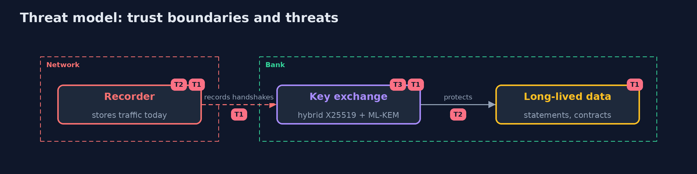

# Threat Model — Post-Quantum Cryptography

A threat model answers four questions: what are we protecting, who or what could harm it, how, and what do we do about it. This one covers this project's own demo system, not a production deployment. Domain: a bank.

## Scope

The key exchange and the signatures of a bank's services, and the question of which data is at risk from recorded traffic. It does not cover hardware security modules, vendors or TLS configuration of a server.

## What we protect (assets)

- Traffic that must stay secret for years.
- Signatures that must stay valid for years.
- The inventory of algorithms.

## Who and what acts on the system

- A recorder who stores traffic now to open it later.
- A future attacker with a quantum computer.
- A team that migrates.

## Trust boundaries

A trust boundary is a line that data or a request crosses between parts that trust each other differently. Threats cluster where those lines are.

- The network between client and server.

Each dashed box is a trust boundary. A rose tag such as T1 shows where the threat of that number, in the table below, applies.

## Threats, using STRIDE

STRIDE is a checklist of six kinds of threat: **Spoofing** (S), **Tampering** (T), **Repudiation** (R), **Information disclosure** (I), **Denial of service** (D), **Elevation of privilege** (E).

| Id | Kind | Threat | Where it shows up | Control in this project | What is left |
| --- | --- | --- | --- | --- | --- |
| T1 | Information disclosure | Recorded key exchange is opened later by a quantum computer | the traffic | Hybrid X25519 plus ML-KEM; move key establishment first | A flaw in both parts |
| T2 | Spoofing | Signatures that must stay valid for decades are forged later | the signatures | Plan ML-DSA for long-lived signatures; inventory first | Larger certificates |
| T3 | Tampering | A tampered ciphertext is taken for a valid one | the exchange | Implicit rejection plus an authenticated cipher that fails at first use | A library that hides the failure |

## Assumptions

- A quantum computer that breaks RSA and elliptic curves may exist; when is unknown.
- ML-KEM and ML-DSA as standardised are sound, but young.

## Out of scope

- Side channels of an implementation.
- Quantum key distribution.

## How the tests check this

- `SizesTest`, `HybridTest`, `MoscaTest`, `InventoryTest`, `SignaturesTest` and `InteropTest` check the standards' lengths, the hybrid, the inequality, the scan and the two implementations.
- `DemoRunsTest` compares the whole demo with the golden output.

## Where this model goes next

The next project in the module is the next row of the advanced plan.
