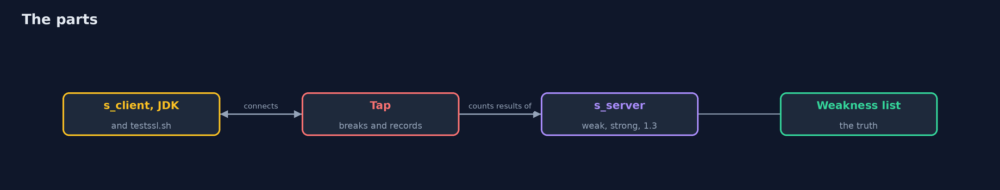
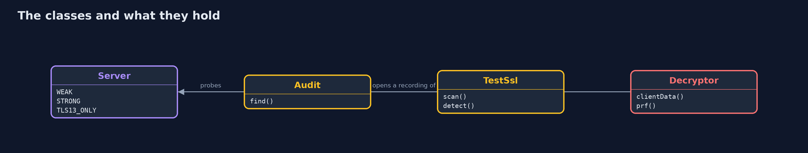
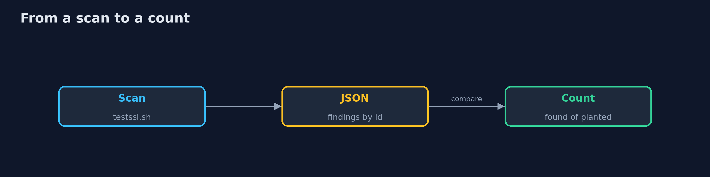
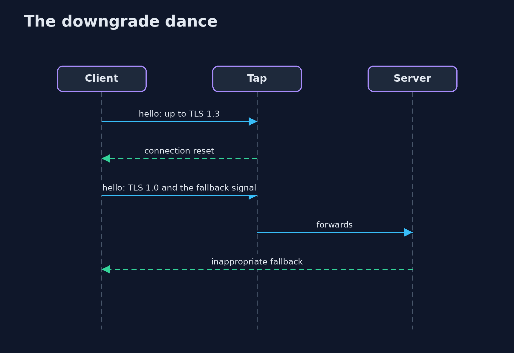

# TLS Attacks and Downgrades

```
src/main/java/com/jk/explore/security/tlsattacks/
├── Audit.java           Finds the planted weaknesses of a server by connecting to it with openssl s_client (our own probes)
├── Decryptor.java       What an attacker with a recording and the server's private key can read
├── Lab.java             The server key, its certificate and a 1024-bit DH group, in a temporary folder that is deleted at the end
├── Openssl.java         Finds an OpenSSL 3 or 4 command line program (not LibreSSL: it cannot run the weak settings of this lab)
├── Probe.java           What one openssl s_client connection did
├── Server.java          One local TLS server, openssl s_server, listening on 127.0.0.1 only
├── Sh.java              Runs a program and returns what it printed, whether it worked or not
├── Tap.java             A man in the middle on 127.0.0.1: it forwards TCP to a target and records both directions
├── TestSsl.java         testssl.sh, pinned to a release tag and cloned into build/, run for real against a local server; its JSON is read here
├── TlsAttacksDemo.java  Deliberately weak local TLS servers, probed and scanned, and what TLS 1.3 removed
├── TlsRecords.java      Reads the bytes of a recorded TLS connection: records, handshake messages and the few fields this lab needs
└── Weakness.java        The weaknesses planted in the weak server: the truth the probes and testssl.sh are scored against
```

**A weak local server has 6 planted weaknesses (TLS 1.0 and 1.1, static RSA, CBC with SHA-1, a 1024-bit DH group, a NULL cipher); our own openssl probes find 6 of 6 and testssl.sh finds 6 of 6, 4 by a finding that names the problem and 2 only by reading its cipher table, and the strong server raises none. A client that falls back ends on TLS 1.0 with AES128-SHA after 4 attempts, the same client with TLS_FALLBACK_SCSV is refused, and a leaked server key opens the recorded static RSA session (1 of 3) and neither the DHE nor the ECDHE one. A TLS 1.3 only server refuses all 3 older versions, static RSA and CBC.**

A TLS server is as strong as the oldest thing it still accepts. This project starts **three local servers** with `openssl s_server` on 127.0.0.1: a weak one with **6 planted weaknesses**, a strong one for TLS 1.2 and 1.3, and a TLS 1.3 only one. Java probes them with `openssl s_client`, runs **testssl.sh v3.2.4** (cloned into `build/` and pinned to its commit) and reads its JSON, and counts what each found against the weaknesses that were planted. The demo needs OpenSSL 3 or 4, git and network access once; it is tagged `integration`: `./gradlew integrationTest`.

What it shows:
- **Truth and measurement.** Our own probes find **6 of 6** planted weaknesses; testssl.sh finds **6 of 6**, **4** by a finding that names the problem and **2** (static RSA, the 1024-bit group) only by reading the key exchange column of its cipher table. The strong server raises **0**.
- **The downgrade dance.** A network that breaks every handshake above TLS 1.0 pushes a retrying client to **TLS 1.0 with AES128-SHA after 4 attempts**; with `TLS_FALLBACK_SCSV` the server refuses; a client with a minimum of TLS 1.2 stops after 2.
- **Forward secrecy.** A recorded session is opened later with the leaked server key: the static RSA one is (**1 of 3**), the DHE and ECDHE ones are not. The Java code does the TLS 1.2 key derivation and the AES-GCM decryption.
- **What TLS 1.3 removed.** A TLS 1.3 only server refuses **3 of 3** older versions, static RSA and CBC; compression and renegotiation have no place in the protocol.
- **Honest limits.** This OpenSSL build has no RC4 and no zlib, and refuses DH groups below 1024 bits, so those could not be planted.

**Maps to:** OWASP Top 10 A02 Cryptographic Failures · NIST SP 800-52 Rev. 2 · RFC 7507 (fallback SCSV), RFC 8446 (TLS 1.3), RFC 8996 (TLS 1.0 and 1.1 deprecated) · PCI DSS 4.0 requirement 4.2.1 · CWE-326, CWE-327.

## The idea in everyday terms

A bank branch that still has its old side door. The main door has a good lock, but if a customer who finds it stuck is told to try the old door, and nobody checks who sent him there, the old door is the one that counts. Forward secrecy is the shredder: the key of the night safe may leak next year, and the receipts of last year are already gone.

## The scenario

A bank's online banking front end must serve a few old devices. The demo starts a server that accepts everything it ever did, scans it, makes a client fall back to the oldest version, opens a recording with a leaked key, and checks that TLS 1.3 does not allow any of it.

## Run

```bash
./gradlew run
```

The demo tells the story in 5 acts, each printing exact numbers that the tests check:

| Act | What it shows |
| --- | --- |
| 1. The weak server | A local server has 6 planted weaknesses; a strong and a TLS 1.3 only server are the controls. |
| 2. Probes and testssl.sh | Our probes and testssl.sh each find 6 of 6; testssl.sh names 4 and shows 2 only in its cipher table. |
| 3. The downgrade dance | A client that retries ends on TLS 1.0 with AES128-SHA; the fallback signal and a minimum version stop it. |
| 4. The leaked key | A recording is opened with the leaked server key for static RSA and not for DHE or ECDHE. |
| 5. What TLS 1.3 removed | A TLS 1.3 only server refuses all 3 older versions, static RSA and CBC; compression and renegotiation have no place. |

## Test

```bash
./gradlew test
```

18 tests in `DecryptorTest`, `DemoRunsTest`, `ReportAndProbeTest`, `TapTest`, `TlsRecordsTest`. The record parser, the key derivation, the middlebox and the report parsing are tested with no tools. The demo runs OpenSSL and testssl.sh (./gradlew integrationTest).

## What the simulation got right, and what it left out

OpenSSL and testssl.sh are real; the servers are local, on 127.0.0.1, with a throw-away key and certificate in a temporary folder. The demo never prints ports, keys or serials, and it never scans anything that is not its own.

## Technologies and versions

Every version below is pinned in the project's build files and was the latest stable release when the project was built.

| Technology | Version | Used for |
| --- | --- | --- |
| Java | 25 | the language and runtime; a Gradle toolchain finds or downloads the JDK |
| Gradle | 9.8.1 (wrapper) | build and run; nothing to install, the wrapper downloads it |
| tools.jackson.core:jackson-databind | 3.1.5 | library the code uses |
| org.junit.jupiter:junit-jupiter | 6.1.3, set by junit-bom | JUnit 5: the tests (tests only) |
| org.junit.platform:junit-platform-launcher | 6.1.3, set by junit-bom | JUnit platform launcher, which Gradle needs to run the tests (tests only) |
| videokit | repository tool (`tools/videokit`) | the narrated video and animation: Piper `en_US-amy-medium`, speed 0.8, longer pauses (the amy-slow voice) |

## Learning Material

| Document | What it is for |
| --- | --- |
| [Problem statement](docs/problem-statement.md) | the situation and what the project must show |
| [Prerequisites](docs/prerequisites.md) | what you need to know first |
| [TLS Attacks and Downgrades, explained](docs/tls-attacks-and-downgrades-explained.md) | the acts in prose |
| [Session guide](docs/session.md) | a one-hour lesson with exercises |
| [Animated walkthrough](docs/animation.html) | the acts step by step, narrated |
| [Threat model](docs/threat-model.md) | what is protected, who could harm it, and how, using STRIDE |
| [Spec](docs/spec.md) | what this project must be true of |
| [Expected output](docs/expected-output.txt) | the golden demo output every test and every port checks against |

### The idea in one picture

The tools probe local servers; a tap sits between a client and a server.



### Where each piece sits

The servers, the two ways to find a weakness and the leaked-key reader.



### How the data moves

The testssl.sh JSON is compared with the planted weaknesses.



### Who calls whom, in order




### Video

`video/tls-attacks-and-downgrades-explained.mp4` (with `.m4a` audio and `.srt` subtitles) is built by `video/build_video.sh`. Rendered media is not committed.

## What it costs

- **The old settings are kept for a few old clients,** and every one of them is open to all the callers.
- **A scanner reports what is offered,** and a person reads the table for what it does not name.
- **Forward secrecy needs ephemeral keys,** one more computation per connection.
- **TLS 1.3 has no way back,** so the old clients must be updated or kept on a separate endpoint.
- **The lab depends on the OpenSSL build:** no RC4, no zlib and no tiny DH groups here.

## When this is too much

An internal tool that only talks to servers you control needs no scan of its own. Use this when a service is reachable by clients you do not control, or when you must show that old settings are really off.

## Where you have already met this

- A load balancer that still lists TLS 1.0 for one partner.
- A scan report with a green grade and a static RSA suite in the middle of it.
- A client library that retries with a lower version on any error.
- A configuration with a 1024-bit DH file nobody has opened since 2015.

## Where this sits

This is a project of the [applied-cryptography-and-pki](..) module, with [post-quantum-cryptography](../post-quantum-cryptography). The earlier [mutual-tls-between-services](../../service-identity-and-zero-trust/mutual-tls-between-services) project builds the strong side of TLS; this one attacks the weak side.
