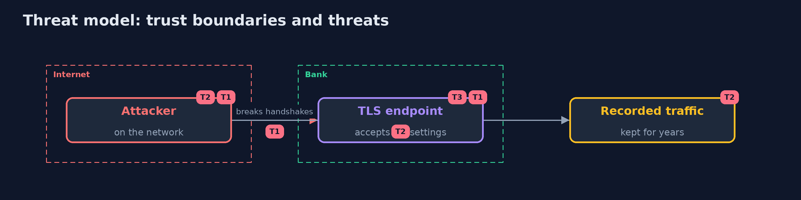

# Threat Model — TLS Attacks and Downgrades

A threat model answers four questions: what are we protecting, who or what could harm it, how, and what do we do about it. This one covers this project's own demo system, not a production deployment. Domain: a bank.

## Scope

TLS endpoints of a bank, tested on local servers with a throw-away key. It does not cover the certificate chain, the hosts or the people.

## What we protect (assets)

- The sessions of online banking.
- The server's private key.
- Recorded traffic.

## Who and what acts on the system

- An attacker on the network path.
- An attacker who gets the server key later.
- A scanner.

## Trust boundaries

A trust boundary is a line that data or a request crosses between parts that trust each other differently. Threats cluster where those lines are.

- The network between the client and the endpoint.

Each dashed box is a trust boundary. A rose tag such as T1 shows where the threat of that number, in the table below, applies.

## Threats, using STRIDE

STRIDE is a checklist of six kinds of threat: **Spoofing** (S), **Tampering** (T), **Repudiation** (R), **Information disclosure** (I), **Denial of service** (D), **Elevation of privilege** (E).

| Id | Kind | Threat | Where it shows up | Control in this project | What is left |
| --- | --- | --- | --- | --- | --- |
| T1 | Tampering | A failing network pushes a client down to an old version | the handshake | Only TLS 1.2 and 1.3, the fallback signal, no retry with lower versions | Old clients that must be served |
| T2 | Information disclosure | Recorded traffic is read later with the leaked server key | recordings | Ephemeral key exchange only, so no static RSA | A leak of the key still allows an impersonation from then on |
| T3 | Information disclosure | A weak group or suite is offered and nobody notices | the endpoint | Scan every release and read the cipher table | Settings the scanner does not name |

## Assumptions

- The lab servers behave like the settings they copy.

## Out of scope

- Certificate validation.
- Attacks that need RC4 or zlib, which this OpenSSL build lacks.

## How the tests check this

- `TlsRecordsTest`, `DecryptorTest`, `TapTest` and `ReportAndProbeTest` check the parser, the key derivation, the tap and the report with no tools.
- `DemoRunsTest` starts OpenSSL and testssl.sh and compares the whole demo with the golden output (integrationTest).

## Where this model goes next

The module goes on with the other applied cryptography and PKI projects.
