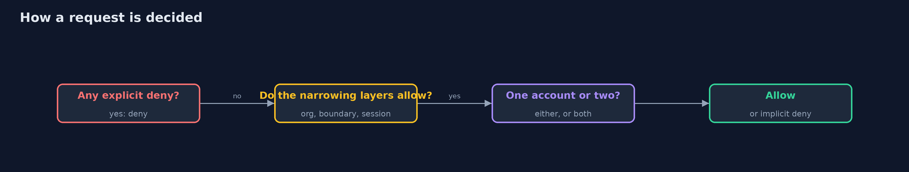

# Cloud IAM Models

```
src/main/java/com/jk/explore/security/iammodel/
├── Conditions.java    The condition operators of policy documents, with the rules for a key that is missing from the request, IfExists, and policy variables such as ${aws:username}
├── Decision.java      The answer, and the layer or rule that decided it
├── Escalation.java    A search for the paths by which a principal can make itself an administrator, using only what the policies allow: assume a role, change a policy that it is attached to, attach a policy to itself, or pass an administrator role to a function that it creates and runs
├── Evaluator.java     The evaluation logic, as the cloud providers document it
├── IamModelDemo.java  ReportCo, a service that reads its customers' buckets by assuming a role in each customer's account
├── Policy.java        A policy document in the usual JSON form: statements with an effect, actions, resources, a principal (for resource policies) and conditions
├── Principal.java     Who is asking: an account, an ARN, the policies attached to them, an optional permission boundary, an optional session policy (for a role session) and tags
├── Request.java       One question for the evaluator: may this principal do this action on this resource?
├── Role.java          A role: a name in an account, a trust policy (who may assume it, under which conditions), the policies it grants and an optional permission boundary
└── Wild.java          The wildcards of policy documents: matches any run of characters (including none) and ?
```

**A policy evaluator written in Java follows the documented rules: nothing is allowed until something allows it, an explicit deny anywhere wins, within one account an identity policy or a resource policy is enough and across accounts both are needed, organization policies, permission boundaries and session policies only narrow, a resource policy that names the principal is not narrowed, and a role's trust policy decides who may assume it; with it a service that assumes roles for many customers is fooled until an external id issued per customer is required, a search over the policies finds the harmless-looking permissions that lead to administrator rights, and the model finds the shape of a problem that a real account must confirm.**

The advanced track moves from one application to systems, and cloud security begins with one question that every provider answers the same way: **may this principal do this to that?** This project writes the answer in Java. A policy evaluator reads documents in the common JSON form (effect, actions, resources, principals, conditions) and follows the rules the providers document. It runs offline: no cloud account, no network, no Docker. (The sibling that runs the same questions against a local cloud emulator and infrastructure as code belongs to the next projects of the module.)

What it shows:
- **Identity policies.** Default deny; an allow; an **explicit deny** that beats every allow; wildcards in actions (case-insensitive) and resources (case-sensitive); and `Allow` with `NotAction`, which allows *everything else*.
- **Accounts.** Within one account an identity policy or a resource policy is enough; across accounts **both** must say yes (a table of six cases). A bucket policy with `Principal: *` lets someone with no account read; a stranger from another account still needs their own account to allow it. An **organization policy** that does not allow an action stops even an administrator.
- **Roles and the layers that narrow them.** A trust policy that asks for a second factor; eight actions asked of the session: the role allows 6, a **permission boundary** leaves 4, a **session policy** leaves 2, and a session policy can only narrow. A bucket policy that **names the session** is not narrowed by either. Conditions on tags and source address, with policy variables.
- **The confused deputy.** A reporting service assumes a role in each customer's account. Mallory types the bank's role into the service's form and reads the bank's data. The trust policy now asks for the **external id** the service issued to the bank: the bank's request works, Mallory's does not. The same idea between services with `aws:SourceArn`.
- **The bill.** A search that asks the evaluator at each step finds who can make themselves an administrator: carol (assume a developer role that may rewrite its own policy) and ben (pass the admin role to a function he runs), and not ana. Every wildcard is a decision nobody made, and a model finds the shape of a problem that a real account confirms.

**Maps to:** NIST CSF 2.0 Protect (PR.AA access control) · CIS Benchmarks for cloud providers · CWE-266, CWE-269 (privilege management), CWE-441 (unintended proxy, the confused deputy) · OWASP Cloud-Native Application Security Top 10.

## The idea in everyday terms

A building with guards at several doors. Each guard has a list; one guard's "no" is final, a guest of a neighbouring company needs both companies' guards to agree, a visitor's pass can be narrower than the person's rights but never wider, and a courier who delivers on request must be told whose delivery it is.

## The scenario

An online bank on a cloud: people in one account, an audit account, a reporting service from a third party. The demo asks the evaluator about each of them and turns the answers into a picture of where trust is given.

## Run

```bash
./gradlew run
```

The demo tells the story in 5 acts, each printing exact numbers that the tests check:

| Act | What it shows |
| --- | --- |
| 1. Identity policies: default deny, allow, explicit deny | Nothing is allowed until something allows it; a deny beats every allow; action names ignore case and resource names do not; Allow with NotAction allows everything else. |
| 2. Accounts: who has to agree | In one account either side is enough; across accounts both; Principal * means anyone; an organization policy stops even an administrator. |
| 3. Roles and the layers that narrow them | A trust policy asks for a second factor; a boundary and a session policy narrow 6 actions to 4 to 2; naming the session is stronger than naming the account. |
| 4. The confused deputy | A reporting service that assumes roles for many customers reads the bank's data for Mallory until the trust policy asks for the external id issued to the bank. |
| 5. The bill | A search over the policies finds carol and ben on a path to administrator, and not ana; wildcards are decisions nobody made; a model is not the service. |

## Test

```bash
./gradlew test
```

19 tests in `DemoRunsTest`, `EvaluatorTest`, `RoleTest`. The tests run the evaluator rule by rule: deny, wildcards, NotAction, one account and two, anonymous callers, organization policies, boundaries and session policies, conditions and missing keys, trust policies, the external id, the source ARN and the escalation search.

## What the simulation got right, and what it left out

Everything is plain Java: the policy documents are parsed with Jackson, the wildcards and conditions are written out, and the accounts, roles and the reporting service are small records. The output is the same on every run.

## Technologies and versions

Every version below is pinned in the project's build files and was the latest stable release when the project was built.

| Technology | Version | Used for |
| --- | --- | --- |
| Java | 25 | the language and runtime; a Gradle toolchain finds or downloads the JDK |
| Gradle | 9.8.1 (wrapper) | build and run; nothing to install, the wrapper downloads it |
| tools.jackson.core:jackson-databind | 3.1.5 | library the code uses |
| org.junit.jupiter:junit-jupiter | 6.1.3, set by junit-bom | JUnit 5: the tests (tests only) |
| org.junit.platform:junit-platform-launcher | 6.1.3, set by junit-bom | JUnit platform launcher, which Gradle needs to run the tests (tests only) |
| videokit | repository tool (`tools/videokit`) | the narrated video and animation: Piper `en_US-amy-medium`, speed 0.8, longer pauses (the amy-slow voice) |

## Learning Material

| Document | What it is for |
| --- | --- |
| [Problem statement](docs/problem-statement.md) | the situation and what the project must show |
| [Prerequisites](docs/prerequisites.md) | what you need to know first |
| [Cloud IAM Models, explained](docs/cloud-iam-models-explained.md) | the acts in prose |
| [Session guide](docs/session.md) | a one-hour lesson with exercises |
| [Animated walkthrough](docs/animation.html) | the acts step by step, narrated |
| [Threat model](docs/threat-model.md) | what is protected, who could harm it, and how, using STRIDE |
| [Spec](docs/spec.md) | what this project must be true of |
| [Expected output](docs/expected-output.txt) | the golden demo output every test and every port checks against |

### The idea in one picture

Documents go in, one decision comes out.


### Where each piece sits

Documents, requests and the evaluator.


### How the data moves

The order of the questions.



### Who calls whom, in order


### Video

`video/cloud-iam-models-explained.mp4` (with `.m4a` audio and `.srt` subtitles) is built by `video/build_video.sh`. Rendered media is not committed.

## What it costs

- **Policies are code that nobody tests:** a wildcard here and a missing condition there are found by an attacker first.
- **Every layer must be understood:** identity, resource, organization, boundary, session.
- **Trust between accounts is a decision with a party on the other side** whose own mistakes become yours.
- **A model is not the service:** it follows the documented rules for a few services and misses the rest.
- **Least privilege is work:** broad policies are quick, narrow ones need the requests to be known.

## When this is too much

A personal account with one user and nothing in it does not need an evaluator. Use one when several people, accounts and third parties share an environment, and when the policies change often.

## Where you have already met this

- A JSON policy with `"Action": "*"` that was "temporary".
- An error that says "is not authorized to perform".
- A role that a vendor asked you to create so that they can "connect".
- A bucket that turned out to be public.

## Where this sits

This is the first project of the [cloud-security-without-a-cloud](..) module of the advanced track. It builds on [access control](../../../intermediate/web-security) and on [secrets management](../../../intermediate/secrets-and-supply-chain/secrets-management-with-openbao) from the intermediate track.
