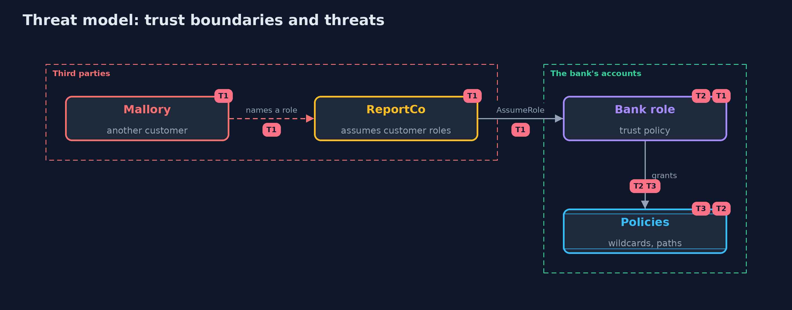

# Threat Model — Cloud IAM Models

A threat model answers four questions: what are we protecting, who or what could harm it, how, and what do we do about it. This one covers this project's own demo system, not a production deployment. Domain: a bank.

## Scope

The permission documents of the bank's accounts, the roles that third parties assume, and the ways the documents interact. It does not cover the provider's own services or the network.

## What we protect (assets)

- The bank's data in buckets and databases.
- The roles and policies that guard it.

## Who and what acts on the system

- A third-party service that assumes roles.
- Another customer of that service.
- An insider with a little more permission than they need.

## Trust boundaries

A trust boundary is a line that data or a request crosses between parts that trust each other differently. Threats cluster where those lines are.

- The account: permissions do not cross it unless both sides allow.
- The trust policy of a role: the place where a third party is let in.

Each dashed box is a trust boundary. A rose tag such as T1 shows where the threat of that number, in the table below, applies.

## Threats, using STRIDE

STRIDE is a checklist of six kinds of threat: **Spoofing** (S), **Tampering** (T), **Repudiation** (R), **Information disclosure** (I), **Denial of service** (D), **Elevation of privilege** (E).

| Id | Kind | Threat | Where it shows up | Control in this project | What is left |
| --- | --- | --- | --- | --- | --- |
| T1 | Elevation of privilege | A third party is made to use its access for someone else | trust policies of roles it assumes | An external id issued per customer; aws:SourceArn and aws:SourceAccount for services | A leaked external id |
| T2 | Elevation of privilege | A small permission leads to administrator rights | policy combinations | Search for escalation paths, permission boundaries on roles that others create | Paths through services the model does not know |
| T3 | Information disclosure | A wildcard or a public principal exposes data | identity and resource policies | Policies reviewed for wildcards and Principal *, organization policies as a floor | Policies that were right when written |

## Assumptions

- The provider evaluates policies as documented.
- Policies are reviewed before they are applied.

## Out of scope

- Vulnerabilities in the provider's services.
- Compromised credentials.

## How the tests check this

- `EvaluatorTest` checks each rule of evaluation: deny, wildcards, NotAction, one and two accounts, anonymous callers, organization policies, boundaries, session policies, resource policies that name the principal, conditions and missing keys.
- `RoleTest` checks trust policies, sessions, the external id, the source ARN and the escalation search.
- `DemoRunsTest` compares the whole demo with the golden output.

## Where this model goes next

The next project in this module is network-isolation.
