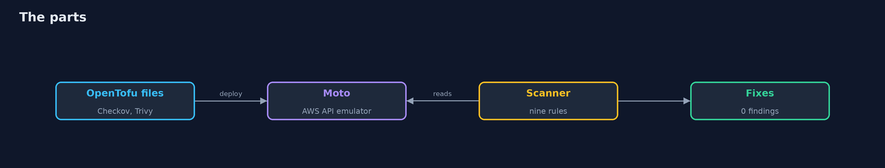
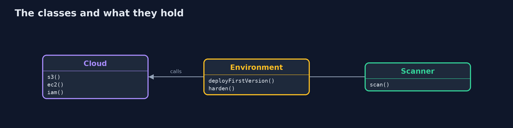
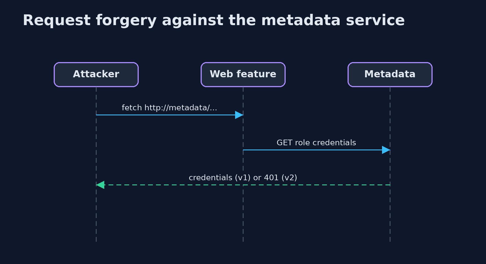

# Cloud Misconfigurations

```
src/main/java/com/jk/explore/security/cloudmisconf/
├── Cloud.java                       The AWS SDK for Java v2, pointed at the emulator with made-up credentials: the same calls a real account would get
├── CloudMisconfigurationsDemo.java  
├── Environment.java                 The first version of the bank's account, as a team in a hurry would leave it, and the hardened version of each resource
├── Finding.java                     One misconfiguration: a rule, how bad it is, the resource, and why it matters
├── IacScanners.java                 Checkov and Trivy reading OpenTofu/Terraform files: no cloud, no network after installation
├── Imds.java                        The instance metadata service as a server on a loopback port, in the two versions, and the two web features that reach it
├── Scanner.java                     Reads the account through the SDK, the way an auditor's tool does, and reports what is exposed, unencrypted, over-broad or open to the world
├── Terraform.java                   The same account as OpenTofu/Terraform files, in two versions: as the team first wrote it and as it should be
└── Venv.java                        A Python virtual environment under build/ with Moto (an AWS emulator) and Checkov (an infrastructure-as-code scanner) installed with pip the first time
```

**On Moto, an emulator of the AWS API that needs no account, a bank's first setup has 13 findings of 9 kinds: a bucket readable by everyone through its ACL, another through its policy, a developer policy that allows every action on every resource, ports 22 and 5432 open to 0.0.0.0/0, a server whose metadata service answers without a token, and disks that are not encrypted; the fixes leave none, but the server and the disks must be replaced; the same setup written as OpenTofu files fails both Checkov and Trivy, which agree on 7 of the 9 kinds and each miss something (Trivy has no check for the wildcard policy or the public bucket policy); a server-side request forgery steals the role's credentials from the metadata service of version 1, version 2 stops a simple fetch with 401 but not a request that can choose its method and headers; a scanner sees the setting, not the intent.**

Most cloud breaches are not clever. A bucket was public, a policy said `*`, a port was open to the world. This project makes those mistakes on purpose, in a safe place: **Moto**, an open-source emulator of the AWS API (no account, no cost, nothing leaves the machine). A Java program deploys a bank's first setup with the real AWS SDK, scans it with nine rules of its own, applies the fixes and scans again; then the same setup is written as OpenTofu files and read by two real scanners, **Checkov** and **Trivy**, before anything is deployed. LocalStack was the usual choice, but it now needs an account token, so it is not used. It needs Python 3 (a virtual environment with Moto and Checkov is built under `build/`) and Trivy (`brew install trivy`); the tests that use them are tagged `integration`: `./gradlew integrationTest`.

What it shows:
- **The first version.** Two buckets readable by everyone (one by ACL, one by bucket policy), a third that is fine, a policy that allows every action on every resource, ports 22 and 5432 open to `0.0.0.0/0`, a server whose metadata service answers without a token and disks that are not encrypted: **13 findings of 9 kinds**.
- **The fixes.** Public access blocked, encryption and versioning on, a least-privilege policy, ports closed, a server with IMDSv2 and encrypted disks: **0 findings**. Two of the nine fixes mean replacing resources, not editing them.
- **Before deploy.** The same setup as `.tf` files fails Checkov and Trivy. **7 of the 9 kinds** are found by both; Checkov alone finds the wildcard policy and the public bucket policy. The fixed files still draw advice: both ask for a customer-managed key where the rule accepts AES256.
- **The metadata endpoint.** A server-side request forgery against IMDSv1 returns the role's credentials; IMDSv2 answers a simple fetch with 401, a request through a proxy with 403, but a feature that lets the visitor choose the method and a header gets the token and the credentials anyway.
- **The bill.** A scanner sees settings, not intent; an emulator is not the cloud; exceptions need an owner and a date; code and the cloud drift apart.

**Maps to:** NIST CSF 2.0 Protect (PR.PS configuration) · CIS AWS Foundations Benchmark · CWE-732, CWE-918 (SSRF), CWE-311 · MITRE ATT&CK T1530 (data from cloud storage) and T1552.005 (cloud instance metadata API).

## The idea in everyday terms

A new office building handed over with every door on its default setting. A checklist walk-through before move-in (the scanner on the plans) finds the doors that open to the street; a walk-through after (the scanner on the live building) finds the ones that someone propped open since.

## The scenario

A bank puts its statements, exports and audit log in buckets, gives its developers an account and runs a web server and a database. The demo deploys the first version and attacks it.

## Run

```bash
./gradlew run
```

The demo tells the story in 5 acts, each printing exact numbers that the tests check:

| Act | What it shows |
| --- | --- |
| 1. The first version | Deployed with the AWS SDK to Moto, the setup has 13 findings of 9 kinds. |
| 2. The fixes | Public access blocked, least privilege, ports closed, IMDSv2, encryption: 0 findings, and two resources replaced. |
| 3. Before deploy: Checkov and Trivy | The same setup as OpenTofu files fails both scanners, which agree on 7 of the 9 kinds. |
| 4. The metadata endpoint | A request forgery reads the role's credentials from IMDSv1; IMDSv2 stops a simple fetch but not a forgery that sets headers. |
| 5. The bill | Scanners see settings, not intent; the emulator is not the cloud; two fixes replace resources. |

## Test

```bash
./gradlew test
```

14 tests in `CloudTest`, `DemoRunsTest`, `ImdsTest`, `TerraformTest`. The metadata service and the file mapping are tested with no tools. The rest start Moto, Checkov and Trivy (./gradlew integrationTest).

## What the simulation got right, and what it left out

Moto answers the same API calls as AWS, so the SDK code is the code you would run against the cloud; only the endpoint differs. Instance and volume ids are never printed.

## Technologies and versions

Every version below is pinned in the project's build files and was the latest stable release when the project was built.

| Technology | Version | Used for |
| --- | --- | --- |
| Java | 25 | the language and runtime; a Gradle toolchain finds or downloads the JDK |
| Gradle | 9.8.1 (wrapper) | build and run; nothing to install, the wrapper downloads it |
| software.amazon.awssdk:s3 | set by the build | library the code uses |
| software.amazon.awssdk:ec2 | set by the build | library the code uses |
| software.amazon.awssdk:iam | set by the build | library the code uses |
| software.amazon.awssdk:apache5-client | set by the build | library the code uses |
| tools.jackson.core:jackson-databind | 3.1.5 | library the code uses |
| org.slf4j:slf4j-nop | 2.0.17 | library the code uses |
| org.junit.jupiter:junit-jupiter | 6.1.3, set by junit-bom | JUnit 5: the tests (tests only) |
| org.junit.platform:junit-platform-launcher | 6.1.3, set by junit-bom | JUnit platform launcher, which Gradle needs to run the tests (tests only) |
| videokit | repository tool (`tools/videokit`) | the narrated video and animation: Piper `en_US-amy-medium`, speed 0.8, longer pauses (the amy-slow voice) |

## Learning Material

| Document | What it is for |
| --- | --- |
| [Problem statement](docs/problem-statement.md) | the situation and what the project must show |
| [Prerequisites](docs/prerequisites.md) | what you need to know first |
| [Cloud Misconfigurations, explained](docs/cloud-misconfigurations-explained.md) | the acts in prose |
| [Session guide](docs/session.md) | a one-hour lesson with exercises |
| [Animated walkthrough](docs/animation.html) | the acts step by step, narrated |
| [Threat model](docs/threat-model.md) | what is protected, who could harm it, and how, using STRIDE |
| [Spec](docs/spec.md) | what this project must be true of |
| [Expected output](docs/expected-output.txt) | the golden demo output every test and every port checks against |

### The idea in one picture

The setup is deployed, scanned, fixed and scanned; the files are scanned before.



### Where each piece sits

A cloud, an environment and a scanner.



### How the data moves

Findings.


### Who calls whom, in order




### Video

`video/cloud-misconfigurations-explained.mp4` (with `.m4a` audio and `.srt` subtitles) is built by `video/build_video.sh`. Rendered media is not committed.

## What it costs

- **Scanners disagree,** and each misses something; use more than one.
- **Fixes can mean replacement:** a disk cannot be encrypted in place.
- **An emulator is not the cloud:** Moto stores the settings but does not enforce every policy.
- **Strict rules produce noise:** some findings are a decision, not a mistake.
- **Fixed files still draw advice,** and advice has a price.

## When this is too much

A throwaway sandbox account with no data does not need nine rules. Scan when the account holds something worth stealing or the code will be reused.

## Where you have already met this

- A bucket opened for a quick demo and never closed.
- A policy with Action star.
- A security group with 0.0.0.0/0 on SSH.
- A scanner report of hundreds of findings that nobody reads.

## Where this sits

This is the third project of the [cloud-security-without-a-cloud](..) module, after [cloud-iam-models](../cloud-iam-models) and [network-isolation](../network-isolation). The scanners in act three are the subject of iac-scanning.
