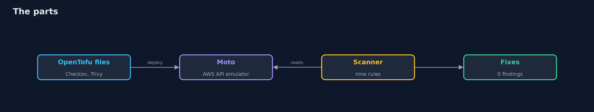
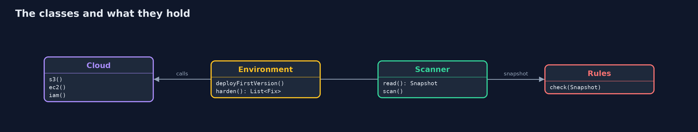
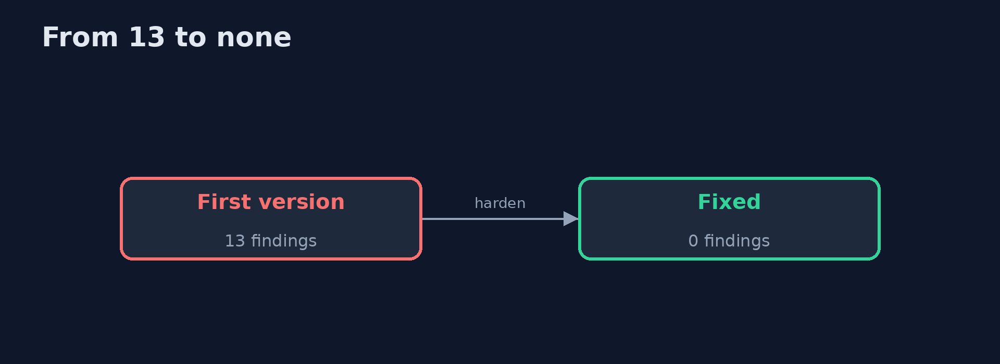
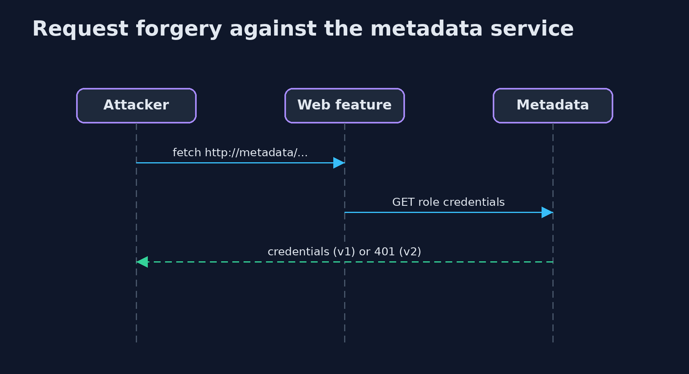

# Cloud Misconfigurations

```
src/main/java/com/jk/explore/security/cloudmisconf/
├── Cloud.java                       The AWS SDK for Java v2, pointed at the emulator with made-up credentials: the same calls a real account would get
├── CloudMisconfigurationsDemo.java  Five acts: a bank's first cloud setup on an AWS emulator and its 13 findings, the fixes, the same setup as files read by Checkov and Trivy, the metadata endpoint attacked, and what neither the scanners nor the emulator can tell
├── Environment.java                 The first version of the bank's account, as a team in a hurry would leave it, and the hardened version of each resource
├── Finding.java                     One misconfiguration: a rule, how bad it is, the resource, and why it matters
├── IacScanners.java                 Checkov and Trivy reading OpenTofu/Terraform files: no cloud, no network after installation
├── Imds.java                        The instance metadata service as a server on a loopback port, in the two versions, and the two web features that reach it
├── Rules.java                       The nine rules, run on what the scanner read
├── Scanner.java                     Reads the account through the SDK, the way an auditor's tool does, then runs the nine rules on what it read
├── Snapshot.java                    What the scanner read from the account: plain values, so the rules can be tested without an emulator
├── Terraform.java                   The same account as OpenTofu/Terraform files, in two versions: as the team first wrote it and as it should be
└── Venv.java                        A Python virtual environment under build/ with Moto (an AWS emulator) and Checkov (an infrastructure-as-code scanner) installed with pip the first time
```

**On Moto, an emulator of the AWS API that needs no account, a bank's first setup gives 13 findings from 9 rules: two buckets anyone can read (by ACL and by bucket policy), a policy that allows * on *, ports 22 and 5432 open to 0.0.0.0/0, a metadata service that answers without a token and unencrypted disks; 7 edits and 2 replacements leave none. The same setup as OpenTofu files fails Checkov and Trivy, which agree on 7 of the 9 rules, and neither flags port 5432. A link fetch steals the role's credentials from IMDSv1; IMDSv2 stops it, but not a feature that sets the method and a header. And Moto accepts a public policy on a blocked bucket that AWS would refuse: an emulator tests the code, not the cloud.**

Most cloud breaches are not clever. A bucket was public, a policy said `*`, a port was open to the world. This project makes those mistakes on purpose, in a safe place: **Moto**, an open-source emulator of the AWS API (no account, no cost, nothing leaves the machine). A Java program deploys a bank's first setup with the real AWS SDK, scans it with nine rules of its own, applies the fixes and scans again; then the same setup is written as OpenTofu files and read by two real scanners, **Checkov** and **Trivy**, before anything is deployed. LocalStack was the usual choice, but it now needs an account token, so it is not used. It needs Python 3 (a virtual environment with Moto and Checkov, pinned, is built under `build/`) and Docker (Trivy runs from the pinned image `aquasec/trivy:0.76.0` with its built-in checks); the tests that use them are tagged `integration`: `./gradlew integrationTest`.

What it shows:
- **The first version.** Two buckets readable by everyone (one by ACL, one by bucket policy), a third that is fine, a policy that allows every action on every resource, ports 22 and 5432 open to `0.0.0.0/0`, a server whose metadata service answers without a token and disks that are not encrypted: **13 findings from 9 rules** (3 CRITICAL + 5 HIGH + 3 MEDIUM + 2 LOW).
- **The fixes.** Nine SDK calls, each logged: **7 edits** in place (including IMDSv2 on the running server) and **2 replacements**, because a disk is encrypted only when it is made. **0 findings.**
- **Before deploy.** The same setup as `.tf` files fails Checkov (37 checks) and Trivy (26). **7 of the 9 rules** are matched by both; only Checkov has checks for the public bucket policy and the wildcard policy, and **neither flags port 5432** open to the world. The fixed files still draw advice: both want a customer-managed key where the rule accepts AES256.
- **The metadata endpoint.** A link fetch reads the role's credentials from IMDSv1 and gets 401 from IMDSv2; a webhook tester that sets the method and a header gets a token and the credentials from IMDSv2 too; through a proxy that adds `X-Forwarded-For`, IMDSv2 refuses the token request with 403.
- **What the tools cannot tell.** Moto accepts a public policy and a public ACL on a blocked bucket, where AWS answers 403; the scan of the account still sees them. Replacement, intent and drift are left for people.

**Maps to:** NIST CSF 2.0 Protect (PR.PS configuration) · CIS AWS Foundations Benchmark · CWE-732, CWE-918 (SSRF), CWE-311 · MITRE ATT&CK T1530 (data from cloud storage) and T1552.005 (cloud instance metadata API).

## The idea in everyday terms

A new office building handed over with every door on its default setting. A checklist walk-through before move-in (the scanner on the plans) finds the doors that open to the street; a walk-through after (the scanner on the live building) finds the ones that someone propped open since.

## The scenario

A bank puts its statements, exports and audit log in buckets, gives its developers an account and runs a web server and a database. The demo deploys the first version and attacks it.

## Run

```bash
./gradlew run
```

The demo tells the story in 5 acts, each printing exact numbers that the tests check:

| Act | What it shows |
| --- | --- |
| 1. The first version, deployed to the emulator | Deployed with the AWS SDK to Moto, the bank's first setup gives 13 findings: 3 CRITICAL + 5 HIGH + 3 MEDIUM + 2 LOW = 13, from 9 rules, 4 of which fire twice (9 + 4 = 13). |
| 2. The fixes, made with the same SDK | Nine changes, 7 edits in place and 2 replacements, take the account from 13 findings to 0. Switching on IMDSv2 is an edit; encrypting a disk means a new disk, and for the root disk a new server. |
| 3. Before deploy: the same setup as files, read by two scanners | Written as OpenTofu files, the first version fails Checkov 3.3.30 (37 checks) and Trivy 0.76.0 (26). Both fire a check for 7 of our 9 rules; only Checkov has one for the public bucket policy and the wildcard policy, and neither flags port 5432. In the fixed files one rule is left: both want a key of your own. |
| 4. The metadata endpoint, reached through the web server | A link fetch reads the role's credentials from IMDSv1 (200) and gets 401 from IMDSv2. A webhook tester that lets the visitor set the method and a header gets a 36-character token with PUT and the credentials with GET, even from IMDSv2. Through a proxy that adds X-Forwarded-For, IMDSv2 refuses the token request with 403; IMDSv1 still answers. |
| 5. What the scanners and the emulator cannot tell | On bank-audit, whose public access is blocked, Moto accepts a public bucket policy and a public-read ACL with 200, where AWS refuses both with 403 AccessDenied; the scan of the account afterwards shows 2 CRITICAL findings. Replacement, intent and drift are left for people. |

## Test

```bash
./gradlew test
```

26 tests in `CloudTest`, `DemoRunsTest`, `ImdsTest`, `RulesTest`, `TerraformTest`. The rules, the policy parsing, the report mapping, the metadata service and the files are tested with no tools (./gradlew test). The rest start Moto, Checkov and Trivy in Docker (./gradlew integrationTest); the golden output never prints an id that changes between runs.

## What the simulation got right, and what it left out

Moto answers the same API calls as AWS, so the SDK code is the code you would run against the cloud; only the endpoint differs. Instance and volume ids are never printed.

## Technologies and versions

Every version below is pinned in the project's build files and was the latest stable release when the project was built.

| Technology | Version | Used for |
| --- | --- | --- |
| Java | 25 | the language and runtime; a Gradle toolchain finds or downloads the JDK |
| Gradle | 9.8.1 (wrapper) | build and run; nothing to install, the wrapper downloads it |
| software.amazon.awssdk:s3 | set by the build | library the code uses |
| software.amazon.awssdk:ec2 | set by the build | library the code uses |
| software.amazon.awssdk:iam | set by the build | library the code uses |
| software.amazon.awssdk:apache5-client | set by the build | library the code uses |
| tools.jackson.core:jackson-databind | 3.1.5 | library the code uses |
| org.slf4j:slf4j-nop | 2.0.17 | library the code uses |
| org.junit.jupiter:junit-jupiter | 6.1.3, set by junit-bom | JUnit 5: the tests (tests only) |
| org.junit.platform:junit-platform-launcher | 6.1.3, set by junit-bom | JUnit platform launcher, which Gradle needs to run the tests (tests only) |
| videokit | repository tool (`tools/videokit`) | the narrated video and animation: Piper `en_US-amy-medium`, speed 0.8, longer pauses (the amy-slow voice) |

## Learning Material

| Document | What it is for |
| --- | --- |
| [Problem statement](docs/problem-statement.md) | the situation and what the project must show |
| [Prerequisites](docs/prerequisites.md) | what you need to know first |
| [Cloud Misconfigurations, explained](docs/cloud-misconfigurations-explained.md) | the acts in prose |
| [Session guide](docs/session.md) | a one-hour lesson with exercises |
| [Animated walkthrough](docs/animation.html) | the acts step by step, narrated |
| [Threat model](docs/threat-model.md) | what is protected, who could harm it, and how, using STRIDE |
| [Spec](docs/spec.md) | what this project must be true of |
| [Expected output](docs/expected-output.txt) | the golden demo output every test and every port checks against |

### The idea in one picture

The setup is deployed, scanned, fixed and scanned; the files are scanned before.



### Where each piece sits

The scanner only reads; the rules judge plain values.



### How the data moves

Findings.



### Who calls whom, in order




### Video

`video/cloud-misconfigurations-explained.mp4` (with `.m4a` audio and `.srt` subtitles) is built by `video/build_video.sh`. Rendered media is not committed.

## What it costs

- **Scanners disagree,** and each misses something; use more than one.
- **Fixes can mean replacement:** a disk cannot be encrypted in place.
- **An emulator is not the cloud:** Moto stores the settings but does not enforce every policy.
- **Strict rules produce noise:** some findings are a decision, not a mistake.
- **Fixed files still draw advice,** and advice has a price.

## When this is too much

A throwaway sandbox account with no data does not need nine rules. Scan when the account holds something worth stealing or the code will be reused.

## Where you have already met this

- A bucket opened for a quick demo and never closed.
- A policy with Action star.
- A security group with 0.0.0.0/0 on SSH.
- A scanner report of hundreds of findings that nobody reads.

## Where this sits

This is the third project of the [cloud-security-without-a-cloud](..) module, after [cloud-iam-models](../cloud-iam-models) and [network-isolation](../network-isolation). The scanners in act three are the subject of iac-scanning.
