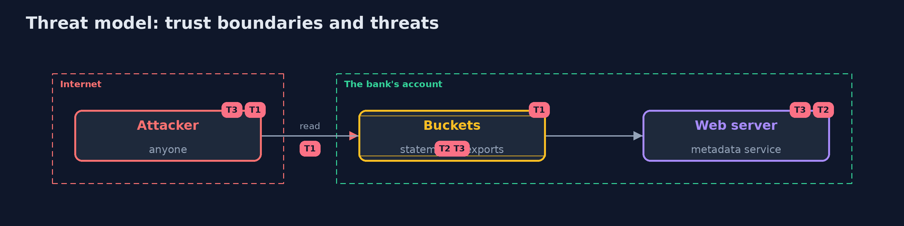

# Threat Model — Cloud Misconfigurations

A threat model answers four questions: what are we protecting, who or what could harm it, how, and what do we do about it. This one covers this project's own demo system, not a production deployment. Domain: a bank.

## Scope

The settings of a bank's buckets, policies, groups, servers and disks. It does not cover the code of the applications or the real cloud's behaviour.

## What we protect (assets)

- Customer statements and exports.
- The audit log.
- The role's credentials.

## Who and what acts on the system

- An anonymous visitor.
- An attacker who can make the server fetch a link.
- A developer who opens a port to get unblocked.

## Trust boundaries

A trust boundary is a line that data or a request crosses between parts that trust each other differently. Threats cluster where those lines are.

- The account: everything inside it trusts its settings.

Each dashed box is a trust boundary. A rose tag such as T1 shows where the threat of that number, in the table below, applies.

## Threats, using STRIDE

STRIDE is a checklist of six kinds of threat: **Spoofing** (S), **Tampering** (T), **Repudiation** (R), **Information disclosure** (I), **Denial of service** (D), **Elevation of privilege** (E).

| Id | Kind | Threat | Where it shows up | Control in this project | What is left |
| --- | --- | --- | --- | --- | --- |
| T1 | Information disclosure | A public bucket exposes customer statements | buckets | Public access block, scanned in the build and in the account | Buckets that must be public, with a dated exception |
| T2 | Elevation of privilege | A forged request steals the role's credentials | the metadata service | IMDSv2, hop limit 1, least-privilege roles | A feature that lets a visitor set the method and headers |
| T3 | Elevation of privilege | A wildcard policy turns one stolen key into everything | IAM policies | Least privilege and a scan for Action and Resource stars | Broad policies written for good reasons |

## Assumptions

- The emulator answers like the cloud for the settings read.

## Out of scope

- Attacks on the cloud provider.
- Stolen developer credentials.

## How the tests check this

- `ImdsTest` and `TerraformTest` check the metadata service and the mapping with no tools.
- `CloudTest` starts Moto, counts 13 findings of 9 kinds, checks 0 after the fixes, and compares Checkov with Trivy.
- `DemoRunsTest` compares the whole demo with the golden output.

## Where this model goes next

This is the last project of this module. The next module starts with iac-scanning.
