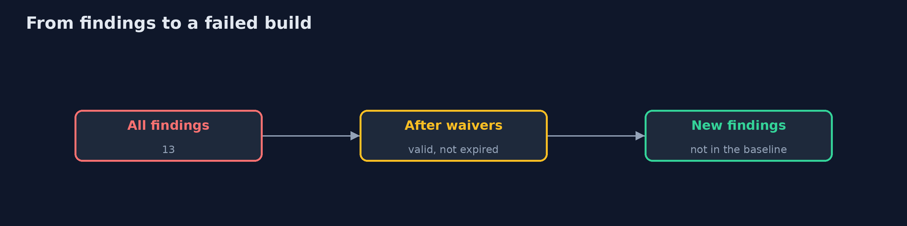

# IaC Scanning

```
src/main/java/com/jk/explore/security/iacscan/
├── Baseline.java         The findings a team has accepted so far: the build fails on a finding that is not in it, so the number can only go down
├── Engine.java           Reads the manifests (several documents in one text) and applies the rules to every container
├── Finding.java          One rule that one container of one resource breaks
├── IacScanningDemo.java  
├── Manifests.java        The online store's Kubernetes manifests, as first written and as fixed
├── Rule.java             A rule is a question about one container: true means it breaks the rule
├── RuleTester.java       Tests a rule with its own two samples: the bad one must fire it, the good one must not
├── Rules.java            The store's eight rules for a container
├── Scanners.java         Checkov, Trivy and KICS reading Kubernetes manifests
├── Venv.java             A Python virtual environment under build/ with Checkov installed with pip the first time
└── Waiver.java           A written exception: who owns it, why, and when it ends
```

**An online store's Kubernetes manifests break 8 rules written in Java (13 findings: a privileged container, root, a latest tag, no limits, a password written in the file, the host network, a writable filesystem, privilege escalation); each rule has a bad and a good sample, 8 of 8 pass, and a rule that only knows :latest fails its own test on an untagged image; Checkov, Trivy and KICS agree on 7 of the 8 and all three miss the password written in the file while two flag the good practice of reading it from a Secret; all three still give advice on the fixed files; an exception is a waiver with an owner, a reason and an end date, an expired one brings the finding back, and a waiver with no owner hides nothing; Checkov's annotation and Trivy's ignore file do the same inside the tools; a baseline fails the build on a new finding, here 5 from a new service.**

Scanning infrastructure code is cheap and early, which makes it easy to do badly: hundreds of findings nobody reads, a rule nobody tested, an exception nobody owns. This project works on the three parts that decide whether a scanner helps. A store's Kubernetes manifests are read by **eight rules written in Java** (each with a bad and a good sample that test the rule itself), then by **Checkov, Trivy and KICS** (KICS runs from its Docker image), then handled with **waivers** and a **baseline**. It needs Python 3, Trivy (`brew install trivy`) and Docker; the tests that use them are tagged `integration`: `./gradlew integrationTest`.

What it shows:
- **Writing a rule.** A rule is a question about one container. The eight: privileged, may run as root, latest or untagged image, no limits, a password in the file, the host network, a writable filesystem, privilege escalation. The first manifests give **13 findings**, the fixed ones 1.
- **Testing the rule.** Every rule has a bad and a good sample; **8 of 8** fire on the first and stay quiet on the second. A rule that only looks for `:latest` fails its own test on an image with no tag.
- **Three scanners.** They agree on **7 of the 8** rules. **All three miss a password written in the file**, and Checkov and KICS flag the good practice of reading it from a Secret. All three still give advice on the fixed files.
- **Exceptions.** A waiver names an owner, a reason and an end date; an expired one brings the finding back; one with no owner hides nothing. Checkov's annotation and Trivy's ignore file do the same inside the tools.
- **A baseline.** The build fails on a finding that is not in the accepted list, so a new service with a latest tag shows **5 new findings** while old ones do not block anyone.
- **The bill.** Every scanner has a blind spot; noise is a cost; an exception without an owner and an end date is a hole.

**Maps to:** NIST CSF 2.0 Protect (PR.PS) · CIS Kubernetes Benchmark · Pod Security Standards · CWE-250, CWE-798 · OWASP CI/CD Security Risks.

## The idea in everyday terms

A spell-checker for building plans. It catches the typos fast, but you must tell it which odd words are on purpose, and it cannot tell you the plan is for the wrong building.

## The scenario

An online store ships web, orders and a metrics agent as Kubernetes workloads. The demo scans the first manifests, fixes them, and runs the same files through three tools.

## Run

```bash
./gradlew run
```

The demo tells the story in 5 acts, each printing exact numbers that the tests check:

| Act | What it shows |
| --- | --- |
| 1. Eight rules in Java | A rule is a question about one container; the first manifests break them 13 times, the fixed ones once. |
| 2. Testing the rules | Each rule has a bad and a good sample; 8 of 8 pass, and a rule that only knows :latest fails its own test. |
| 3. Three scanners on the same files | They agree on 7 of 8 rules; all three miss the password written in the file. |
| 4. Exceptions | A waiver has an owner, a reason and an end date; an expired one brings the finding back. |
| 5. A baseline, and the bill | The build fails on new findings only; every scanner has a blind spot and an exception is a hole until it ends. |

## Test

```bash
./gradlew test
```

14 tests in `DemoRunsTest`, `EngineTest`, `ScannersTest`. The rules, waivers and baseline are tested with no tools. The rest run the three scanners (./gradlew integrationTest).

## What the simulation got right, and what it left out

The tools are real: Checkov from pip, Trivy from Homebrew and KICS from its image. The demo prints which checks fail, never how many, because each tool's rule set changes with its version.

## Technologies and versions

Every version below is pinned in the project's build files and was the latest stable release when the project was built.

| Technology | Version | Used for |
| --- | --- | --- |
| Java | 25 | the language and runtime; a Gradle toolchain finds or downloads the JDK |
| Gradle | 9.8.1 (wrapper) | build and run; nothing to install, the wrapper downloads it |
| tools.jackson.core:jackson-databind | 3.1.5 | library the code uses |
| tools.jackson.dataformat:jackson-dataformat-yaml | 3.1.5 | library the code uses |
| org.junit.jupiter:junit-jupiter | 6.1.3, set by junit-bom | JUnit 5: the tests (tests only) |
| org.junit.platform:junit-platform-launcher | 6.1.3, set by junit-bom | JUnit platform launcher, which Gradle needs to run the tests (tests only) |
| videokit | repository tool (`tools/videokit`) | the narrated video and animation: Piper `en_US-amy-medium`, speed 0.8, longer pauses (the amy-slow voice) |

## Learning Material

| Document | What it is for |
| --- | --- |
| [Problem statement](docs/problem-statement.md) | the situation and what the project must show |
| [Prerequisites](docs/prerequisites.md) | what you need to know first |
| [IaC Scanning, explained](docs/iac-scanning-explained.md) | the acts in prose |
| [Session guide](docs/session.md) | a one-hour lesson with exercises |
| [Animated walkthrough](docs/animation.html) | the acts step by step, narrated |
| [Threat model](docs/threat-model.md) | what is protected, who could harm it, and how, using STRIDE |
| [Spec](docs/spec.md) | what this project must be true of |
| [Expected output](docs/expected-output.txt) | the golden demo output every test and every port checks against |

### The idea in one picture

Manifests go through our rules and three tools; waivers and the baseline decide what blocks.


### Where each piece sits

Rules, an engine, waivers and a baseline.


### How the data moves

What survives each step.



### Who calls whom, in order


### Video

`video/iac-scanning-explained.mp4` (with `.m4a` audio and `.srt` subtitles) is built by `video/build_video.sh`. Rendered media is not committed.

## What it costs

- **Noise:** the fixed files still draw dozens of findings from each tool.
- **Tools disagree in names and counts,** so comparing them takes a mapping.
- **A rule you wrote is a program,** and needs tests like one.
- **Exceptions pile up** unless they end.
- **Scanning files says nothing about the running cluster.**

## When this is too much

A single manifest for a demo on a laptop does not need three scanners and a baseline. Add them when several people change the files.

## Where you have already met this

- A CI job that prints 300 warnings and always passes.
- A `latest` tag in a Deployment.
- A comment saying `# TODO remove` on an exception.
- A password in an env block.

## Where this sits

This is the fourth project of the [cloud-security-without-a-cloud](..) module, after [cloud-misconfigurations](../cloud-misconfigurations). Rules that stop a deployment are the subject of policy-as-code.
