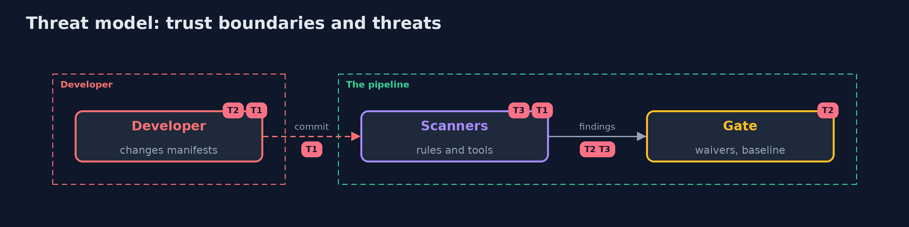

# Threat Model — IaC Scanning

A threat model answers four questions: what are we protecting, who or what could harm it, how, and what do we do about it. This one covers this project's own demo system, not a production deployment. Domain: an online store.

## Scope

The checks on infrastructure files in the build. It does not cover the running cluster or the images.

## What we protect (assets)

- The manifests that reach the cluster.
- The trust in the scan result.

## Who and what acts on the system

- A developer in a hurry.
- An attacker who can change a manifest.

## Trust boundaries

A trust boundary is a line that data or a request crosses between parts that trust each other differently. Threats cluster where those lines are.

- The pipeline: what it passes is applied.

Each dashed box is a trust boundary. A rose tag such as T1 shows where the threat of that number, in the table below, applies.

## Threats, using STRIDE

STRIDE is a checklist of six kinds of threat: **Spoofing** (S), **Tampering** (T), **Repudiation** (R), **Information disclosure** (I), **Denial of service** (D), **Elevation of privilege** (E).

| Id | Kind | Threat | Where it shows up | Control in this project | What is left |
| --- | --- | --- | --- | --- | --- |
| T1 | Tampering | A risky setting reaches the cluster because no rule knows it | the rules | Rules with their own tests and more than one scanner | Problems no scanner has a check for |
| T2 | Repudiation | An exception hides a finding forever | waivers and ignore files | An owner, a reason and an end date, and a report of stale ones | Valid waivers that are wrong |
| T3 | Denial of service | Noise makes people stop reading the scan | the report | A baseline that blocks only new findings | A long accepted list |

## Assumptions

- The scanners run on the same files that are applied.

## Out of scope

- Compromised scanners.
- Changes made directly in the cluster.

## How the tests check this

- `EngineTest` checks the rules, their samples, the waivers and the baseline with no tools.
- `ScannersTest` runs Checkov, Trivy and KICS.
- `DemoRunsTest` compares the whole demo with the golden output.

## Where this model goes next

The next project in this module is policy-as-code.
