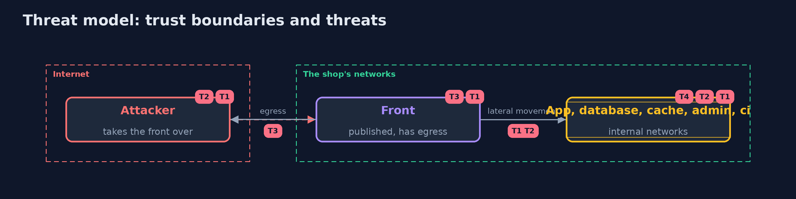

# Threat Model — Network Isolation

A threat model answers four questions: what are we protecting, who or what could harm it, how, and what do we do about it. This one covers this project's own demo system, not a production deployment. Domain: an online store.

## Scope

The networks between the shop's services and what a taken-over service can reach through them. It does not cover the services' own authentication or the host's firewall.

## What we protect (assets)

- The database and the cache.
- The admin panel and the build server.

## Who and what acts on the system

- An attacker who has taken over the front.
- An operator who changes networks by hand.

## Trust boundaries

A trust boundary is a line that data or a request crosses between parts that trust each other differently. Threats cluster where those lines are.

- Each network: members trust each other as far as the network lets them.

Each dashed box is a trust boundary. A rose tag such as T1 shows where the threat of that number, in the table below, applies.

## Threats, using STRIDE

STRIDE is a checklist of six kinds of threat: **Spoofing** (S), **Tampering** (T), **Repudiation** (R), **Information disclosure** (I), **Denial of service** (D), **Elevation of privilege** (E).

| Id | Kind | Threat | Where it shows up | Control in this project | What is left |
| --- | --- | --- | --- | --- | --- |
| T1 | Elevation of privilege | A taken-over service reaches services it has no need of | shared networks | A layout built from a table of allowed pairs, measured against it | Pivots that are allowed on purpose |
| T2 | Tampering | The layout drifts from the design | networks changed by hand | Measure on every change and on a schedule | The time between measurements |
| T3 | Information disclosure | Stolen data leaves through the front | egress | Internal networks, then an egress allow-list for the front | Open egress on the front |
| T4 | Elevation of privilege | Anyone with the runtime's socket changes the networks | the Docker socket | Keep the socket away from services | Operators with the socket |

## Assumptions

- The attacker starts in the front.
- The container runtime enforces the separation of networks.

## Out of scope

- Escapes from the container.
- Attacks on the Docker daemon.

## How the tests check this

- `IntentTest` checks the pairs, the order of names and the comparison with no Docker.
- `IsolationTest` creates real networks and containers for the flat network, the layout built from the intent, drift, the published ports and egress.
- `DemoRunsTest` compares the whole demo with the golden output.

## Where this model goes next

The next project in this module is cloud-misconfigurations.
