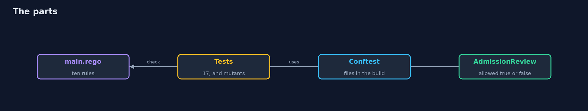
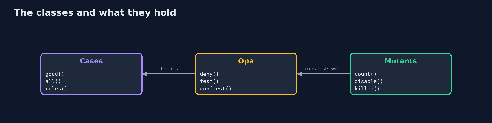
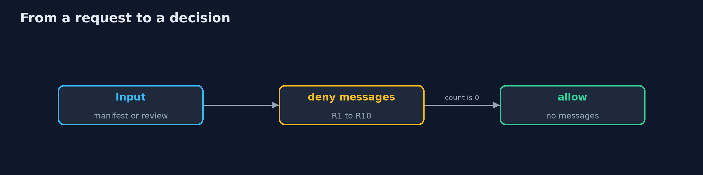
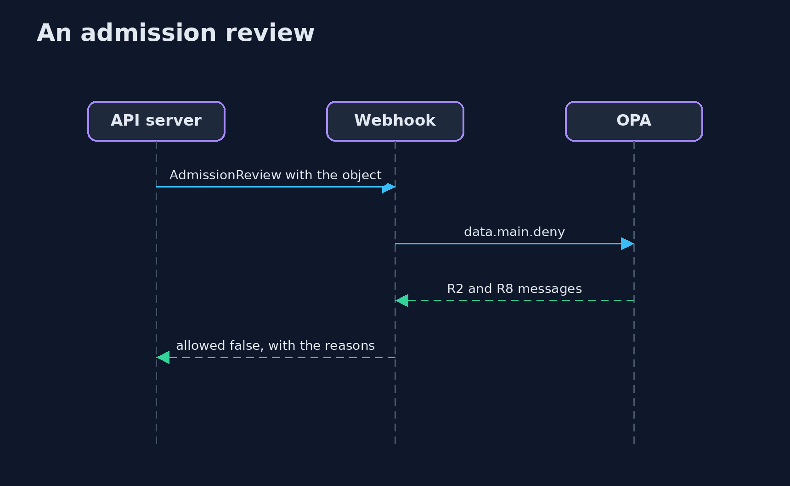

# Policy as Code

```
src/main/java/com/jk/explore/security/policyascode/
├── Admission.java         The shape of a Kubernetes validating webhook: an AdmissionReview comes in, a response with allowed true or false goes out
├── Cases.java             The requests the bank's policy is tested with, each with the rules that a careful reviewer says it breaks
├── Mutants.java           Switches off one deny rule at a time and asks whether the tests notice
├── Opa.java               The opa and conftest command line tools (brew install opa conftest)
└── PolicyAsCodeDemo.java  How many cases the policy in that folder decides as the reviewer expects
```

**A bank's deployment policy in Rego (OPA) denies everything that does not pass its ten rules, and a table of 13 requests agrees with it on 13 of 13; the first draft agreed on only 11, because an empty object and a Deployment without containers were allowed (a missing field made the rule undefined, so nothing was denied); a list of what is forbidden allows a container with no security context and no limits, the policy that asks for what is required denies it; opa test runs 17 tests, and switching off one of the 12 rules at a time shows how good the tests are: 8 of 12 with one test for each rule, 12 of 12 with all; the same file serves an admission review (allowed true or false with the reasons) and Conftest in the build (exit 1), and a new rule is rolled out as a warning (exit 0) before it becomes a denial (exit 1).**

A rule in a wiki is a wish; a rule in code is checked on every change. This project writes a bank's deployment policy in **Rego**, the language of **Open Policy Agent**, and spends most of its effort on the part that is easy to skip: making sure the policy is right. A Java program drives the real `opa` and `conftest` command line tools (`brew install opa conftest`); the tests that use them are tagged `integration`: `./gradlew integrationTest`. The policy is in [`policy/main.rego`](policy/main.rego) with its tests beside it.

What it shows:
- **Deny by default.** Ten rules: allowed kinds, the bank's registry, non-root, not privileged, limits, an owner label, no host network, no `latest`, no default namespace, and containers declared. A table of **13 requests**, each with the rules a reviewer expects it to break, and the policy agrees on **13 of 13**.
- **The holes.** The first draft agreed on only **11 of 13**: an empty object and a Deployment with no containers were allowed, because a missing field makes a rule undefined and an undefined rule denies nothing. A list of what is forbidden does the same to a container with no security context.
- **Testing the policy.** `opa test` runs **17 tests**. Switching off one rule at a time (12 mutants) and asking whether the tests notice gives **8 of 12** with one test for each rule and **12 of 12** with all of them: the missing four are the cases a happy-path test never reaches.
- **In the cluster and in the build.** The same file answers an AdmissionReview (`allowed: false` with the reasons) and Conftest on files (exit 1). A new rule is first a **warning** (exit 0), then a denial (exit 1).
- **The bill.** A policy is code: reviewed, versioned and tested, and so are its tests.

**Maps to:** NIST CSF 2.0 Govern and Protect (GV.PO policy, PR.PS) · NIST SP 800-53 CM-6, CM-7 · CIS Kubernetes Benchmark · Pod Security Standards · OPA Gatekeeper and Kyverno are the same idea in other engines.

## The idea in everyday terms

A security checkpoint with a written list of what may pass. The list that says "no knives" lets through anything it did not think of. The list that says "only these items" does not. Then someone has to test the guard, not only the list.

## The scenario

A bank deploys its payment services to Kubernetes and wants nothing to run that its security team has not allowed. The demo feeds the policy thirteen requests, then breaks the policy on purpose to see whether the tests notice.

## Run

```bash
./gradlew run
```

The demo tells the story in 5 acts, each printing exact numbers that the tests check:

| Act | What it shows |
| --- | --- |
| 1. Deny by default | Ten rules, and a table of 13 requests that the policy decides as a reviewer expects. |
| 2. The holes | The first draft agreed on 11 of 13: a missing field made a rule undefined, so nothing was denied. |
| 3. Testing the policy and its tests | 17 tests pass; switching off one of 12 rules at a time, one test for each rule notices 8 and all tests notice 12. |
| 4. In the cluster and in the build | An AdmissionReview gets allowed false with reasons, Conftest exits 1 on files, and a new rule starts as a warning. |
| 5. The bill | A policy is code; a missing field must mean deny; a rule is rolled out as a warning first. |

## Test

```bash
./gradlew test
```

11 tests in `DemoRunsTest`, `PolicyTest`. The cases, the mutants and the response are tested with no tools. The rest run opa and conftest (./gradlew integrationTest).

## What the simulation got right, and what it left out

The tools are real (`opa` and `conftest`), and the AdmissionReview has the shape a validating webhook receives; there is no cluster. The demo prints decisions and counts of tests, never paths or ids.

## Technologies and versions

Every version below is pinned in the project's build files and was the latest stable release when the project was built.

| Technology | Version | Used for |
| --- | --- | --- |
| Java | 25 | the language and runtime; a Gradle toolchain finds or downloads the JDK |
| Gradle | 9.8.1 (wrapper) | build and run; nothing to install, the wrapper downloads it |
| tools.jackson.core:jackson-databind | 3.1.5 | library the code uses |
| tools.jackson.dataformat:jackson-dataformat-yaml | 3.1.5 | library the code uses |
| org.junit.jupiter:junit-jupiter | 6.1.3, set by junit-bom | JUnit 5: the tests (tests only) |
| org.junit.platform:junit-platform-launcher | 6.1.3, set by junit-bom | JUnit platform launcher, which Gradle needs to run the tests (tests only) |
| videokit | repository tool (`tools/videokit`) | the narrated video and animation: Piper `en_US-amy-medium`, speed 0.8, longer pauses (the amy-slow voice) |

## Learning Material

| Document | What it is for |
| --- | --- |
| [Problem statement](docs/problem-statement.md) | the situation and what the project must show |
| [Prerequisites](docs/prerequisites.md) | what you need to know first |
| [Policy as Code, explained](docs/policy-as-code-explained.md) | the acts in prose |
| [Session guide](docs/session.md) | a one-hour lesson with exercises |
| [Animated walkthrough](docs/animation.html) | the acts step by step, narrated |
| [Threat model](docs/threat-model.md) | what is protected, who could harm it, and how, using STRIDE |
| [Spec](docs/spec.md) | what this project must be true of |
| [Expected output](docs/expected-output.txt) | the golden demo output every test and every port checks against |

### The idea in one picture

One policy file serves the build and the cluster.



### Where each piece sits

Cases, tools and mutants.



### How the data moves

The object is read from either shape of input.



### Who calls whom, in order




### Video

`video/policy-as-code-explained.mp4` (with `.m4a` audio and `.srt` subtitles) is built by `video/build_video.sh`. Rendered media is not committed.

## What it costs

- **A new language to learn,** with undefined as a third value besides true and false.
- **Deny by default blocks legitimate work** until the policy catches up.
- **Tests for the policy are a second program** to keep up to date.
- **A policy engine in the request path** can take the cluster down if it fails closed or open at the wrong time.
- **Rules about files say nothing about what was changed by hand.**

## When this is too much

A team with three services and one cluster can use the built-in Pod Security Standards. Write your own policy when rules are specific to the organisation (a registry, an owner label) or must be tested and reviewed like code.

## Where you have already met this

- A wiki page of deployment rules that nobody checks.
- A pipeline step that greps for `latest`.
- A policy that was copied and never tested.
- An exception made in the cluster by hand.

## Where this sits

This is the fifth project of the [cloud-security-without-a-cloud](..) module, after [iac-scanning](../iac-scanning). Enforcing the policy inside a cluster is the subject of kubernetes-admission-control.
