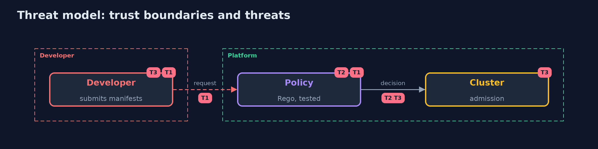

# Threat Model — Policy as Code

A threat model answers four questions: what are we protecting, who or what could harm it, how, and what do we do about it. This one covers this project's own demo system, not a production deployment. Domain: a bank.

## Scope

The rules that decide which workloads may be created. It does not cover the images, the nodes or changes that bypass the API server.

## What we protect (assets)

- The cluster's workloads.
- The policy itself.

## Who and what acts on the system

- A developer who submits a manifest.
- An attacker who finds a gap in the policy.
- A maintainer who changes the policy.

## Trust boundaries

A trust boundary is a line that data or a request crosses between parts that trust each other differently. Threats cluster where those lines are.

- The admission point: nothing is created without passing it.

Each dashed box is a trust boundary. A rose tag such as T1 shows where the threat of that number, in the table below, applies.

## Threats, using STRIDE

STRIDE is a checklist of six kinds of threat: **Spoofing** (S), **Tampering** (T), **Repudiation** (R), **Information disclosure** (I), **Denial of service** (D), **Elevation of privilege** (E).

| Id | Kind | Threat | Where it shows up | Control in this project | What is left |
| --- | --- | --- | --- | --- | --- |
| T1 | Elevation of privilege | A gap in the policy lets a risky workload in | the rules | Deny by default, a table of cases and tests for every rule | Cases nobody thought of |
| T2 | Tampering | A change to the policy weakens it unnoticed | the policy repository | Review, tests and mutation testing in the build | A reviewer who approves a bad test |
| T3 | Denial of service | A strict new rule blocks legitimate deployments | admission | Roll out as a warning first | Time spent on warnings |

## Assumptions

- The webhook is called for every request and fails closed.

## Out of scope

- Compromise of the API server.
- Policies for network traffic.

## How the tests check this

- `PolicyTest` checks the cases, the mutants and the response with no tools, and the decisions, the Rego tests and the mutation score with opa.
- `DemoRunsTest` compares the whole demo with the golden output.

## Where this model goes next

The next project in this module is kubernetes-admission-control.
