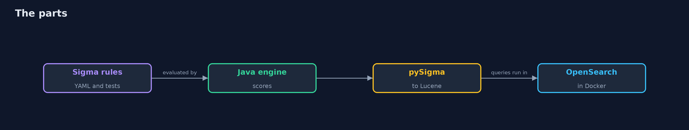
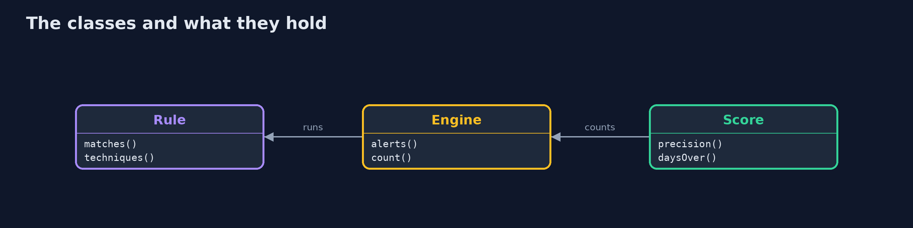
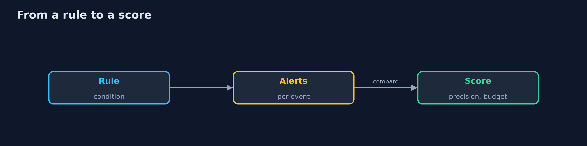
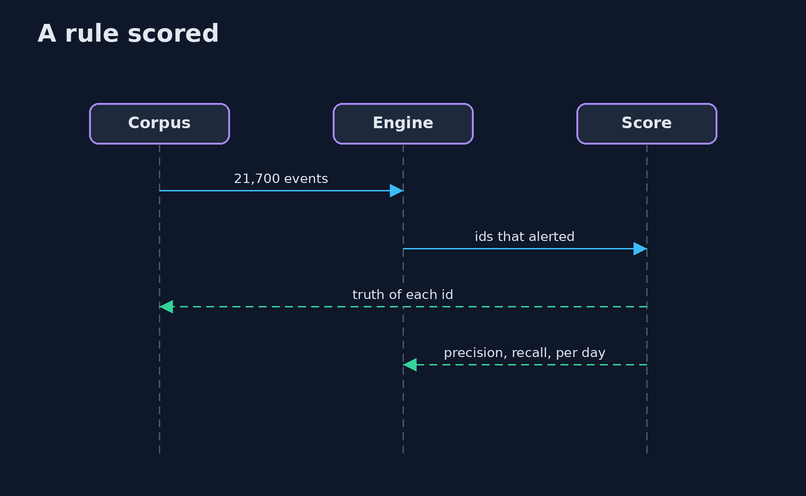

# Detection as Code

```
src/main/java/com/jk/explore/security/detectioncode/
├── Attacks.java              Labelled attacks: for each rule 8 that the rule is written for and 2 evasions it is not (a different binary, a different spelling), and some attacks with no rule at all
├── Benign.java               Ordinary traffic of a bank for a week: logins, process starts on hosts, web requests
├── Corpus.java               A week of recorded events from a bank's hosts and applications, made by a seeded generator, with the truth of every event
├── Coverage.java             The ATT&CK techniques the rules are tagged with against the techniques the labelled attacks used, and what each rule really caught
├── DetectionAsCodeDemo.java  The rules that are alerts on their own: everything except the base rule that only the correlation uses
├── Engine.java               Runs a rule over events in time order and returns the ids of the events that raise an alert
├── Ev.java                   One recorded log event: a number, a time in milliseconds and flat text fields named as Sigma names them (Image, CommandLine, User)
├── Lookalikes.java           Benign events that look like attacks
├── Mutator.java              Small changes to a rule, each a loosening (more alerts) or a tightening (fewer): drop a filter, drop a field from a selection, drop one value of a list, change the first "and" to "or" or "1 of" to "all of", move a correlation threshold or window
├── OpenSearch.java           A single-node OpenSearch with the security plugin off, in a Docker container with a name of its own, on a free port; removed on close
├── Pysigma.java              pySigma with its OpenSearch backend, installed with pip into a virtual environment under build/ the first time, and the script that converts the rules
├── Rule.java                 A Sigma rule read from its YAML: a detection (selections and a condition) or an event_count correlation over another rule
├── RuleTests.java            The tests that sit beside a rule: rules/tests/NAME.json holds cases, each a few events and whether the rule must alert on them (should match) or must not (should not match)
├── Score.java                One rule against the truth
├── Sigma.java                The part of Sigma this project needs, evaluated in Java: selections of fields with the modifiers contains, startswith, endswith and all, wildcards, matching with no regard to case, a missing field that matches nothing, and the conditions and, or, not, parentheses, "1 of selection_ ", "all of them"
└── Truth.java                What an event really is
```

**8 Sigma rules run over 21,700 recorded events with 92 labelled attacks catch 65 of 82 attacks the rules are meant for (the 17 evasions are the misses) with 57 false alarms, 3 of the 8 rules go over their false-alarm budget, 83 rule test cases kill 80 of 80 mutated rules, 5 ATT&CK gaps are listed, and the queries pySigma makes return the same events as the Java evaluation in 8 of 8 cases in OpenSearch (the correlation rule is not converted by the backend).**

A detection is code: it has an author, a test, a version and a cost in alerts. This project writes **8 Sigma rules** (YAML) for a bank's hosts and applications, each tagged with MITRE ATT&CK techniques: a shell started by a web server, a new administrator, credential dumping tools, a burst of failed logins, a download piped into a shell, cleared logs, a scheduled task and an injection in a web request. A seeded generator makes **a week of 21,700 recorded events** (benign traffic, look-alikes and 92 labelled attacks), a small Sigma evaluator in Java scores every rule against the truth, and **pySigma** converts the rules to queries that run in **OpenSearch** in Docker. The demo is tagged `integration`: `./gradlew integrationTest`.

What it shows:
- **Scored.** 65 of the 82 attacks the rules are written for are caught; the 17 misses are spelled another way on purpose; 57 false alarms.
- **Budgets.** Each rule has a number of false alarms per day it may raise; 3 of 8 go over.
- **Tests and mutation.** 83 should-match and should-not-match cases; 80 of 80 loosened or tightened rules fail them.
- **Coverage.** ATT&CK techniques the rules cover against those the attacks used, with 5 gaps.
- **Conversion.** pySigma makes 8 queries; OpenSearch returns the same events as the Java evaluation for 8 of 8.

**Maps to:** MITRE ATT&CK T1505.003, T1136.001, T1003, T1110, T1105, T1070, T1053, T1190 · NIST CSF DE.CM, DE.AE · NIST SP 800-92.

## The idea in everyday terms

A smoke alarm with a test button and a log of every time it rang. You know how often it rings for toast, which fires it misses, and you can say so before the real fire.

## The scenario

A bank's security team keeps its detections in a repository. Every change is a rule file with tests, it is scored on recorded logs, and it must stay within a budget of false alarms a day.

## Run

```bash
./gradlew run
```

The demo tells the story in 6 acts, each printing exact numbers that the tests check:

| Act | What it shows |
| --- | --- |
| 1. The recorded logs | A week of 21,700 events with 92 labelled attacks, 94 look-alikes with no filter and 208 with one. |
| 2. Rules scored | The 8 rules catch 65 of the 82 attacks they are written for, with 57 false alarms. |
| 3. False-positive budgets | Each rule has a number of false alarms a day; 3 of the 8 go over it. |
| 4. Tests and mutants | 83 test cases fail on 80 of 80 loosened or tightened rules. |
| 5. ATT&CK coverage | Techniques the rules cover against the techniques the attacks used, with 5 gaps and 10 partial. |
| 6. pySigma and OpenSearch | pySigma converts 8 of 9 rules; the queries return the same events as Java for 8 of 8. |

## Test

```bash
./gradlew test
```

35 tests in `CorpusTest`, `CoverageTest`, `DemoRunsTest`, `EngineTest`, `RulesAsCodeTest`, `ScoreTest`, `SigmaTest`. The Sigma evaluator, the correlation, the corpus, the scoring, the rule tests, the mutation of every rule and the coverage matrix are tested with no tools. The demo runs pySigma and OpenSearch in Docker (./gradlew integrationTest).

## What the simulation got right, and what it left out

Sigma, pySigma and OpenSearch are real; the logs are made by a seeded generator and are made up. The demo prints counts and rule names, never ports or container names.

## Technologies and versions

Every version below is pinned in the project's build files and was the latest stable release when the project was built.

| Technology | Version | Used for |
| --- | --- | --- |
| Java | 25 | the language and runtime; a Gradle toolchain finds or downloads the JDK |
| Gradle | 9.8.1 (wrapper) | build and run; nothing to install, the wrapper downloads it |
| tools.jackson.core:jackson-databind | 3.1.5 | library the code uses |
| tools.jackson.dataformat:jackson-dataformat-yaml | 3.1.5 | library the code uses |
| org.junit.jupiter:junit-jupiter | 6.1.3, set by junit-bom | JUnit 5: the tests (tests only) |
| org.junit.platform:junit-platform-launcher | 6.1.3, set by junit-bom | JUnit platform launcher, which Gradle needs to run the tests (tests only) |
| videokit | repository tool (`tools/videokit`) | the narrated video and animation: Piper `en_US-amy-medium`, speed 0.8, longer pauses (the amy-slow voice) |

## Learning Material

| Document | What it is for |
| --- | --- |
| [Problem statement](docs/problem-statement.md) | the situation and what the project must show |
| [Prerequisites](docs/prerequisites.md) | what you need to know first |
| [Detection as Code, explained](docs/detection-as-code-explained.md) | the acts in prose |
| [Session guide](docs/session.md) | a one-hour lesson with exercises |
| [Animated walkthrough](docs/animation.html) | the acts step by step, narrated |
| [Threat model](docs/threat-model.md) | what is protected, who could harm it, and how, using STRIDE |
| [Spec](docs/spec.md) | what this project must be true of |
| [Expected output](docs/expected-output.txt) | the golden demo output every test and every port checks against |

### The idea in one picture

Rules are scored in Java and converted by pySigma.



### Where each piece sits

The rule, the engine and the score.



### How the data moves

A rule becomes alerts that are counted against the truth.



### Who calls whom, in order




### Video

`video/detection-as-code-explained.mp4` (with `.m4a` audio and `.srt` subtitles) is built by `video/build_video.sh`. Rendered media is not committed.

## What it costs

- **Evasions exist.** A rule written for one spelling misses another.
- **Filters are holes.** A filter that silences a false alarm is also a way past the rule.
- **Labelled logs are made by people** and fit the attacks they thought of.
- **Conversion is not complete.** Backends do not support every Sigma feature.
- **Budgets need upkeep** as the traffic changes.

## When this is too much

A very small team with one log source can start with a few rules in the SIEM. Use detections as code when rules are shared, reviewed and changed often.

## Where you have already met this

- Rules edited in a SIEM console with no history.
- An alert that fires 200 times a day and is muted.
- A coverage slide that lists techniques with no test.
- A rule that nobody knows still works.

## Where this sits

This is a project of the [detection-engineering](..) module. It uses the ideas of [privacy-engineering](../../governance-risk-and-compliance/privacy-engineering) only in that it measures against a labelled truth, as [sast](../../devsecops-pipelines/sast) does.
