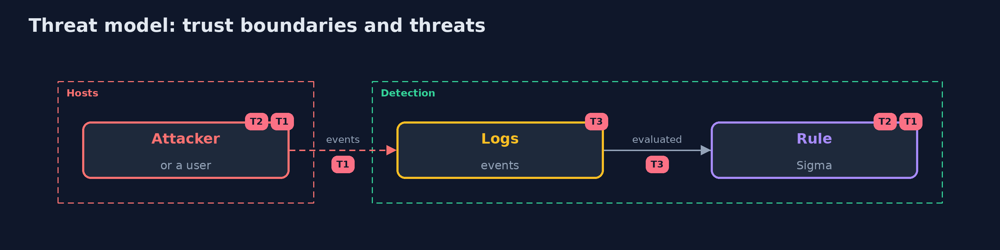

# Threat Model — Detection as Code

A threat model answers four questions: what are we protecting, who or what could harm it, how, and what do we do about it. This one covers this project's own demo system, not a production deployment. Domain: a bank.

## Scope

Detection rules and the logs they run on. It does not cover how the logs are collected.

## What we protect (assets)

- The detections.
- The analysts' attention.
- The logs.

## Who and what acts on the system

- An attacker who spells a command another way.
- An engineer who loosens a rule.
- A rule that is noisy.

## Trust boundaries

A trust boundary is a line that data or a request crosses between parts that trust each other differently. Threats cluster where those lines are.

- The log pipeline into the rules.

Each dashed box is a trust boundary. A rose tag such as T1 shows where the threat of that number, in the table below, applies.

## Threats, using STRIDE

STRIDE is a checklist of six kinds of threat: **Spoofing** (S), **Tampering** (T), **Repudiation** (R), **Information disclosure** (I), **Denial of service** (D), **Elevation of privilege** (E).

| Id | Kind | Threat | Where it shows up | Control in this project | What is left |
| --- | --- | --- | --- | --- | --- |
| T1 | Elevation of privilege | An attack is spelled so that the rule misses it | the rules | Score on labelled attacks including evasions, list gaps | Evasions nobody labelled |
| T2 | Tampering | A change loosens or tightens a rule unnoticed | the rules | Rule tests and mutation tests in review | Cases that do not cover a field |
| T3 | Denial of service | A noisy rule buries the real alerts | the analysts | A false-alarm budget per rule checked on recorded logs | Traffic that changes |

## Assumptions

- The logs are complete and in time.

## Out of scope

- Log tampering at the source.
- Machine learning detections.

## How the tests check this

- `RulesAsCodeTest`, `SigmaTest`, `EngineTest`, `CorpusTest`, `ScoreTest` and `CoverageTest` check the rules, tests, mutants and scoring with no tools.
- `DemoRunsTest` runs pySigma and OpenSearch and compares the whole demo with the golden output (integrationTest).

## Where this model goes next

The next project in the module continues detection engineering.
