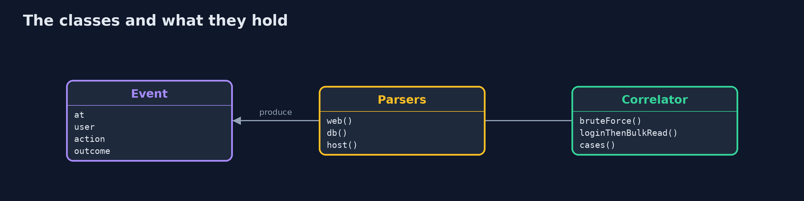
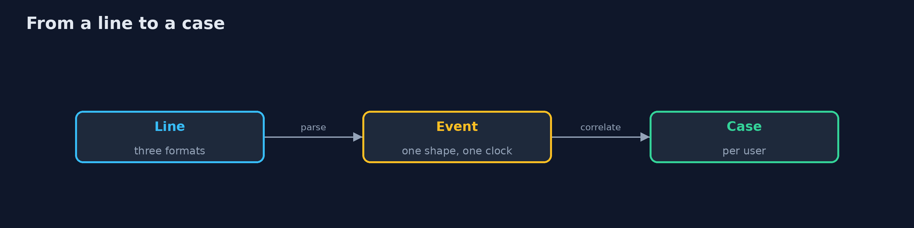
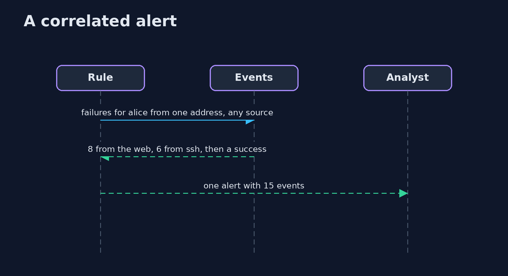

# SIEM Basics

```
src/main/java/com/jk/explore/security/siembasics/
├── Correlator.java      Rules that look across sources and across time
├── Event.java           The one shape that every source is turned into: when (in UTC), who, from where, what, and whether it worked
├── Parsers.java         Turns the lines of each source into events
├── SiemBasicsDemo.java  
└── Sources.java         One day of log lines from three sources in three formats, always the same: a web application (JSON), a database audit log (key=value, local time) and a host (syslog)
```

**One day of a bank's logs comes from three sources in three formats, a web application (623 lines of JSON), a database audit log (322 lines of key=value in local time) and a host (506 lines of syslog); 20 lines that do not fit are kept as dead letters; a query written for the web fields finds 121 failed logins and one query on the common fields finds 178 from 2 sources; the database's +0530 clock, read as if it were UTC, moves an event by 330 minutes and a rule misses the bulk export (1 alert against 0); a rule of 10 failed logins within 10 minutes finds 0 alerts one source at a time and 1 alert on the joined events (alice, 15 events), 0 for ordinary mistyped passwords, and the 2 alerts become 1 case.**

A SIEM does three things before it can say anything useful: it **collects** lines from many sources, it **normalizes** them into one shape and one clock, and it **correlates** them across sources and time. This project does all three in Java for one day at a bank, from three sources in three formats: a web application (JSON), a database audit log (key=value, in local time with an offset) and a host (syslog, with no year and no time zone). An attack is hidden across them. It needs only the JDK: `./gradlew test`, then `./gradlew run`.

What it shows:
- **Collecting.** 623 + 322 + 506 lines; the **20** lines of the database log that do not fit are kept as **dead letters**, not dropped.
- **Normalizing.** A query written for the web's field names finds **121** failed logins; one query on the common fields finds **178**, from 2 sources.
- **The clock.** The database writes `+0530`; read as UTC it moves an event by **330 minutes**, and a correlation rule misses the bulk export (**1** alert against **0**).
- **Correlating.** A rule of 10 failed logins in 10 minutes raises **0** alerts one source at a time and **1** on the joined events; ordinary mistyped passwords raise **0**.
- **Cases.** The 2 alerts about the same user are **1** case.

**Maps to:** NIST CSF 2.0 DE.CM and DE.AE · NIST SP 800-92 (log management) · MITRE ATT&CK T1110 (brute force), T1078 (valid accounts), T1213 (data from information repositories) · ECS and OCSF as common schemas.

## The idea in everyday terms

A call centre that takes reports in three languages and three time zones. Until the reports are written in one language and stamped with one clock, nobody can see that three callers described the same man at the same door.

## The scenario

A bank's logs arrive from a web application, a database and a host, each in its own format. The demo parses them, puts them on one clock and one schema, and runs two rules that need all three.

## Run

```bash
./gradlew run
```

The demo tells the story in 5 acts, each printing exact numbers that the tests check:

| Act | What it shows |
| --- | --- |
| 1. Collecting three sources | 623 JSON lines, 322 database lines and 506 syslog lines; the 20 that do not fit are kept as dead letters. |
| 2. Normalizing into one shape | A query for the web's fields finds 121 failed logins; one query on the common fields finds 178 from 2 sources. |
| 3. The clock | The database's +0530 clock, read as UTC, moves an event by 330 minutes and a correlation rule misses the attack. |
| 4. Correlating across sources | A rule of 10 failures in 10 minutes raises 0 alerts one source at a time and 1 on the joined events. |
| 5. From alerts to cases | The 2 alerts about alice are 1 case. |

## Test

```bash
./gradlew test
```

10 tests in `DemoRunsTest`, `SiemTest`. The parsers, the rules and the generator are tested with the JDK only. The demo is compared with its golden output.

## What the simulation got right, and what it left out

The parsers and rules are real Java, and the three formats are those of a typical web application, database audit log and ssh server. The lines are made by a seeded generator, so each run is the same.

## Technologies and versions

Every version below is pinned in the project's build files and was the latest stable release when the project was built.

| Technology | Version | Used for |
| --- | --- | --- |
| Java | 25 | the language and runtime; a Gradle toolchain finds or downloads the JDK |
| Gradle | 9.8.1 (wrapper) | build and run; nothing to install, the wrapper downloads it |
| org.junit.jupiter:junit-jupiter | 6.1.3, set by junit-bom | JUnit 5: the tests (tests only) |
| org.junit.platform:junit-platform-launcher | 6.1.3, set by junit-bom | JUnit platform launcher, which Gradle needs to run the tests (tests only) |
| videokit | repository tool (`tools/videokit`) | the narrated video and animation: Piper `en_US-amy-medium`, speed 0.8, longer pauses (the amy-slow voice) |

## Learning Material

| Document | What it is for |
| --- | --- |
| [Problem statement](docs/problem-statement.md) | the situation and what the project must show |
| [Prerequisites](docs/prerequisites.md) | what you need to know first |
| [SIEM Basics, explained](docs/siem-basics-explained.md) | the acts in prose |
| [Session guide](docs/session.md) | a one-hour lesson with exercises |
| [Animated walkthrough](docs/animation.html) | the acts step by step, narrated |
| [Threat model](docs/threat-model.md) | what is protected, who could harm it, and how, using STRIDE |
| [Spec](docs/spec.md) | what this project must be true of |
| [Expected output](docs/expected-output.txt) | the golden demo output every test and every port checks against |

### The idea in one picture

Three sources become one stream of events.


### Where each piece sits

The event, the parsers and the rules.



### How the data moves

Each step makes the next possible.



### Who calls whom, in order




### Video

`video/siem-basics-explained.mp4` (with `.m4a` audio and `.srt` subtitles) is built by `video/build_video.sh`. Rendered media is not committed.

## What it costs

- **Every source needs a parser** and a person to keep it working.
- **Lines that do not parse are a blind spot** unless they are counted.
- **Clocks disagree,** and the disagreement hides attacks.
- **Storage and licences grow with volume.**
- **Correlation rules need tuning** against your own traffic.

## When this is too much

A small team with one application can read its log directly. A SIEM pays when several sources must be read together, retention and search are required, or the same rules must run on all of them.

## Where you have already met this

- A log line with no time zone.
- A parser that silently drops what it cannot read.
- Three dashboards for one attack.
- An alert threshold applied to one source only.

## Where this sits

This is a project of the [detection-engineering](..) module, after [detection-as-code](../detection-as-code) and [threat-hunting](../threat-hunting). The rules there assume the common shape that this project builds.
