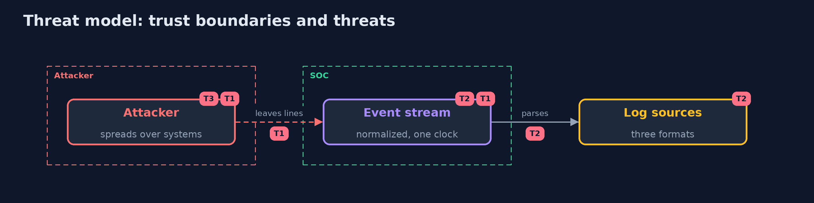

# Threat Model — SIEM Basics

A threat model answers four questions: what are we protecting, who or what could harm it, how, and what do we do about it. This one covers this project's own demo system, not a production deployment. Domain: a bank.

## Scope

The collection, normalization and correlation of security logs. It does not cover how the logs are produced or the response.

## What we protect (assets)

- The logs.
- The rules.
- The clock.

## Who and what acts on the system

- An attacker who spreads over systems.
- An analyst.
- A log source that changes its format.

## Trust boundaries

A trust boundary is a line that data or a request crosses between parts that trust each other differently. Threats cluster where those lines are.

- The parser: what it cannot read is a blind spot.

Each dashed box is a trust boundary. A rose tag such as T1 shows where the threat of that number, in the table below, applies.

## Threats, using STRIDE

STRIDE is a checklist of six kinds of threat: **Spoofing** (S), **Tampering** (T), **Repudiation** (R), **Information disclosure** (I), **Denial of service** (D), **Elevation of privilege** (E).

| Id | Kind | Threat | Where it shows up | Control in this project | What is left |
| --- | --- | --- | --- | --- | --- |
| T1 | Repudiation | An attack that spans sources is not seen | the rules | Normalize the sources and write rules over the joined events | Sources that are not collected |
| T2 | Information disclosure | Lines that do not parse hide an attack | the parsers | Keep dead letters, count them, alert when they rise | Formats that change without notice |
| T3 | Tampering | A wrong clock reorders events | the timestamps | Record the offset of every source and test with it | Clocks that drift |

## Assumptions

- The sources' clocks are right, or their offsets are known.

## Out of scope

- Log tampering at the source.
- Response.

## How the tests check this

- `SiemTest` checks the parsers, the offset, the dead letters, the rules and the cases with the JDK only.
- `DemoRunsTest` compares the whole demo with the golden output.

## Where this model goes next

This is the last project of the module.
