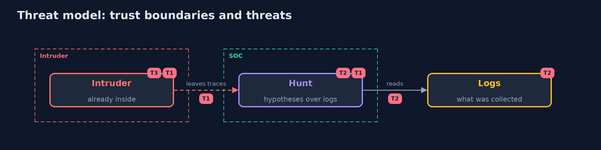

# Threat Model — Threat Hunting

A threat model answers four questions: what are we protecting, who or what could harm it, how, and what do we do about it. This one covers this project's own demo system, not a production deployment. Domain: a bank.

## Scope

The use of logs to find an intruder who has not raised an alert. It does not cover response.

## What we protect (assets)

- The logs.
- The hunt notes and rules.

## Who and what acts on the system

- An intruder who stays quiet.
- An analyst.
- An administrator whose work looks odd.

## Trust boundaries

A trust boundary is a line that data or a request crosses between parts that trust each other differently. Threats cluster where those lines are.

- The log pipeline: what is not collected cannot be hunted.

Each dashed box is a trust boundary. A rose tag such as T1 shows where the threat of that number, in the table below, applies.

## Threats, using STRIDE

STRIDE is a checklist of six kinds of threat: **Spoofing** (S), **Tampering** (T), **Repudiation** (R), **Information disclosure** (I), **Denial of service** (D), **Elevation of privilege** (E).

| Id | Kind | Threat | Where it shows up | Control in this project | What is left |
| --- | --- | --- | --- | --- | --- |
| T1 | Repudiation | An intruder stays unseen because no rule asks the right question | the detections | Hypothesis-driven hunts that become rules | Techniques nobody thought of |
| T2 | Information disclosure | A gap in the logs hides an attack | the log sources | List the data gaps and close them | Sources that cannot be collected |
| T3 | Denial of service | Too many false leads exhaust the analysts | the team | Rarity and baseline filters, allowlists with reasons | Time spent on each lead |

## Assumptions

- The logs are complete and have not been tampered with.

## Out of scope

- Attacks that leave no log.
- Response.

## How the tests check this

- `HuntsTest` checks each hunt, the generator and the median with the JDK only.
- `DemoRunsTest` compares the whole demo with the golden output.

## Where this model goes next

The next project in the module is siem-basics.
