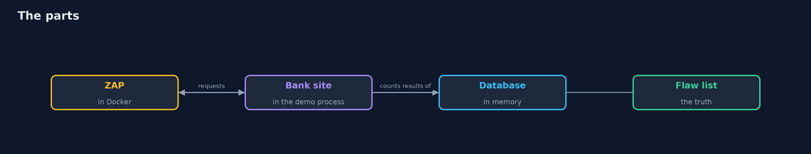
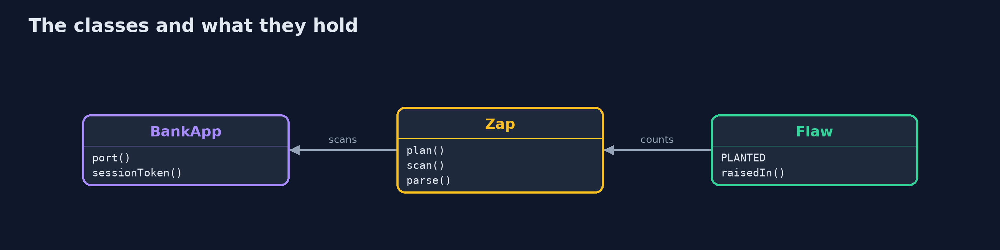
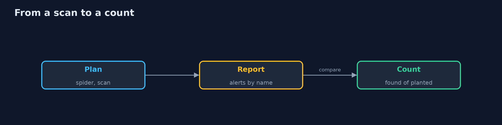
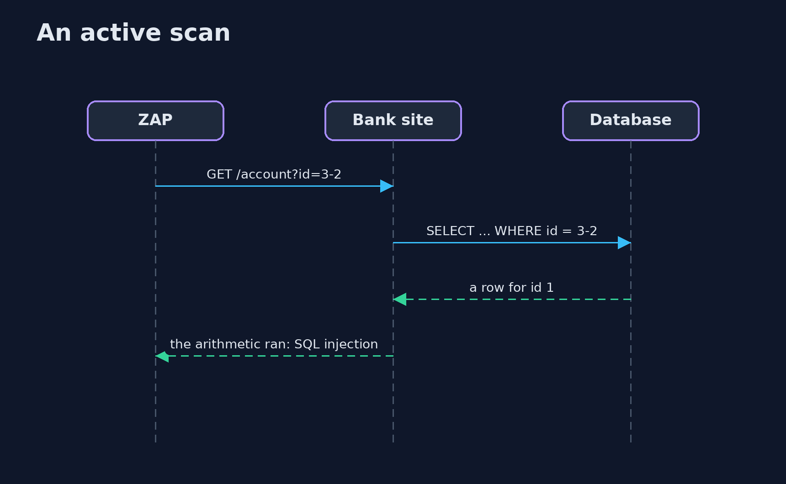

# Dynamic Analysis

```
src/main/java/com/jk/explore/security/dast/
├── Alert.java     One kind of alert in a ZAP report: its name, its risk and confidence (3 high, 2 medium, 1 low, 0 informational), and where it was raised: each hit is a path, the parameter that was attacked and the attack string, if any
├── BankApp.java   A small bank web application, run in this process
├── DastDemo.java  The kind of a planted flaw, from the alert it should raise
├── Flaw.java      A flaw planted in the application: what a scanner should raise, and on which path ({@code null} for any path)
├── Probe.java     A teaching class: the two active checks of this demo, redone by hand with the same attack strings ZAP sends
├── Sh.java        Runs a program and returns what it printed, whether it worked or not
└── Zap.java       OWASP ZAP in Docker, driven by an automation plan: spider, passive rules, and optionally an active scan limited to chosen rules
```

**ZAP's reflected-script attack string comes back unchanged from the flawed bank site and escaped from the fixed one, and an id of 3-2 returns the page for id 1, so the database worked the input out; of 9 planted flaws, one behind the login, a passive scan finds the 5 cookie and header flaws, an active scan without a login adds 2 of 3 script flaws and the query flaw but never reaches the admin area, and a logged-in scan finds 3 + 1 + 5 = 9 of 9 with 2 high, 3 medium, 3 low and 2 informational alerts; after the fixes none of the planted flaws is raised and one medium alert (no anti-CSRF token on the login form) is left for a person to judge.**

Dynamic analysis tests the running application from outside, as an attacker would: it crawls the pages, reads the responses and sends attack strings. This project starts a small bank web application in Java with **9 planted flaws** (reflected script, a query built with a string, cookie flags, missing security headers), one of them behind the login, and scans it with **OWASP ZAP** in Docker driven by an automation plan. A Java program starts the application and ZAP (the image is pinned by digest, about 2 GB, pulled once) and counts what each scan found against the planted truth; the demo is tagged `integration`: `./gradlew integrationTest`.

What it shows:
- **One attack by hand.** ZAP's attack string for reflected script comes back unchanged from the flawed site and escaped from the fixed one.
- **Passive.** A scan that only reads responses finds the **5** cookie and header flaws and none of the script and query flaws.
- **Active, anonymous.** An id of `3-2` returns the page of id 1: the database worked the input out. The scan finds **2 of 3** script flaws and the query flaw; the admin area is never reached.
- **Active, logged in.** With the session cookie the scan finds **3 + 1 + 5 = 9 of 9**.
- **The fixed application.** Nothing planted is raised; one medium alert (no anti-CSRF token) remains for a person to judge.

**Maps to:** OWASP Top 10 (2025) A05 Injection and A02 Security Misconfiguration · OWASP ASVS 5.0 V1 Encoding and Sanitization, V13 Configuration · NIST SSDF PW.8 · CWE-79, CWE-89.

## The idea in everyday terms

A building inspector who tries the doors from the street. She finds the unlocked ones she can see, and only if she has a key does she walk the corridors behind the lobby. Telling her the building is clean after she tried the front doors would be an overstatement.

## The scenario

A bank's web application has a search page, an account page, a login and an admin area. The demo starts it with known flaws, scans it three ways, fixes it and scans it again.

## Run

```bash
./gradlew run
```

The demo tells the story in 5 acts, each printing exact numbers that the tests check:

| Act | What it shows |
| --- | --- |
| 1. One attack, worked out by hand | The request puts ZAP's attack string for reflected script, </p><scrIpt>alert(1);</scRipt><p>, in the search parameter. The flawed application returns it unchanged inside its page; the fixed one returns it escaped (&lt;scrIpt&gt;...). ZAP reports Cross Site Scripting (Reflected) on /search, parameter q, with the same attack, risk high, confidence medium. |
| 2. The application, and a passive scan | The bank site has 9 planted flaws, 1 behind the login: 3 script flaws (/search, /account, /admin/report), 1 query flaw (/account), 2 cookie flaws (/login) and 3 missing headers (every page). A passive scan crawls and only reads the responses, sends no attacks, and finds script 0 of 3, query 0 of 1, cookie and header 5 of 5. |
| 3. An active scan, without a login | The plan adds two active rules, 40012 reflected script and 40018 SQL injection. Worked out by hand: GET /account?id=1 and id=3-2 both return Asha: 1200 while id=2 returns Ben: 300, so the database worked 3-2 out; the fixed application answers id=3-2 with status 400. The scan finds script 2 of 3, query 1 of 1, cookie and header 5 of 5; it missed the reflected page in the admin area, which it never reached. |
| 4. An active scan that is logged in | A replacer rule in the plan sends Cookie: session=<the login's value> with every request. The scan reaches the admin area and finds script 3 of 3, query 1 of 1, cookie and header 5 of 5: 3 + 1 + 5 = 9 of 9 planted flaws. The report has 10 alerts: 2 high, 3 medium, 3 low and 2 informational, each with a confidence. |
| 5. The fixed application | The fixed version escapes its output, binds the query to a number, sets HttpOnly and SameSite on the cookie and sends security headers. Before the fixes the logged-in scan raised 9 of 9 planted flaws (high 2, medium 3, low 3, informational 2); after them the same scan raises 0 of 9 (high 0, medium 1, low 0, informational 2). Left for a person: Absence of Anti-CSRF Tokens on /login, risk medium, confidence low. |

## Test

```bash
./gradlew test
```

18 tests in `BankAppTest`, `DastDemoTest`, `DemoRunsTest`, `ProbeTest`, `ZapAndFlawTest`. The application, the two checks redone by hand, the report parsing and the plan are tested with no tools. The demo runs Docker and ZAP, pinned by image digest (./gradlew integrationTest).

## What the simulation got right, and what it left out

ZAP and the application are real; the application is a small made-up bank site that runs in the demo's own process. The demo prints counts and flaw names, never addresses or ports.

## Technologies and versions

Every version below is pinned in the project's build files and was the latest stable release when the project was built.

| Technology | Version | Used for |
| --- | --- | --- |
| Java | 25 | the language and runtime; a Gradle toolchain finds or downloads the JDK |
| Gradle | 9.8.1 (wrapper) | build and run; nothing to install, the wrapper downloads it |
| tools.jackson.core:jackson-databind | 3.1.5 | library the code uses |
| com.h2database:h2 | 2.5.252 | library the code uses |
| org.junit.jupiter:junit-jupiter | 6.1.3, set by junit-bom | JUnit 5: the tests (tests only) |
| org.junit.platform:junit-platform-launcher | 6.1.3, set by junit-bom | JUnit platform launcher, which Gradle needs to run the tests (tests only) |
| videokit | repository tool (`tools/videokit`) | the narrated video and animation: Piper `en_US-amy-medium`, speed 0.8, longer pauses (the amy-slow voice) |

## Learning Material

| Document | What it is for |
| --- | --- |
| [Problem statement](docs/problem-statement.md) | the situation and what the project must show |
| [Prerequisites](docs/prerequisites.md) | what you need to know first |
| [Dynamic Analysis, explained](docs/dast-explained.md) | the acts in prose |
| [Session guide](docs/session.md) | a one-hour lesson with exercises |
| [Animated walkthrough](docs/animation.html) | the acts step by step, narrated |
| [Threat model](docs/threat-model.md) | what is protected, who could harm it, and how, using STRIDE |
| [Spec](docs/spec.md) | what this project must be true of |
| [Expected output](docs/expected-output.txt) | the golden demo output every test and every port checks against |

### The idea in one picture

ZAP attacks the running application from outside.



### Where each piece sits

The application, the scanner and the truth.



### How the data moves

The report is compared with the planted flaws.



### Who calls whom, in order




### Video

`video/dast-explained.mp4` (with `.m4a` audio and `.srt` subtitles) is built by `video/build_video.sh`. Rendered media is not committed.

## What it costs

- **A scan sees only what it can reach,** so it needs logins and a good crawl.
- **Active scans send attacks,** so they run against a test copy, never production.
- **Alerts need judging;** risk and confidence are guides.
- **A scan takes time and a Docker image of 2 GB.**
- **A clean result is not a proof.**

## When this is too much

A static site with no forms needs no active scan. Use DAST when the application takes input, has a login, or is built from parts that static analysis cannot see together.

## Where you have already met this

- A yearly penetration test as the only test.
- A scan that never logged in.
- A report with hundreds of informational alerts.
- An active scan run against production.

## Where this sits

This is a project of the [devsecops-pipelines](..) module, with [sast](../sast) and [secret-scanning](../secret-scanning). SAST reads the source; DAST attacks the running application.
