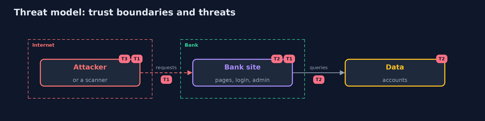

# Threat Model — Dynamic Analysis

A threat model answers four questions: what are we protecting, who or what could harm it, how, and what do we do about it. This one covers this project's own demo system, not a production deployment. Domain: a bank.

## Scope

A web application, tested from outside on a test copy. It does not cover the network, the hosts or the people.

## What we protect (assets)

- The accounts.
- The admin area.
- The sessions.

## Who and what acts on the system

- An attacker who reaches the site.
- A team that scans without a login.
- A scanner.

## Trust boundaries

A trust boundary is a line that data or a request crosses between parts that trust each other differently. Threats cluster where those lines are.

- The site's public pages and the login.

Each dashed box is a trust boundary. A rose tag such as T1 shows where the threat of that number, in the table below, applies.

## Threats, using STRIDE

STRIDE is a checklist of six kinds of threat: **Spoofing** (S), **Tampering** (T), **Repudiation** (R), **Information disclosure** (I), **Denial of service** (D), **Elevation of privilege** (E).

| Id | Kind | Threat | Where it shows up | Control in this project | What is left |
| --- | --- | --- | --- | --- | --- |
| T1 | Tampering | An injection flaw is found by an attacker first | the pages | Active scans on a test copy, with a login | Flaws the scan cannot reach |
| T2 | Information disclosure | A scan that never logged in hides the admin area | the admin area | Give the scan a session and count it against planted flaws | Roles the scan does not use |
| T3 | Denial of service | An active scan damages the target | the target | Scan a test copy only | A test copy unlike production |

## Assumptions

- The scan runs against a test copy that is like production.

## Out of scope

- Denial of service.
- Business logic abuse.

## How the tests check this

- `BankAppTest` and `ZapAndFlawTest` check the application, the report parsing and the plan with no tools.
- `DemoRunsTest` runs Docker and ZAP and compares the whole demo with the golden output (integrationTest).

## Where this model goes next

The next project in the module is secure-pipeline.
