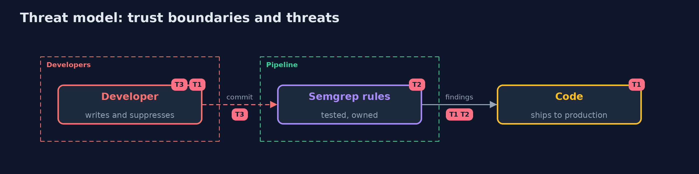

# Threat Model — Static Analysis

A threat model answers four questions: what are we protecting, who or what could harm it, how, and what do we do about it. This one covers this project's own demo system, not a production deployment. Domain: a bank.

## Scope

Injection flaws in the source of the application. It does not cover flaws that exist only at runtime, in dependencies or in configuration.

## What we protect (assets)

- The application source.
- The rules and the suppressions.

## Who and what acts on the system

- A developer who writes an unsafe query.
- A developer who suppresses a finding to get a build green.
- A maintainer of the rules.

## Trust boundaries

A trust boundary is a line that data or a request crosses between parts that trust each other differently. Threats cluster where those lines are.

- The build: findings stop it or do not.

Each dashed box is a trust boundary. A rose tag such as T1 shows where the threat of that number, in the table below, applies.

## Threats, using STRIDE

STRIDE is a checklist of six kinds of threat: **Spoofing** (S), **Tampering** (T), **Repudiation** (R), **Information disclosure** (I), **Denial of service** (D), **Elevation of privilege** (E).

| Id | Kind | Threat | Where it shows up | Control in this project | What is left |
| --- | --- | --- | --- | --- | --- |
| T1 | Tampering | An injection flaw ships because no rule saw it | the source | Taint rules for the sources and sinks of the application, scored on planted flaws | Flows across files and frameworks |
| T2 | Repudiation | A rule silently stops working | the rules | Rule tests in the build | Cases the tests do not cover |
| T3 | Repudiation | A finding is suppressed without a reason | the code | A check that requires a rule, a reason and an owner | A reason that is not true |

## Assumptions

- The rules know the sources, sinks and sanitizers of the code.

## Out of scope

- Business logic flaws.
- Flaws in libraries.

## How the tests check this

- `ScoreTest` and `MarkerAndSuppressionsTest` check the scoring, the markers and the suppression check with no tools.
- `DemoRunsTest` runs Semgrep and compares the whole demo with the golden output (integrationTest).

## Where this model goes next

The next project in the module is dast.
