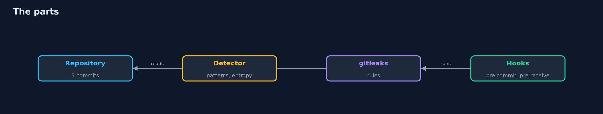
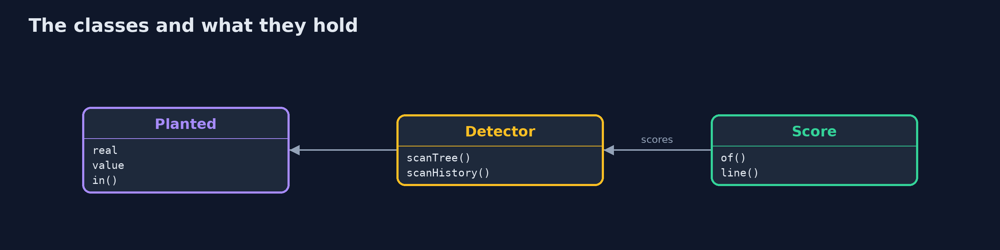
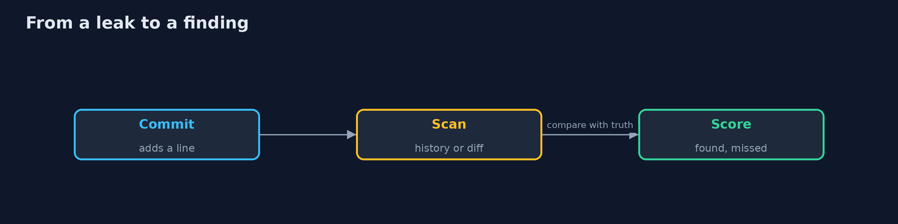
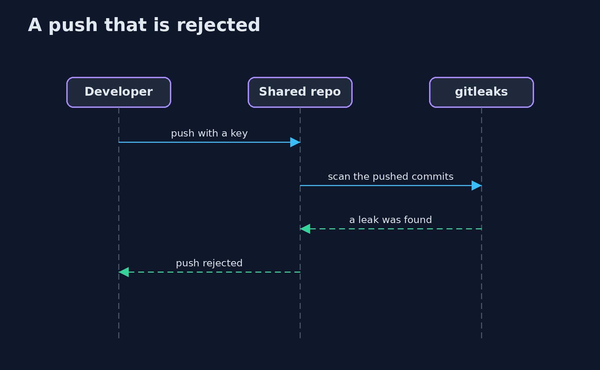

# Secret Scanning

```
src/main/java/com/jk/explore/security/secretscan/
├── BankRepo.java            The bank's repository as it grew: five commits, five real secrets, four look-alikes, and a clean-up commit that removes two files
├── Detector.java            A small secret scanner written for this project: a few patterns and an entropy check, on files or on every line ever added
├── EntropySteps.java        A teaching class: the entropy that {@link Detector#entropy} computes in one loop, worked out in steps
├── Finding.java             Something a scanner reported: the rule, the file, the text it matched, and the commit it was added in (empty for a scan of files)
├── Git.java                 A git repository driven through the git command line, with fixed author and dates so that runs do not differ
├── Gitleaks.java            The real gitleaks command line, asked for a JSON report
├── Planted.java             A string put in the bank's repository on purpose, with the truth about it: a real secret, or a look-alike that is not one
├── Score.java               What a scanner got right against what was planted
├── SecretScanningDemo.java  The commit a finding came from, by number ("commit 3"), or nothing for a scan of files
└── Sh.java                  Runs a program and returns what it printed, whether it worked or not
```

**A key in base64 matches no pattern, but its entropy, worked out by hand, is 4.707 bits per character, above the threshold of 4.2, while a hex checksum can never pass 4.0; a bank's repository of 5 commits holds 5 real secrets and 4 look-alikes, the files now hold 2 of the 5 and a fresh clone still holds a key that commit 4 removed; over the whole history a scanner written in Java finds 5 of 5 and flags 2 look-alikes (precision 71%), gitleaks finds 4 of 5 and flags 1 (precision 80%); an allowlist leaves no look-alike flagged and a baseline of 7 findings leaves 1 new one; a pre-commit hook refuses a commit with a key, --no-verify gets around it, and a pre-receive hook on the shared repository rejects the push.**

A secret committed once is in the repository for good: removing the file removes it from the files, not from the history, and every clone carries the history. This project builds a bank's git repository in five commits with **5 real secrets and 4 look-alikes** planted in it, and measures two scanners against that truth: a small one written in Java (patterns and an entropy check) and **gitleaks**. A Java program drives the real `git` and `gitleaks` 8.30.1 command lines (the pinned gitleaks release is downloaded into `build/` once and checked against its SHA-256); the demo is tagged `integration`: `./gradlew integrationTest`.

What it shows:
- **Entropy by hand.** A key in base64 matches no pattern; its entropy is worked out step by step: **4.707** bits per character, above the threshold of 4.2. A hex checksum can never pass 4.0.
- **Files now or the whole history.** The files at HEAD hold 2 of the 5 secrets; a fresh clone still holds a key that commit 4 removed.
- **Misses and false alarms.** Over the whole history the scanner written in Java finds **5 of 5** and flags 2 look-alikes; gitleaks finds **4 of 5** (it misses a short database password) and flags 1.
- **An allowlist and a baseline.** An allowlist for documentation and fixtures removes the look-alike; a baseline turns **7 findings** into **1 new** one.
- **Blocking.** A pre-commit hook refuses a commit with a key, `--no-verify` skips it, and a pre-receive hook on the shared repository still rejects the push.

**Maps to:** OWASP Top 10 (2025) A04 Cryptographic Failures and A07 Authentication Failures · NIST SSDF PS.1 · CIS Software Supply Chain · MITRE ATT&CK T1552 Unsecured Credentials.

## The idea in everyday terms

A house key left in a hotel room drawer. Taking it out of the drawer today does not help the guests who already copied it. The only fix is to change the lock, and the next best thing is a front desk that stops the key from being left there.

## The scenario

A bank's payments team has committed keys and passwords over the years, and cleaned some of them up. The demo builds such a repository, scans it in several ways and then tries to commit and push one more.

## Run

```bash
./gradlew run
```

The demo tells the story in 5 acts, each printing exact numbers that the tests check:

| Act | What it shows |
| --- | --- |
| 1. One string, measured by hand | The key in k8s/secret.yaml (commit 5) is base64, 44 characters, and no pattern rule matches it. Its entropy, worked out in four groups of characters (21 once, 6 twice, 2 three times, 1 five times), is 4.707 bits per character, above the threshold of 4.2. A SHA-256 checksum in hex has 16 different characters, so at most 4.000 bits; its entropy is 3.786. The detector reports the key as a high-entropy string and the checksum not at all. |
| 2. The files now, and the whole history | The bank's repository has 5 commits. Of the 9 planted strings, the payment key, the database password and the cloud key were added in commits 1 and 2 and removed in commit 4. A scan of the files now finds 2 of 5 real secrets with either scanner; a scan of the whole history finds 5 of 5 with our scanner and 4 of 5 with gitleaks. A fresh clone still holds the payment key that commit 4 removed. |
| 3. What each scanner gets wrong | Over the whole history our scanner finds all 5 real secrets and flags 2 look-alikes (the documentation key and the test key): recall 5/5 = 100%, precision 5/7 = 71%. gitleaks finds 4, misses the database password, and flags the test key: recall 4/5 = 80%, precision 4/5 = 80%. The password is 11 characters with an entropy of 3.096 and no known prefix; our scanner has a rule for the word password. |
| 4. An allowlist and a baseline | An allowlist in gitleaks.toml for ^docs/ and /test/resources/ changes the whole-history scan from 4 of 5 found with 1 look-alike flagged to 4 of 5 with 0 flagged. Today's report has 7 findings (the key in commit 5 is reported by three rules) and exit code 1; with it as the baseline, one more commit with a new token gives 1 new finding, still exit 1. |
| 5. Blocking a secret before it is shared | A pre-commit hook on the laptop runs gitleaks on what is staged, and a pre-receive hook on the shared repository runs it on each push. A clean first push is accepted. A commit with the payment key is refused by the pre-commit hook (1 commit); with --no-verify it is made (2 commits); its push is rejected by the pre-receive hook (1 commit on the server). With the key taken out, a clean change is accepted (2 commits on the server). |

## Test

```bash
./gradlew test
```

18 tests in `DemoRunsTest`, `DetectorTest`, `EntropyStepsTest`, `GitleaksAndPlantedTest`, `ScoreTest`. The detector, the entropy steps, the scoring and the verdicts are tested with no tools. The demo runs git and gitleaks 8.30.1 (./gradlew integrationTest).

## What the simulation got right, and what it left out

The git repositories and the gitleaks runs are real. The keys are made-up strings in the shapes of real ones, and none of them opens anything. The demo prints counts, names and only the first characters of a key, never a whole key.

## Technologies and versions

Every version below is pinned in the project's build files and was the latest stable release when the project was built.

| Technology | Version | Used for |
| --- | --- | --- |
| Java | 25 | the language and runtime; a Gradle toolchain finds or downloads the JDK |
| Gradle | 9.8.1 (wrapper) | build and run; nothing to install, the wrapper downloads it |
| tools.jackson.core:jackson-databind | 3.1.5 | library the code uses |
| org.junit.jupiter:junit-jupiter | 6.1.3, set by junit-bom | JUnit 5: the tests (tests only) |
| org.junit.platform:junit-platform-launcher | 6.1.3, set by junit-bom | JUnit platform launcher, which Gradle needs to run the tests (tests only) |
| videokit | repository tool (`tools/videokit`) | the narrated video and animation: Piper `en_US-amy-medium`, speed 0.8, longer pauses (the amy-slow voice) |

## Learning Material

| Document | What it is for |
| --- | --- |
| [Problem statement](docs/problem-statement.md) | the situation and what the project must show |
| [Prerequisites](docs/prerequisites.md) | what you need to know first |
| [Secret Scanning, explained](docs/secret-scanning-explained.md) | the acts in prose |
| [Session guide](docs/session.md) | a one-hour lesson with exercises |
| [Animated walkthrough](docs/animation.html) | the acts step by step, narrated |
| [Threat model](docs/threat-model.md) | what is protected, who could harm it, and how, using STRIDE |
| [Spec](docs/spec.md) | what this project must be true of |
| [Expected output](docs/expected-output.txt) | the golden demo output every test and every port checks against |

### The idea in one picture

Scanners read the files or the history; hooks stop a push.



### Where each piece sits

The truth, a scanner and the score.



### How the data moves

A secret is found where it was added.



### Who calls whom, in order




### Video

`video/secret-scanning-explained.mp4` (with `.m4a` audio and `.srt` subtitles) is built by `video/build_video.sh`. Rendered media is not committed.

## What it costs

- **Every scanner misses and flags,** so a person reads the results.
- **A hook on a laptop can be skipped,** so the check must also run on the server.
- **A key found in history has to be revoked,** which can break production.
- **An allowlist can hide a real secret.**
- **Scanning the whole history takes longer** than scanning a diff.

## When this is too much

A private repository with one developer and no cloud keys can rely on a pre-commit hook alone. A scan of the whole history is for the day a repository becomes shared, public or audited.

## Where you have already met this

- A password in application.properties "for now".
- A key removed by a commit that is still in the log.
- A hook that everyone skips with --no-verify.
- A scanner that nobody has measured.

## Where this sits

This project is part of the [devsecops-pipelines](..) module, which lets a pipeline stop what a person misses. The keys it finds are the ones the [kubernetes-secrets](../../kubernetes-and-container-security/kubernetes-secrets) project keeps out of the cluster.
