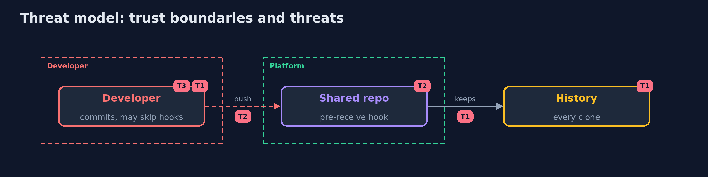

# Threat Model — Secret Scanning

A threat model answers four questions: what are we protecting, who or what could harm it, how, and what do we do about it. This one covers this project's own demo system, not a production deployment. Domain: a bank.

## Scope

Secrets in the source repository, in the files and in the history. It does not cover secrets typed into chat, tickets or build logs.

## What we protect (assets)

- The payment key, the cloud key and the tokens.
- The repository and its clones.

## Who and what acts on the system

- A developer who commits a key by accident.
- An attacker who reads a clone or a fork.
- A developer who skips the hook.

## Trust boundaries

A trust boundary is a line that data or a request crosses between parts that trust each other differently. Threats cluster where those lines are.

- The shared repository, where the push is accepted or rejected.

Each dashed box is a trust boundary. A rose tag such as T1 shows where the threat of that number, in the table below, applies.

## Threats, using STRIDE

STRIDE is a checklist of six kinds of threat: **Spoofing** (S), **Tampering** (T), **Repudiation** (R), **Information disclosure** (I), **Denial of service** (D), **Elevation of privilege** (E).

| Id | Kind | Threat | Where it shows up | Control in this project | What is left |
| --- | --- | --- | --- | --- | --- |
| T1 | Information disclosure | A secret stays in the history after the file is cleaned | git history | Scan the whole history, revoke the key first | Forks and copies already made |
| T2 | Tampering | A secret reaches the shared repository | the push | A pre-receive hook that scans what is pushed | Secrets no rule recognises |
| T3 | Repudiation | A developer skips the local check | the laptop | Do not rely on the laptop: check on the server too | Time between the commit and the push |

## Assumptions

- The server hook cannot be skipped by developers.

## Out of scope

- Compromise of the Git server.
- Secrets that no rule recognises.

## How the tests check this

- `DetectorTest` and `ScoreTest` check the rules, the entropy and the scoring with no tools.
- `DemoRunsTest` runs git and gitleaks and compares the whole demo with the golden output (integrationTest).

## Where this model goes next

The next project in the module is secure-pipeline.
