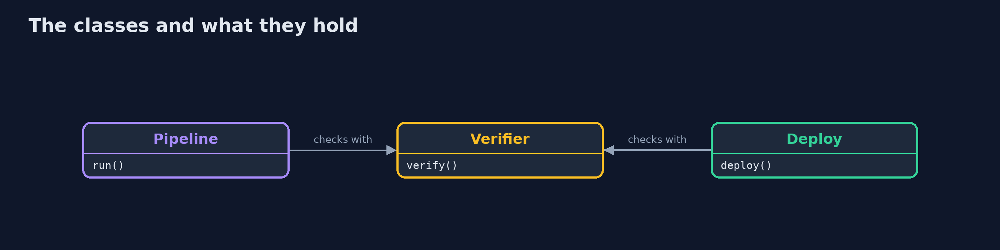
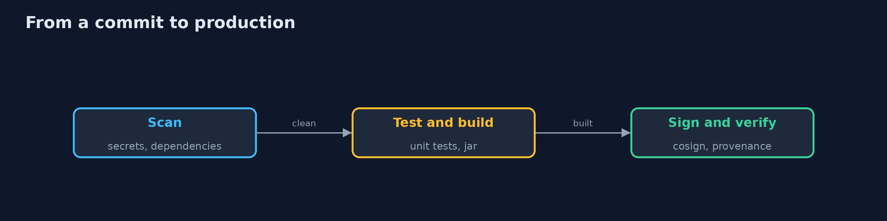
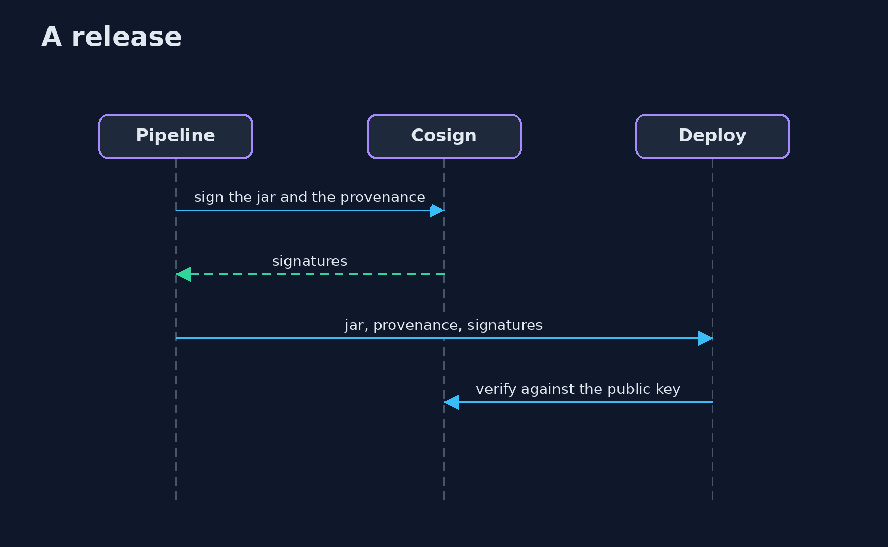

# Secure Pipeline

```
src/main/java/com/jk/explore/security/securepipe/
├── BankLib.java             The small Gradle library of a bank that the pipelines build: a git repository with two commits, in one of several flavours
├── Bundle.java              The four files a release is made of: the jar, its signature, the provenance and the signature of the provenance
├── Cosign.java              The real cosign command line, with a key pair that lives in a temporary directory and nowhere else
├── Deploy.java              The last step: a directory that stands for production, which takes a jar only when its release verifies
├── Digest.java              SHA-256 of bytes and files, as lower-case hex
├── Gate.java                How a gate that runs an outside tool turns what happened into pass, fail or error
├── Git.java                 A git repository driven through the git command line, with fixed author and dates so that runs do not differ
├── Gradle.java              Runs this project's own Gradle wrapper inside a checkout of the library, so that the build there never touches this project's build directory
├── Pipeline.java            The stages of a release, driven from Java: checkout, secret scan, dependency check, unit tests, build, provenance, signing and a signature check
├── Provenance.java          An in-toto statement with a SLSA v1 provenance predicate: what was built, from what, by whom and how
├── Reproducibility.java     Builds the same commit in two clean checkouts in different directories and compares the jars
├── Sbom.java                A small CycloneDX software bill of materials made from the dependencies a build.gradle declares for the code that ships
├── Scratch.java             Temporary directories and files that the demo makes, all removed at the end (the signing keys among them)
├── SecurePipelineDemo.java  A release pipeline for a bank's Gradle library, driven from Java: reproducible builds, signatures and provenance, gates that fail closed, and a deploy step that accepts only what verifies
├── Sh.java                  Runs a program and returns what it printed, whether it worked or not
├── SignatureCheck.java      Says whether a signature file is a valid signature of a file under a public key
└── Verifier.java            Everything that must be true before a release is trusted
```

**The same commit built in two clean checkouts gives identical jars with preserveFileTimestamps off and reproducibleFileOrder on (identical: yes), and different jars when the old settings keep file times (no) or when the build path is written into the jar (no, 1 entry: build-info.properties); cosign verifies the jar and its provenance with the public key and refuses a jar with one bit changed and a signature checked with another key; the in-toto provenance names the builder, the command, 3 inputs, the jar digest and the source commit and tree, and an edited commit no longer verifies; 4 gates (secret scan with gitleaks, dependency check with trivy on a CycloneDX bill of materials, unit tests, signature check) stop 6 of 6 planted failures, 0 let through, each at the gate that owns the flaw; 3 of 3 broken tools (gitleaks missing, gitleaks crashing, trivy without its database) stop the pipeline that fails closed and 3 of 3 are released by one that fails open; the deploy step accepts the genuine release and refuses 3 of 3 forged releases (a swapped jar, an attacker's own build and a replayed old release), so 1 jar is in production.**

A release pipeline is the road every change takes to production, so it has to be the hardest road to cheat on. This project builds one for a small Gradle library of a bank and then tries to cheat it. The stages are driven from Java and use the real tools: **git**, **Gradle**, **gitleaks**, **trivy** and **cosign**. No Gitea or Woodpecker server is run: the stages are the same ones a Woodpecker pipeline would call, in a Java program that can measure them. The demo is tagged `integration`: `./gradlew integrationTest` (trivy needs its vulnerability database, downloaded once).

What it shows:
- **Reproducible build.** The same commit in two directories gives identical jars: **yes**. With the old archive settings: **no** (file times). With the build path written into the jar: **no** (1 entry).
- **Signing.** cosign verifies the jar and the provenance; a jar with one bit changed and a signature checked with another key both fail.
- **Provenance.** An in-toto statement with a SLSA v1 predicate: builder, command, **3** inputs, jar digest, source commit and tree.
- **Gates.** **4** gates stop **6 of 6** planted failures, each at its own gate. **3 of 3** broken tools stop a pipeline that fails closed and get past one that fails open.
- **Deploy.** The genuine release is accepted and **3 of 3** forged releases are refused.

**Maps to:** SLSA v1 (build levels and provenance) · in-toto attestation · NIST SSDF PS.1, PS.2 and PW.4 · OWASP CI/CD Security Risks · CIS software supply chain guide.

## The idea in everyday terms

A bank vault with a guard at every door. The guard at each door has an order: if you cannot tell whether the visitor is allowed in, the answer is no. A guard who lets people in when the phone is dead is not a guard.

## The scenario

A bank keeps a small ledger library. Every release must come out of a clean build, must be signed, must say where it came from, and must pass four checks. The demo plants six failures, breaks three tools and forges three releases to see what gets through.

## Run

```bash
./gradlew run
```

The demo tells the story in 5 acts, each printing exact numbers that the tests check:

| Act | What it shows |
| --- | --- |
| 1. Build it twice | The same commit built in two directories gives identical jars only with fixed archive settings and no path in the jar. |
| 2. Sign it | cosign signs the jar and the provenance; one changed bit or another key fails verification. |
| 3. Say where it came from | An in-toto statement with a SLSA predicate names the builder, the command, 3 inputs, the jar digest and the source. |
| 4. Gates that fail closed | 4 gates stop 6 of 6 planted failures, and 3 of 3 broken tools stop the pipeline that fails closed. |
| 5. Deploy only what verifies | The deploy step accepts the genuine release and refuses 3 of 3 forged releases. |

## Test

```bash
./gradlew test
```

20 tests in `DemoRunsTest`, `JdkSignatures`, `PipelinePartsTest`, `VerifierTest`. The verifier, the provenance, the bill of materials, the gate rules and the comparison of jars are tested with the JDK only (a JDK ECDSA key stands in for cosign). The demo runs the tools (./gradlew integrationTest).

## What the simulation got right, and what it left out

git, Gradle, gitleaks, trivy and cosign are the real tools. The pipeline is a Java program, not a Gitea and Woodpecker server, and the signing key pair is made for each run and never stored. The library, the planted flaws and the builder id are the project's own.

## Technologies and versions

Every version below is pinned in the project's build files and was the latest stable release when the project was built.

| Technology | Version | Used for |
| --- | --- | --- |
| Java | 25 | the language and runtime; a Gradle toolchain finds or downloads the JDK |
| Gradle | 9.8.1 (wrapper) | build and run; nothing to install, the wrapper downloads it |
| tools.jackson.core:jackson-databind | 3.1.5 | library the code uses |
| org.junit.jupiter:junit-jupiter | 6.1.3, set by junit-bom | JUnit 5: the tests (tests only) |
| org.junit.platform:junit-platform-launcher | 6.1.3, set by junit-bom | JUnit platform launcher, which Gradle needs to run the tests (tests only) |
| videokit | repository tool (`tools/videokit`) | the narrated video and animation: Piper `en_US-amy-medium`, speed 0.8, longer pauses (the amy-slow voice) |

## Learning Material

| Document | What it is for |
| --- | --- |
| [Problem statement](docs/problem-statement.md) | the situation and what the project must show |
| [Prerequisites](docs/prerequisites.md) | what you need to know first |
| [Secure Pipeline, explained](docs/secure-pipeline-explained.md) | the acts in prose |
| [Session guide](docs/session.md) | a one-hour lesson with exercises |
| [Animated walkthrough](docs/animation.html) | the acts step by step, narrated |
| [Threat model](docs/threat-model.md) | what is protected, who could harm it, and how, using STRIDE |
| [Spec](docs/spec.md) | what this project must be true of |
| [Expected output](docs/expected-output.txt) | the golden demo output every test and every port checks against |

### The idea in one picture

Source goes through four gates and a signature to a deploy step that checks it all again.


### Where each piece sits

The pipeline and the deploy step share one verifier.



### How the data moves

Each stage can say no.



### Who calls whom, in order




### Video

`video/secure-pipeline-explained.mp4` (with `.m4a` audio and `.srt` subtitles) is built by `video/build_video.sh`. Rendered media is not committed.

## What it costs

- **Reproducible builds need care:** one timestamp or path in a jar is enough to break them.
- **Gates add minutes** to every change and tools need updating (the trivy database is large).
- **Fail closed stops releases** when a tool has a bad day.
- **Provenance is only as good as the builder** that writes it; a compromised builder signs lies.
- **Keys must be kept** somewhere better than a pipeline variable.

## When this is too much

A personal project that nobody else installs does not need signatures and provenance. Anything that other people or other machines trust and run does.

## Where you have already met this

- A pipeline that is green because the scanner was not installed.
- A jar on a shared drive that nobody can trace to a commit.
- A hotfix built on a laptop.
- An old release that was valid yesterday and is replayed today.

## Where this sits

This is a project of the [devsecops-pipelines](..) module. secret-scanning, sast and dast are three of the gates; this project puts gates, signatures and provenance on one road. The signed-images idea reappears in kubernetes-admission-control, where the cluster does the verifying.
