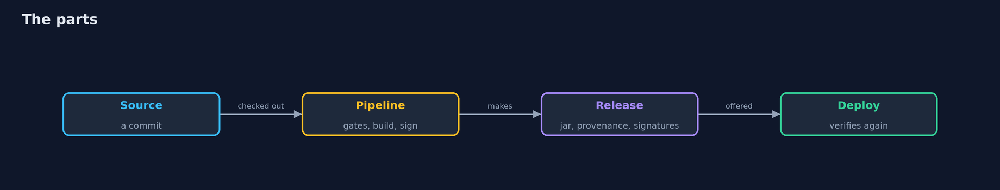
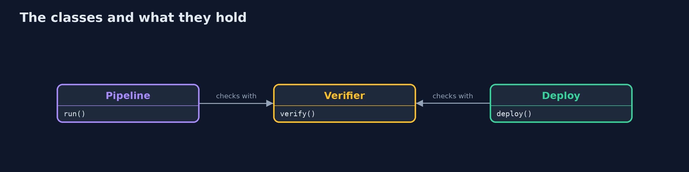
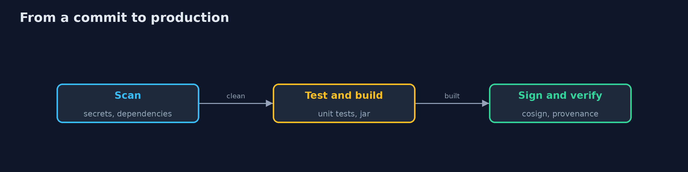
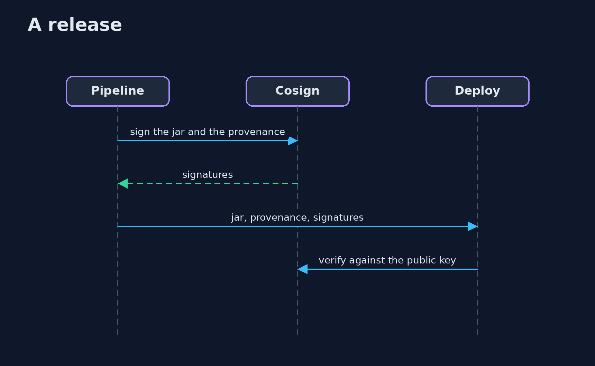

# Secure Pipeline

```
src/main/java/com/jk/explore/security/securepipe/
├── BankLib.java             The small Gradle library of a bank that the pipelines build: a git repository with two commits, in one of several flavours
├── Bundle.java              The four files a release is made of: the jar, its signature, the provenance and the signature of the provenance
├── Cosign.java              The real cosign command line (the pinned release from Tools), with a key pair that lives in a temporary directory and nowhere else
├── Deploy.java              The last step: a directory that stands for production, which takes a jar only when its release verifies
├── Digest.java              SHA-256 of bytes and files, as lower-case hex
├── Gate.java                How a gate that runs an outside tool turns what happened into pass, fail or error
├── Git.java                 A git repository driven through the git command line, with fixed author and dates so that runs do not differ
├── Gradle.java              Runs this project's own Gradle wrapper inside a checkout of the library, so that the build there never touches this project's build directory
├── Pipeline.java            The stages of a release, driven from Java: checkout, secret scan, dependency check, unit tests, build, provenance, signing and a signature check
├── Provenance.java          An in-toto statement with a SLSA v1 provenance predicate: what was built, from what, by whom and how
├── Reports.java             Reads what each gate's tool reported, so the demo can say what was found and not only that something was
├── Reproducibility.java     Builds the same commit in two clean checkouts in different directories and compares the jars
├── Sbom.java                A small CycloneDX software bill of materials made from the dependencies a build.gradle declares for the code that ships
├── Scratch.java             Temporary directories and files that the demo makes, all removed at the end (the signing keys among them)
├── SecurePipelineDemo.java  A release pipeline for a bank's Gradle library, driven from Java: reproducible builds, signatures and provenance, gates that fail closed, and a deploy step that accepts only what verifies
├── Sh.java                  Runs a program and returns what it printed, whether it worked or not
├── SignatureCheck.java      Says whether a signature file is a valid signature of a file under a public key
├── SignatureSteps.java      A teaching class: the check cosign verify-blob makes, redone with the JDK alone
├── Tools.java               The three outside tools, each one pinned release
└── Verifier.java            Everything that must be true before a release is trusted
```

**Commit 7feddf9e3682 built in two clean checkouts gives identical jars with fixed archive settings (every entry dated 1980-02-01 00:00), and different jars when the file times are kept or when build-info.properties records the build path; cosign signs the SHA-256 of the jar with an EC key of 256 bits, and both cosign and the JDK alone refuse a jar with one bit changed and a signature checked with another key; the provenance names the builder, the command, the commit and tree, build.gradle and 1 dependency, and an edited commit no longer verifies; 4 gates stop 6 of 6 planted flaws, each at its own gate (2 of 4 unit tests fail, trivy reports CVE-2022-42889 CRITICAL in commons-text 1.9, gitleaks reports an aws-access-token); 3 broken tools give no program, exit 1 and exit 1, which a pipeline that fails closed stops 3 of 3 times and one that fails open releases 3 of 3 times; deploy makes 7 checks in order, accepts the genuine release (7 of 7) and refuses a swapped jar and a foreign key at check 2 and a replayed old release at check 6, so 1 jar is in production.**

A release pipeline is the road every change takes to production, so it has to be the hardest road to cheat on. This project builds one for a small Gradle library of a bank and then tries to cheat it. The stages are driven from Java and use real tools: **git**, **Gradle**, **gitleaks** 8.30.1, **trivy** 0.76.1 and **cosign** 3.1.4. The three scanners and signers decide the golden output, so each pinned release is downloaded from GitHub into `build/tools` once and checked against its SHA-256. No Gitea or Woodpecker server is run: the stages are the ones a Woodpecker pipeline would call, in a Java program that can measure them. The demo is tagged `integration`: `./gradlew integrationTest` (trivy's vulnerability database is downloaded once).

What it shows:
- **Build it twice.** Commit `7feddf9e3682` in two clean checkouts gives identical jars with fixed archive settings (every entry dated 1980-02-01 00:00), and different jars when file times are kept or the build path is written into the jar.
- **Sign it.** cosign signs the SHA-256 of the jar with an EC key of 256 bits; a small class redoes the check with the JDK alone and agrees: one changed bit or another key fails.
- **Say where it came from.** An in-toto statement with a SLSA v1 predicate: builder, command, commit and tree, build.gradle and **1** dependency.
- **Gates.** **4** gates stop **6 of 6** planted flaws, each at its own gate, and the demo prints what each tool saw (2 of 4 tests failed, CVE-2022-42889, an aws-access-token).
- **Fail closed.** **3** broken tools: a pipeline that fails closed stops **3 of 3**; one that fails open releases **3 of 3**.
- **Deploy.** **7** checks in order: the genuine release passes 7 of 7, a swapped jar and a foreign key stop at check 2, a replayed old release at check 6.

**Maps to:** SLSA v1 (build levels and provenance) · in-toto attestation · NIST SSDF PS.1, PS.2 and PW.4 · OWASP CI/CD Security Risks · CIS software supply chain guide.

## The idea in everyday terms

An armoured cash van. Every bag is sealed, the van carries a signed manifest of where each bag came from, and the guard at the vault opens nothing whose seal is broken, whose manifest is forged or whose bag belongs to yesterday's run. A guard who waves a van through because the scanner is switched off is not a guard.

## The scenario

A bank keeps a small ledger library. Every release must come out of a clean build, must be signed, must say where it came from, and must pass four gates. The demo plants six flaws, breaks three tools and forges three releases to see what gets through.

## Run

```bash
./gradlew run
```

The demo tells the story in 6 acts, each printing exact numbers that the tests check:

| Act | What it shows |
| --- | --- |
| 1. Build it twice | Commit 7feddf9e3682 is cloned into two clean directories and built with gradlew jar, two seconds apart, in three settings. Fixed archive settings give identical jars: 5 entries each, every one dated 1980-02-01 00:00. Keeping the file times gives the same 5 entries and the same bytes inside, but different times, so the SHA-256 differs. Writing the build path into build-info.properties gives one entry with other bytes: builtIn=<checkout 1> against builtIn=<checkout 2>. |
| 2. Sign it | The release jar, built from commit 7feddf9e3682 after all 4 gates passed, is signed with a cosign key pair made for this run; the key is EC, 256 bits. cosign sign-blob takes the SHA-256 of the jar's bytes and signs it with ECDSA. cosign verify-blob and a small class that uses the JDK alone agree on all four checks: the jar as built yes, one bit changed no, another key no, provenance.json as built yes. |
| 3. Say where it came from | provenance.json is an in-toto statement with a SLSA v1 predicate: the subject bank-ledger.jar with its SHA-256, the builder id, the command gradlew jar, and 3 inputs (commit 7feddf9e3682 with tree a209b03297dd, build.gradle with sha256 9895030fa19b, and commons-codec 1.17.1). The subject equals the SHA-256 of the jar, the commit equals the checked-out commit, and the tree equals that commit's tree. The previous release names commit 0ada0140f8f3, and a statement edited to name 000000000000 no longer verifies. |
| 4. Four gates, six planted flaws | The gates in order: secret scan (gitleaks git, exit 7 for found), dependency check (trivy sbom on a CycloneDX bill of materials, exit 3), unit tests (gradlew test, exit 1) and signature check (the 7 checks of the verifier). The clean change passes 4 of 4. Six planted flaws are stopped 6 of 6, each at the gate that owns it, after 2, 1, 0, 3, 3 and 3 gates. The tools say why: 2 of 4 tests failed (the fee 10000 / 10 = 1000, not 100), CVE-2022-42889 CRITICAL in commons-text 1.9, an aws-access-token in config/payments.properties:2, and the verifier's files present and artifact signature checks. |
| 5. A gate whose tool cannot answer | Three tools are broken, each on a change with a flaw: gitleaks is missing (no program), gitleaks crashes on a configuration that is not TOML (exit 1, not 0 or 7), and trivy has an empty database (exit 1, not 0 or 3). Each answer is an ERROR. A pipeline that fails closed stops 3 of 3, at the secret scan and the dependency check; the same pipeline set to fail open releases 3 of 3 flawed changes. |
| 6. Deploy only what verifies | Deploy trusts one public key, one builder and commit 7feddf9e3682 with tree a209b03297dd, and makes 7 checks in order: files present, artifact signature, provenance signature, artifact digest, builder, source commit, source tree. The genuine release passes 7 of 7 and is accepted. A swapped jar and an attacker's own build with its own key pass 1 of 7 and are refused at the artifact signature; the genuine previous release (commit 0ada0140f8f3) passes 5 of 7 and is refused at the source commit. 1 jar is in production, and no key file is left on disk. |

## Test

```bash
./gradlew test
```

27 tests in `DemoRunsTest`, `JdkSignatures`, `PipelinePartsTest`, `StepsAndReportsTest`, `VerifierTest`. The verifier, the provenance, the bill of materials, the gate rules, the tool reports, the JDK signature check and the comparison of jars are tested with the JDK only (a JDK ECDSA key stands in for cosign). The demo runs the pinned tools (./gradlew integrationTest).

## What the simulation got right, and what it left out

git, Gradle, gitleaks, trivy and cosign are the real tools, and the three outside ones are pinned releases checked by SHA-256. The pipeline is a Java program, not a Gitea and Woodpecker server, and the signing key pairs are made for each run and deleted at its end. The library, the planted flaws and the builder id are the project's own. Commits, trees and build.gradle digests are printed (fixed author and dates make them the same on every run); jar digests, keys and temporary paths never are.

## Technologies and versions

Every version below is pinned in the project's build files and was the latest stable release when the project was built.

| Technology | Version | Used for |
| --- | --- | --- |
| Java | 25 | the language and runtime; a Gradle toolchain finds or downloads the JDK |
| Gradle | 9.8.1 (wrapper) | build and run; nothing to install, the wrapper downloads it |
| tools.jackson.core:jackson-databind | 3.1.5 | library the code uses |
| org.junit.jupiter:junit-jupiter | 6.1.3, set by junit-bom | JUnit 5: the tests (tests only) |
| org.junit.platform:junit-platform-launcher | 6.1.3, set by junit-bom | JUnit platform launcher, which Gradle needs to run the tests (tests only) |
| videokit | repository tool (`tools/videokit`) | the narrated video and animation: Piper `en_US-amy-medium`, speed 0.8, longer pauses (the amy-slow voice) |

## Learning Material

| Document | What it is for |
| --- | --- |
| [Problem statement](docs/problem-statement.md) | the situation and what the project must show |
| [Prerequisites](docs/prerequisites.md) | what you need to know first |
| [Secure Pipeline, explained](docs/secure-pipeline-explained.md) | the acts in prose |
| [Session guide](docs/session.md) | a one-hour lesson with exercises |
| [Animated walkthrough](docs/animation.html) | the acts step by step, narrated |
| [Threat model](docs/threat-model.md) | what is protected, who could harm it, and how, using STRIDE |
| [Spec](docs/spec.md) | what this project must be true of |
| [Expected output](docs/expected-output.txt) | the golden demo output every test and every port checks against |

### The idea in one picture

Source goes through four gates and a signature to a deploy step that checks it all again.



### Where each piece sits

The pipeline and the deploy step share one verifier.



### How the data moves

Each stage can say no.



### Who calls whom, in order




### Video

`video/secure-pipeline-explained.mp4` (with `.m4a` audio and `.srt` subtitles) is built by `video/build_video.sh`. Rendered media is not committed.

## What it costs

- **Reproducible builds need care:** one timestamp or path in a jar is enough to break them.
- **Gates add minutes** to every change and tools need updating (the trivy database is large).
- **Fail closed stops releases** when a tool has a bad day.
- **Provenance is only as good as the builder** that writes it; a compromised builder signs lies.
- **Keys must be kept** somewhere better than a pipeline variable.

## When this is too much

A personal project that nobody else installs does not need signatures and provenance. Anything that other people or other machines trust and run does.

## Where you have already met this

- A pipeline that is green because the scanner was not installed.
- A jar on a shared drive that nobody can trace to a commit.
- A hotfix built on a laptop.
- An old release that was valid yesterday and is replayed today.

## Where this sits

This is a project of the [devsecops-pipelines](..) module. [secret-scanning](../secret-scanning), [sast](../sast) and [dast](../dast) are three of the gates; this project puts gates, signatures and provenance on one road. The signed-images idea reappears in kubernetes-admission-control, where the cluster does the verifying.
