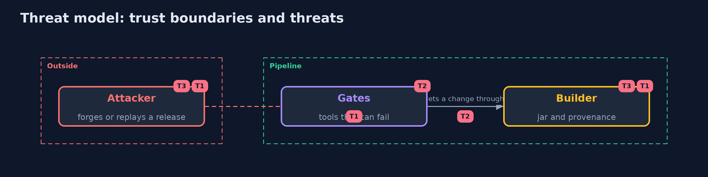

# Threat Model — Secure Pipeline

A threat model answers four questions: what are we protecting, who or what could harm it, how, and what do we do about it. This one covers this project's own demo system, not a production deployment. Domain: a bank.

## Scope

The release path of one library: checkout, gates, build, signing, provenance and deploy. It does not cover the security of the machine that builds.

## What we protect (assets)

- The jar that runs in production.
- The signing key.
- The record of where a release came from.

## Who and what acts on the system

- An attacker who can reach the artifact store.
- A developer who commits a secret.
- A broken or missing tool.

## Trust boundaries

A trust boundary is a line that data or a request crosses between parts that trust each other differently. Threats cluster where those lines are.

- The artifact store between the builder and production.

Each dashed box is a trust boundary. A rose tag such as T1 shows where the threat of that number, in the table below, applies.

## Threats, using STRIDE

STRIDE is a checklist of six kinds of threat: **Spoofing** (S), **Tampering** (T), **Repudiation** (R), **Information disclosure** (I), **Denial of service** (D), **Elevation of privilege** (E).

| Id | Kind | Threat | Where it shows up | Control in this project | What is left |
| --- | --- | --- | --- | --- | --- |
| T1 | Tampering | A jar is swapped or forged after the build | the artifact store | Signatures, provenance and a digest check at deploy | A compromised builder |
| T2 | Spoofing | A gate passes because its tool did not run | the gates | A tool that cannot answer is a failure | A tool with a wrong answer |
| T3 | Repudiation | A genuine old release is replayed | the artifact store | Provenance names the commit, and deploy checks it | A commit that is old but wanted |

## Assumptions

- The builder is not compromised.
- The signing key stays in the pipeline.

## Out of scope

- Compromise of the builder.
- Keyless signing and a transparency log.

## How the tests check this

- `VerifierTest` checks every refusal of the verifier and the deploy step with JDK signatures.
- `PipelinePartsTest` checks the bill of materials, the provenance, the gate rules and the comparison of jars.
- `DemoRunsTest` runs the real tools and compares the whole demo with the golden output (integrationTest).

## Where this model goes next

The next project in the module is the next in docs/advanced-plan.md.
