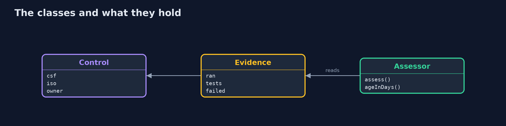
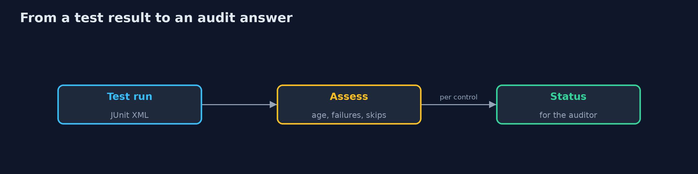
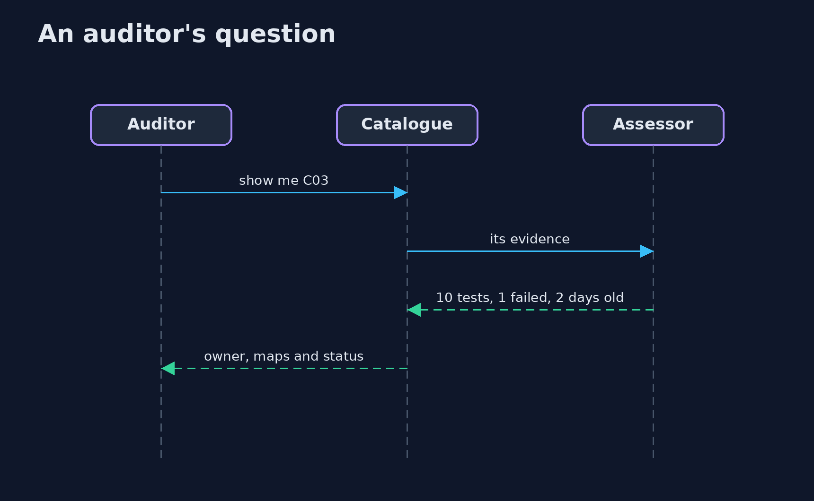

# Controls and Evidence

```
src/main/java/com/jk/explore/security/controlsevidence/
├── Assessor.java                 Decides what the evidence of a control says on a given day
├── Control.java                  A control of the bank: who owns it, which NIST CSF 2.0 subcategory and ISO/IEC 27001 Annex A controls it serves, and where its evidence is
├── ControlsAndEvidenceDemo.java  
└── Evidence.java                 The result of a test run, read from a JUnit XML file: when it ran, how many tests, which failed
```

**A bank's 12 controls, each with an owner, are mapped to the 6 functions of NIST CSF 2.0 and to 13 of the 14 ISO 27001 Annex A controls it has chosen (A.8.28 is not served); evidence is read from JUnit test results and from attestations: today 4 of 12 controls have fresh passing test evidence, 1 is failing, 1 partial (skipped tests), 2 stale (one 144 days old against a limit of 90) and 1 has no evidence at all; one failing test turns a passing control failing and leaves 1 of 5 Protect controls with passing evidence instead of 2.**

An audit asks two questions about every control: *is it mapped to what we promised*, and *can you show that it works today*. This project keeps the bank's **12 controls** in a catalogue with an owner and a mapping to **NIST CSF 2.0** subcategories and to **ISO/IEC 27001:2022 Annex A**, reads evidence from **JUnit test results** (and from signed-off attestations where no test exists), and gives each control a status for the day. It needs only the JDK; `./gradlew test`, then `./gradlew run`.

What it shows:
- **The maps.** All **6** CSF functions have a control (Protect has 5); **13 of the 14** Annex A controls the bank chose are served, and A.8.28 is not.
- **The evidence today.** **4 of 12** controls have fresh passing test evidence; **1** is failing, **1** is partial because tests were skipped, **2** are stale and **1** has no evidence.
- **The trail.** For one control: the owner, the CSF and ISO references, the test run, its age, and the test that failed.
- **A test starts to fail.** One failing test turns a passing control failing and leaves **1 of 5** Protect controls with passing evidence.
- **The bill.** Evidence shows that a test passed, not that the control is effective.

**Maps to:** NIST CSF 2.0 Govern (GV.OC, GV.PO) · ISO/IEC 27001:2022 clause 9 and Annex A · SOC 2 CC4.1 monitoring · NIST SP 800-53 CA-2, CA-7.

## The idea in everyday terms

A restaurant's food-safety binder. The chef says the fridge is cold. The inspector wants the temperature log, with today's date, signed by whoever read the thermometer. A binder that is a year old, or that has a gap in it, is worth less than a thermometer that reports every hour.

## The scenario

A bank is preparing for an audit. It has twelve controls, a statement of applicability with fourteen Annex A controls, and test results from the build. The demo says which controls it can prove today.

## Run

```bash
./gradlew run
```

The demo tells the story in 5 acts, each printing exact numbers that the tests check:

| Act | What it shows |
| --- | --- |
| 1. The catalogue and its maps | 12 controls reach all 6 CSF functions and 13 of the 14 chosen Annex A controls. |
| 2. What the evidence says today | 4 of 12 controls have fresh passing test evidence; the rest are failing, partial, stale, attested or missing. |
| 3. The trail for one control | From the control to the test run that failed, with its age and its owner. |
| 4. When a test starts to fail | One failing test turns a passing control failing and leaves 1 of 5 Protect controls with passing evidence. |
| 5. The bill | Evidence shows a test passed, not that the control works; attestations prove less and age slowly. |

## Test

```bash
./gradlew test
```

10 tests in `AssessorTest`, `DemoRunsTest`. The assessor, the parsing of test reports and the catalogue are tested with the JDK only. The demo is compared with its golden output.

## What the simulation got right, and what it left out

The catalogue and the test results are small fixtures that look like the real thing; the dates are fixed so that every run gives the same output. The mappings use real NIST CSF 2.0 and ISO 27001:2022 identifiers.

## Technologies and versions

Every version below is pinned in the project's build files and was the latest stable release when the project was built.

| Technology | Version | Used for |
| --- | --- | --- |
| Java | 25 | the language and runtime; a Gradle toolchain finds or downloads the JDK |
| Gradle | 9.8.1 (wrapper) | build and run; nothing to install, the wrapper downloads it |
| org.junit.jupiter:junit-jupiter | 6.1.3, set by junit-bom | JUnit 5: the tests (tests only) |
| org.junit.platform:junit-platform-launcher | 6.1.3, set by junit-bom | JUnit platform launcher, which Gradle needs to run the tests (tests only) |
| videokit | repository tool (`tools/videokit`) | the narrated video and animation: Piper `en_US-amy-medium`, speed 0.8, longer pauses (the amy-slow voice) |

## Learning Material

| Document | What it is for |
| --- | --- |
| [Problem statement](docs/problem-statement.md) | the situation and what the project must show |
| [Prerequisites](docs/prerequisites.md) | what you need to know first |
| [Controls and Evidence, explained](docs/controls-and-evidence-explained.md) | the acts in prose |
| [Session guide](docs/session.md) | a one-hour lesson with exercises |
| [Animated walkthrough](docs/animation.html) | the acts step by step, narrated |
| [Threat model](docs/threat-model.md) | what is protected, who could harm it, and how, using STRIDE |
| [Spec](docs/spec.md) | what this project must be true of |
| [Expected output](docs/expected-output.txt) | the golden demo output every test and every port checks against |

### The idea in one picture

A control is proved by evidence with a date.


### Where each piece sits

A control, its evidence and the verdict.



### How the data moves

Status follows the tests.



### Who calls whom, in order




### Video

`video/controls-and-evidence-explained.mp4` (with `.m4a` audio and `.srt` subtitles) is built by `video/build_video.sh`. Rendered media is not committed.

## What it costs

- **Evidence has to be kept fresh,** or it turns stale in a quarter.
- **A mapping is a claim,** and nobody checks the claim without a review.
- **Tests can be weak,** and a green test proves little.
- **Attestations are cheap to give and hard to check.**
- **A catalogue needs owners who answer.**

## When this is too much

A small team with one auditor and a handful of controls can use a spreadsheet. Automate evidence when the same questions come every quarter, or when several frameworks ask about the same controls.

## Where you have already met this

- A spreadsheet of controls updated before the audit.
- A screenshot as evidence.
- A control that serves three standards and has three owners.
- A statement of applicability nobody has read since it was signed.

## Where this sits

This is a project of the [governance-risk-and-compliance](..) module, after [risk-management](../risk-management), which prices the controls that this project tracks.
