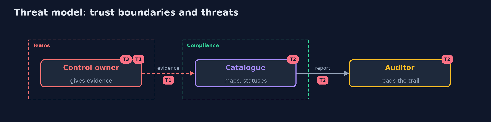

# Threat Model — Controls and Evidence

A threat model answers four questions: what are we protecting, who or what could harm it, how, and what do we do about it. This one covers this project's own demo system, not a production deployment. Domain: a bank.

## Scope

The evidence that the bank's controls work. It does not cover the controls themselves.

## What we protect (assets)

- The catalogue.
- The evidence files.
- The audit report.

## Who and what acts on the system

- A control owner who wants a green status.
- An auditor.
- A maintainer of the catalogue.

## Trust boundaries

A trust boundary is a line that data or a request crosses between parts that trust each other differently. Threats cluster where those lines are.

- The evidence folder: what is written there is trusted.

Each dashed box is a trust boundary. A rose tag such as T1 shows where the threat of that number, in the table below, applies.

## Threats, using STRIDE

STRIDE is a checklist of six kinds of threat: **Spoofing** (S), **Tampering** (T), **Repudiation** (R), **Information disclosure** (I), **Denial of service** (D), **Elevation of privilege** (E).

| Id | Kind | Threat | Where it shows up | Control in this project | What is left |
| --- | --- | --- | --- | --- | --- |
| T1 | Tampering | Evidence is edited to show a green status | the evidence files | Take the reports from the build, and review changes to the evidence folder | A weak test that always passes |
| T2 | Repudiation | An old result is shown as current | the report | Show the age, and make old evidence stale | Limits that are too generous |
| T3 | Information disclosure | A test report with an entity reads a file | the XML parser | Refuse a document type definition | Other parsers in the pipeline |

## Assumptions

- The test reports come from the build and are not edited by hand.

## Out of scope

- The correctness of the tests.
- Legal conclusions.

## How the tests check this

- `AssessorTest` checks the status rules, the catalogue and the parsing of test reports, including one that tries an external entity, with the JDK only.
- `DemoRunsTest` compares the whole demo with the golden output.

## Where this model goes next

The next project in the module is security-architecture-review.
