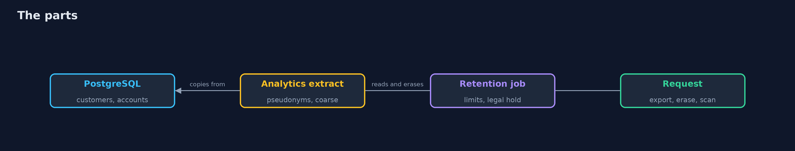
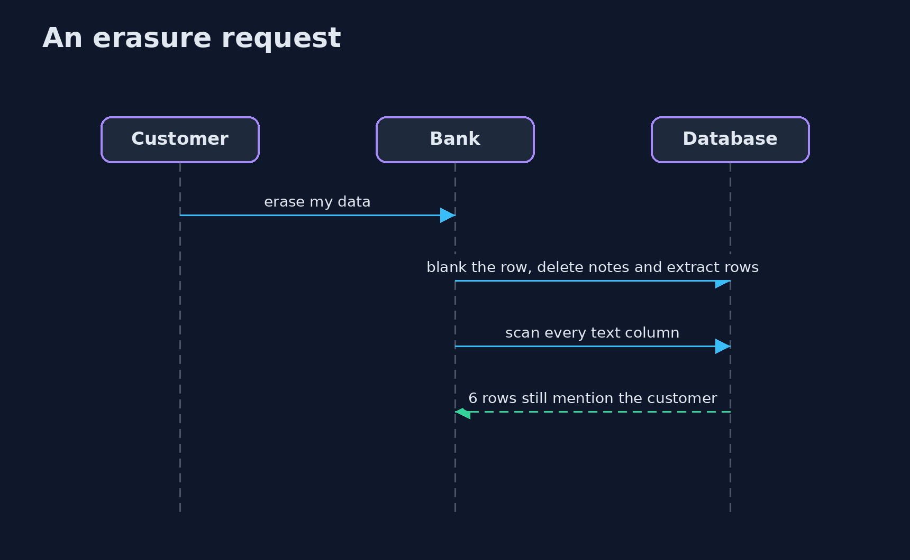

# Privacy Engineering

```
src/main/java/com/jk/explore/security/privacyeng/
├── Anonymity.java               How easily a person can be picked out by columns that are not names: postcode, birth date and gender
├── Pg.java                      PostgreSQL in a Docker container, started for the demo and removed at the end
├── PrivacyEngineeringDemo.java  
├── Pseudonyms.java              Keyed pseudonyms for analytics: the same customer always gets the same one under one key, and nobody can compute it without the key
├── Purposes.java                Why the bank holds each personal column of the customers table: the purposes and the columns each one needs
├── Retention.java               How long each kind of data may be kept, and the job that removes what has expired, except where a legal hold applies
├── Seed.java                    A made-up bank database: 2,000 customers with accounts, transactions and support notes, always the same because the generator is seeded
├── Sh.java                      Runs a program and returns what it printed, whether it worked or not
└── Subject.java                 A customer's request to see their data or to have it erased: the data map, the export, the erasure and the search for what remains
```

**A bank's PostgreSQL database of 2,000 customers collects 9 personal columns of which 7 are needed by a purpose and phone and gender by none; 99.8% of customers are alone in their group on postcode, birth date and gender, and an outside list names 1,398 of them from pseudonymized rows, but with the postcode cut to 3 digits and the birth date to its decade nobody is alone and the outside list names 0; a retention job deletes 9,643 old transactions, keeps 14 under a legal hold, withdraws 494 old consents and deletes 505 old notes, and does not touch 8,054 analytics rows from before the limit; an erasure request for one customer blanks their data and still leaves 6 rows in other people's notes and payments that mention them, found by a scan of every text column and scrubbed to 0.**

Privacy engineering turns the principles of data protection law into code and queries: collect what a purpose needs, keep it only as long as it is needed, make it hard to pick a person out of the data that is shared, and be able to find and erase everything about one person when they ask. This project does it in **PostgreSQL** (started in Docker) with a seeded database of **2,000 customers** with accounts, transactions and support notes, and measures each step. A Java program starts the database and runs the queries; the demo is tagged `integration`: `./gradlew integrationTest`.

What it shows:
- **Minimization.** 9 personal columns, **7** needed by one of 5 purposes; **phone** and **gender** are held for no purpose.
- **Who can be picked out.** **99.8%** of customers are alone in their group on postcode, birth date and gender; an outside list names **1,398** from pseudonymized rows. Cut the postcode to 3 digits and the birth date to its decade and nobody is alone and the list names **0**.
- **Pseudonyms.** Keyed HMAC pseudonyms: the same customer gets the same one under one key and another under a new key. A pseudonym is a name replaced, not a person hidden.
- **Retention.** The job deletes **9,643** transactions older than 7 years, keeps **14** under a legal hold, withdraws **494** old consents and deletes **505** notes, and does not reach **8,054** analytics rows.
- **A customer's request.** The data map is found from the schema; after erasure **6** rows in other people's notes and payments still mention the customer, until they are scrubbed.

**Maps to:** GDPR Articles 5 (minimization, storage limitation), 15 (access), 17 (erasure), 25 (data protection by design) and 32 · ISO/IEC 27701 · NIST Privacy Framework (CT.DM, CT.DP) · NIST SP 800-188 (de-identification).

## The idea in everyday terms

A library that keeps loan records. It asks only for what lending needs, throws old loans away on a schedule, and publishes reading statistics without names. When a reader asks to be forgotten it has to look in the card file, in the staff's notes and in the statistics, because the reader's name is on more cards than the reader's own.

## The scenario

A bank holds customer data in PostgreSQL, shares an analytics extract, and gets a request from a customer to see and then erase their data. The demo builds the database and measures each step.

## Run

```bash
./gradlew run
```

The demo tells the story in 5 acts, each printing exact numbers that the tests check:

| Act | What it shows |
| --- | --- |
| 1. What is collected, and why | 9 personal columns are collected and 7 are needed by a purpose; phone and gender have none. |
| 2. Who can be picked out | 99.8% of customers are alone in their group on postcode, birth date and gender; coarser values leave nobody alone. |
| 3. Pseudonyms for analytics | A keyed pseudonym is stable under one key and different under another; it replaces a name, it does not hide a person. |
| 4. Retention | The job deletes 9,643 old transactions and keeps 14 under a legal hold, but does not reach 8,054 analytics rows. |
| 5. A customer's request | After an erasure request, 6 rows in other people's notes and payments still mention the customer, until they are scrubbed. |

## Test

```bash
./gradlew test
```

11 tests in `DemoRunsTest`, `PrivacyDatabaseTest`, `PurposesPseudonymsSeedTest`. The purposes, the pseudonyms and the seed are tested with the JDK only; the database tests need Docker (./gradlew integrationTest).

## What the simulation got right, and what it left out

PostgreSQL is real and the data is made up by a seeded generator, so each run is the same. The identifiers are invented and match nobody. The demo prints counts, never names or numbers of customers.

## Technologies and versions

Every version below is pinned in the project's build files and was the latest stable release when the project was built.

| Technology | Version | Used for |
| --- | --- | --- |
| Java | 25 | the language and runtime; a Gradle toolchain finds or downloads the JDK |
| Gradle | 9.8.1 (wrapper) | build and run; nothing to install, the wrapper downloads it |
| org.postgresql:postgresql | 42.7.14 | library the code uses |
| org.junit.jupiter:junit-jupiter | 6.1.3, set by junit-bom | JUnit 5: the tests (tests only) |
| org.junit.platform:junit-platform-launcher | 6.1.3, set by junit-bom | JUnit platform launcher, which Gradle needs to run the tests (tests only) |
| videokit | repository tool (`tools/videokit`) | the narrated video and animation: Piper `en_US-amy-medium`, speed 0.8, longer pauses (the amy-slow voice) |

## Learning Material

| Document | What it is for |
| --- | --- |
| [Problem statement](docs/problem-statement.md) | the situation and what the project must show |
| [Prerequisites](docs/prerequisites.md) | what you need to know first |
| [Privacy Engineering, explained](docs/privacy-engineering-explained.md) | the acts in prose |
| [Session guide](docs/session.md) | a one-hour lesson with exercises |
| [Animated walkthrough](docs/animation.html) | the acts step by step, narrated |
| [Threat model](docs/threat-model.md) | what is protected, who could harm it, and how, using STRIDE |
| [Spec](docs/spec.md) | what this project must be true of |
| [Expected output](docs/expected-output.txt) | the golden demo output every test and every port checks against |

### The idea in one picture

Data is minimized, shared with care, retained, and erased on request.



### Where each piece sits

Purposes, anonymity and a customer's request.


### How the data moves

Erasure has to look in the copies and the free text.


### Who calls whom, in order




### Video

`video/privacy-engineering-explained.mp4` (with `.m4a` audio and `.srt` subtitles) is built by `video/build_video.sh`. Rendered media is not committed.

## What it costs

- **Coarser data is less useful** for analytics.
- **Retention jobs must know every copy,** or the copies outlive the source.
- **Erasure conflicts with the law** that requires a bank to keep records.
- **Free text hides personal data** that no schema describes.
- **Pseudonym keys become the new secret** to protect and rotate.

## When this is too much

A site that collects a name and an email for a newsletter needs a retention rule and a delete button, not k-anonymity. Use the measures here when data is shared for analytics, copied across systems, or held for years.

## Where you have already met this

- A column collected because it might be useful.
- A data extract with the name removed.
- A retention policy in a document and no job.
- An erasure request answered by deleting one row.

## Where this sits

This is the last project of the [governance-risk-and-compliance](..) module. It uses the keyed-hash idea of the cryptography modules for pseudonyms and the retention and evidence habits of [controls-and-evidence](../controls-and-evidence).
