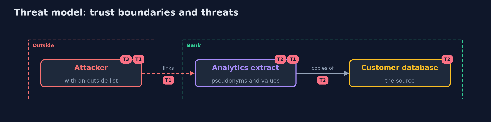

# Threat Model — Privacy Engineering

A threat model answers four questions: what are we protecting, who or what could harm it, how, and what do we do about it. This one covers this project's own demo system, not a production deployment. Domain: a bank.

## Scope

Personal data of customers in a database and the extracts made from it. It does not cover data in backups, logs or the minds of staff.

## What we protect (assets)

- Customer records.
- The analytics extract.
- The pseudonym key.

## Who and what acts on the system

- An analyst with the extract and an outside list.
- A customer who asks for erasure.
- An administrator who runs the retention job.

## Trust boundaries

A trust boundary is a line that data or a request crosses between parts that trust each other differently. Threats cluster where those lines are.

- The extract: what leaves the database.

Each dashed box is a trust boundary. A rose tag such as T1 shows where the threat of that number, in the table below, applies.

## Threats, using STRIDE

STRIDE is a checklist of six kinds of threat: **Spoofing** (S), **Tampering** (T), **Repudiation** (R), **Information disclosure** (I), **Denial of service** (D), **Elevation of privilege** (E).

| Id | Kind | Threat | Where it shows up | Control in this project | What is left |
| --- | --- | --- | --- | --- | --- |
| T1 | Information disclosure | People are named from a pseudonymized extract | the extract | Coarsen the values and measure the smallest group | Other outside data sets |
| T2 | Repudiation | A copy outlives the source | the extract and the notes | A data map from the schema; retention that reaches every copy | Copies outside the database |
| T3 | Information disclosure | The pseudonym key leaks | the key | Keep the key apart and rotate it; re-pseudonymize | Data already shared |

## Assumptions

- The outside list is public or purchasable.

## Out of scope

- Backups.
- Log files.

## How the tests check this

- `PurposesPseudonymsSeedTest` checks purposes, pseudonyms and the seed with the JDK only; `PrivacyDatabaseTest` checks the data map, retention, erasure and anonymity on PostgreSQL (integrationTest).
- `DemoRunsTest` compares the whole demo with the golden output.

## Where this model goes next

This is the last project of the module.
