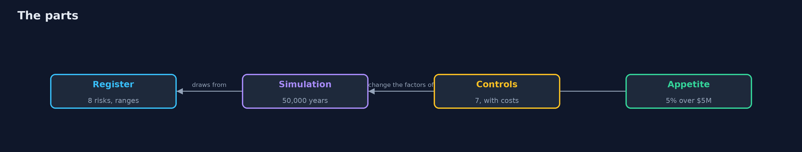
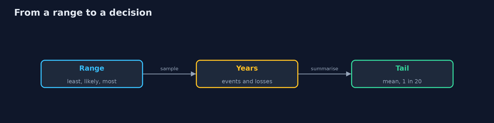
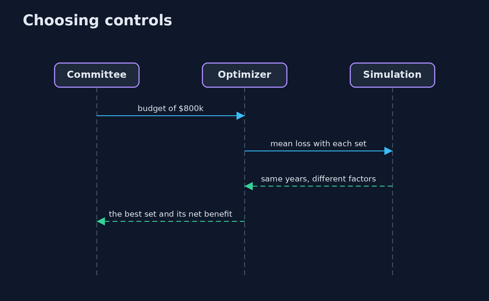

# Risk Management

```
src/main/java/com/jk/explore/security/riskmgmt/
├── Control.java             A treatment: what it costs a year, and for each risk it touches the factors by which it multiplies the frequency and the loss of an event
├── Optimizer.java           Chooses the set of controls that gives the largest net benefit (the loss avoided minus what the controls cost) within a budget, by trying every set
├── Register.java            The bank's register and its controls: made-up numbers in dollars, with ranges, the way an assessment workshop would produce them
├── Risk.java                A line of the register: how often it happens in a year, how much one event costs, and the 1 to 5 scores a heat map would use
├── RiskManagementDemo.java  
├── Simulation.java          Monte Carlo over years
└── Tri.java                 A three-point estimate (the least, the most likely and the most that an expert will say) as a triangular distribution
```

**A bank's register of 8 risks, each with a range for how often it happens and what it costs, is simulated for 50,000 years: the heat map's top three share only 1 of 3 risks with the top three by expected loss; the whole register has an expected loss of $5.8M a year, 1 year in 20 loses more than $16.8M, and the chance of losing more than $5.0M in a year is 41.4%, against an appetite of 5%; the best set of controls within an $800k budget (backups, multi-factor login, vendor assessments and dual approval, $610k) cuts the expected loss to $3.1M and beats the cheapest-first set by $581k a year, but still leaves a 19.5% chance over the appetite; only all 7 controls ($1.7M) bring it to 4.1%.**

A risk register with a heat map says which risks look big; it does not say how much money is at stake, what a control is worth, or whether the bank is inside its appetite. This project keeps the register as ranges, a least, a most likely and a most value for how often a risk happens in a year and for what one event costs, and simulates **50,000 years** of events in Java (a seeded Monte Carlo, in the spirit of FAIR). It then picks controls within a budget by trying every set, and checks the residual risk against a stated appetite. It needs only the JDK; `./gradlew test`, then `./gradlew run`.

What it shows:
- **Heat map against money.** The top three risks by likelihood times impact share only **1 of 3** with the top three by expected loss.
- **The whole register.** Expected loss **$5.8M** a year, **1 year in 20** loses more than **$16.8M**, and the chance of losing more than $5.0M in a year is **41.4%**; 1,000 years give an estimate 0.9% away.
- **Treatment.** Within **$800k** the best set of four controls costs **$610k**, cuts the expected loss to **$3.1M**, and beats cheapest-first by **$581k** a year.
- **Appetite.** After the best set the chance over the appetite is **19.5%** against 5%; only all seven controls (**$1.7M**) give **4.1%**.
- **The bill.** The inputs are an expert's ranges, the risks are taken as independent, and a number is easy to trust too much.

**Maps to:** NIST CSF 2.0 Govern (GV.RM risk management strategy) · ISO/IEC 27005 · FAIR (Factor Analysis of Information Risk) · NIST SP 800-30 and 800-39.

## The idea in everyday terms

A weather forecast against a calendar saying that Tuesday is usually grey. The calendar ranks days. The forecast says how likely rain is, how much, and whether you should carry an umbrella that costs something to carry. Neither knows about the storm that nobody has seen before.

## The scenario

A bank's risk committee has eight risks, seven possible controls and a budget of $800k, and wants to know what the money buys. The demo turns the register into ranges, simulates years, and compares treatments.

## Run

```bash
./gradlew run
```

The demo tells the story in 5 acts, each printing exact numbers that the tests check:

| Act | What it shows |
| --- | --- |
| 1. Heat map against money | The top three risks by score share only 1 of 3 with the top three by expected loss. |
| 2. The whole register | The expected loss is $5.8M a year, 1 year in 20 loses more than $16.8M, and 41.4% of years lose more than $5.0M. |
| 3. Controls within a budget | The best set within $800k costs $610k and beats cheapest first by $581k a year. |
| 4. Appetite and what is left | After the best set the chance of losing more than $5.0M is 19.5% against an appetite of 5%; all seven controls give 4.1%. |
| 5. The bill | The inputs are ranges from a workshop, the risks are independent here, and a number is easy to trust too much. |

## Test

```bash
./gradlew test
```

15 tests in `DemoRunsTest`, `OptimizerTest`, `SimulationTest`. The distributions, the simulation, the optimizer and the register are tested with the JDK only. The demo is compared with its golden output.

## What the simulation got right, and what it left out

The simulation is real and seeded, so every run gives the same numbers. The register, the ranges and the costs are made up for a bank and are not data about any real organisation.

## Technologies and versions

Every version below is pinned in the project's build files and was the latest stable release when the project was built.

| Technology | Version | Used for |
| --- | --- | --- |
| Java | 25 | the language and runtime; a Gradle toolchain finds or downloads the JDK |
| Gradle | 9.8.1 (wrapper) | build and run; nothing to install, the wrapper downloads it |
| org.junit.jupiter:junit-jupiter | 6.1.3, set by junit-bom | JUnit 5: the tests (tests only) |
| org.junit.platform:junit-platform-launcher | 6.1.3, set by junit-bom | JUnit platform launcher, which Gradle needs to run the tests (tests only) |
| videokit | repository tool (`tools/videokit`) | the narrated video and animation: Piper `en_US-amy-medium`, speed 0.8, longer pauses (the amy-slow voice) |

## Learning Material

| Document | What it is for |
| --- | --- |
| [Problem statement](docs/problem-statement.md) | the situation and what the project must show |
| [Prerequisites](docs/prerequisites.md) | what you need to know first |
| [Risk Management, explained](docs/risk-management-explained.md) | the acts in prose |
| [Session guide](docs/session.md) | a one-hour lesson with exercises |
| [Animated walkthrough](docs/animation.html) | the acts step by step, narrated |
| [Threat model](docs/threat-model.md) | what is protected, who could harm it, and how, using STRIDE |
| [Spec](docs/spec.md) | what this project must be true of |
| [Expected output](docs/expected-output.txt) | the golden demo output every test and every port checks against |

### The idea in one picture

A register becomes simulated years, and controls change them.



### Where each piece sits

A risk, the years and the choice.


### How the data moves

Ranges become years, years become a tail.



### Who calls whom, in order




### Video

`video/risk-management-explained.mp4` (with `.m4a` audio and `.srt` subtitles) is built by `video/build_video.sh`. Rendered media is not committed.

## What it costs

- **The inputs are guesses with ranges,** and the output inherits them.
- **Independence is assumed;** real incidents arrive together.
- **A number looks more certain than it is.**
- **Workshops to agree ranges take time** and argument.
- **A model cannot know the incident nobody has imagined.**

## When this is too much

A small company with a handful of risks can use a heat map and a conversation. Quantify when money is being chosen between controls, when a board asks how much, or when the appetite is stated as a number.

## Where you have already met this

- A heat map where everything is amber.
- A control bought because a peer bought it.
- A risk register updated once a year.
- An appetite statement with no number in it.

## Where this sits

This is a project of the [governance-risk-and-compliance](..) module. The controls it prices are the kinds built in the earlier modules: backups, segmentation, multi-factor login and tokenization.
