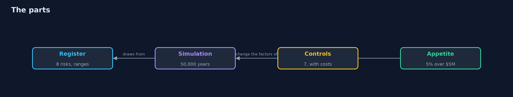
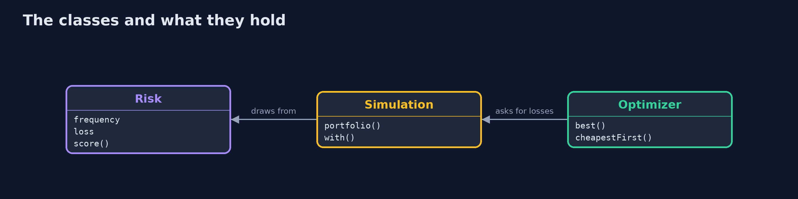
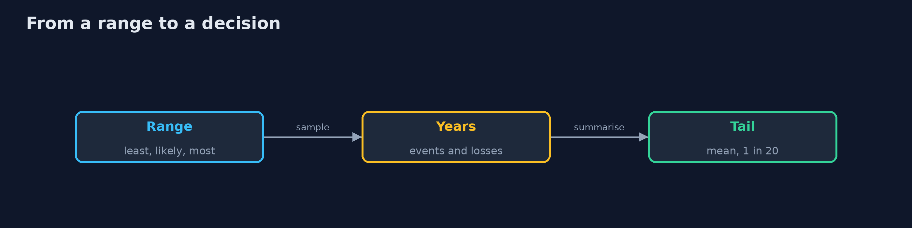
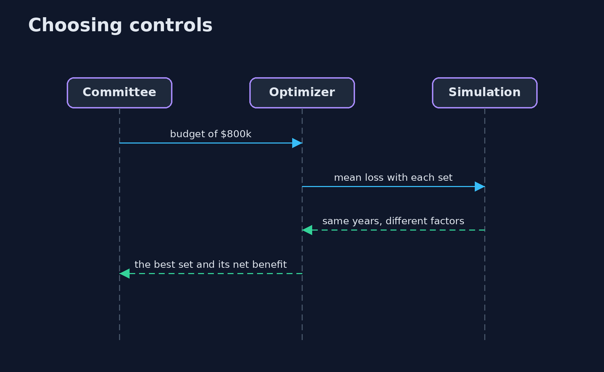

# Risk Management

```
src/main/java/com/jk/explore/security/riskmgmt/
├── Control.java             A treatment: what it costs a year, and for each risk it touches the factors by which it multiplies the frequency and the loss of an event
├── Optimizer.java           Chooses the set of controls that gives the largest net benefit (the loss avoided minus what the controls cost) within a budget, by trying every set
├── Register.java            The bank's register and its controls: made-up numbers in dollars, with ranges, the way an assessment workshop would produce them
├── Risk.java                A line of the register: how often it happens in a year, how much one event costs, and the 1 to 5 scores a heat map would use
├── RiskManagementDemo.java  Prints the five acts
├── Simulation.java          Monte Carlo over years
├── Tri.java                 A three-point estimate (the least, the most likely and the most that an expert will say) as a triangular distribution
└── YearSteps.java           A teaching class: one simulated year of one risk, redone by hand from the same draws the simulation keeps
```

**A bank's register of 8 risks, each with two ranges (how often, how much), is simulated for 50,000 years: ransomware alone, worked out by hand, costs $1.8M a year on average while 79.7% of years see none; the heat map's top three share only 1 of 3 with the top three by money; the whole register loses $5.8M in an average year, but 1 year in 20 loses more than $16.8M and 41.4% of years lose more than $5.0M; the best of 56 sets of controls within an $800k budget costs $610k and gains $2.1M a year, $581k more than buying the cheapest first, yet still leaves 19.5% of years over the board's appetite of 5%; only all 7 controls ($1.7M) reach 4.1%.**

A risk register with a heat map says which risks look big; it does not say how much money is at stake, what a control is worth, or whether the bank is inside its appetite. This project keeps the register as ranges, a least, a most likely and a most value for how often a risk happens in a year and for what one event costs, and simulates **50,000 years** of events in Java (a seeded Monte Carlo, in the spirit of FAIR). It then picks controls within a budget by trying every set, and checks the residual risk against a stated appetite. It needs only the JDK; `./gradlew test`, then `./gradlew run`.

What it shows:
- **One risk by hand.** Ransomware's ranges average 0.233 events and $7.8M an event: **$1.8M** a year. One simulated year is worked out from its three draws, and **79.7%** of years see no ransomware at all.
- **Heat map against money.** The top three risks by likelihood times impact share only **1 of 3** with the top three by expected loss.
- **The whole register.** Expected loss **$5.8M** a year, **1 year in 20** loses more than **$16.8M**, and the chance of losing more than $5.0M in a year is **41.4%**; 1,000 years give an estimate 0.9% away.
- **Treatment.** Of the 127 sets of seven controls, 56 fit **$800k**; the best, four controls, costs **$610k**, cuts the expected loss to **$3.1M**, and beats cheapest-first by **$581k** a year.
- **Appetite.** After the best set the chance over the appetite is **19.5%** against 5%; only all seven controls (**$1.7M**) give **4.1%**.
- **The bill.** The inputs are an expert's ranges, the risks are taken as independent, and a number is easy to trust too much.

**Maps to:** NIST CSF 2.0 Govern (GV.RM risk management strategy) · ISO/IEC 27005 · FAIR (Factor Analysis of Information Risk) · NIST SP 800-30 and 800-39.

## The idea in everyday terms

A weather forecast against a calendar saying that Tuesday is usually grey. The calendar ranks days. The forecast says how likely rain is, how much, and whether you should carry an umbrella that costs something to carry. Neither knows about the storm that nobody has seen before.

## The scenario

A bank's risk committee has eight risks, seven possible controls and a budget of $800k, and wants to know what the money buys. The demo turns the register into ranges, simulates years, and compares treatments.

## Run

```bash
./gradlew run
```

The demo tells the story in 5 acts, each printing exact numbers that the tests check:

| Act | What it shows |
| --- | --- |
| 1. One risk, from ranges to money | Ransomware is three-point ranges: 0.05, 0.15 and 0.5 events a year, and $500k, $3.0M and $20.0M for one event. Their averages, 0.233 and $7.8M, give an expected loss of $1.8M a year. Year 11 is worked out by hand from its three draws: 0.348 events a year, 1 event, a loss of $3.0M. Over 50,000 years, 79.7% have no ransomware at all. |
| 2. The register: the heat map against money | Eight risks are scored on a heat map and simulated as money. The top three by score (card-breach, insider-fraud, outage) share only 1 of 3 with the top three by expected loss (ransomware $1.8M, third-party $1.0M, card-breach $920k). |
| 3. The whole register: the bad years | Adding the eight risks year by year gives an expected loss of $5.8M (the eight averages also add to $5.8M), but 1 year in 10 loses more than $12.8M, 1 in 20 more than $16.8M, and 41.4% of years lose more than $5.0M. A ransomware loss 50% more likely to be large moves the total by $116k, as 0.233 x $1.5M / 3 predicts. |
| 4. Controls within a budget | Seven controls each lower how often or how much. Of the 127 possible sets, 56 fit the $800k budget; the best (backups, mfa, vendors, approval) costs $610k, cuts the expected loss from $5.8M to $3.1M and gains $2.1M a year. Buying the cheapest first gains $1.5M: $581k a year less. |
| 5. The appetite, and what is left | The board's appetite allows at most 5.0% of years to lose more than $5.0M. Before any control 41.4% do; after the best set 19.5% (outside), with a residual 1 in 20 year over $8.4M; only all seven controls, $1.7M, reach 4.1% (within), $910k over the budget. |

## Test

```bash
./gradlew test
```

20 tests in `DemoRunsTest`, `OptimizerTest`, `SimulationTest`, `YearStepsTest`. The distributions, the simulation, the hand-worked year (`YearSteps`, proved equal to the simulation for every risk and year), the optimizer and the register are tested with the JDK only. The simulation is seeded and uses `StrictMath`, so the demo prints the same text on every run and machine, and it is compared with its golden output.

## What the simulation got right, and what it left out

The simulation is real and seeded, so every run gives the same numbers. The register, the ranges and the costs are made up for a bank and are not data about any real organisation.

## Technologies and versions

Every version below is pinned in the project's build files and was the latest stable release when the project was built.

| Technology | Version | Used for |
| --- | --- | --- |
| Java | 25 | the language and runtime; a Gradle toolchain finds or downloads the JDK |
| Gradle | 9.8.1 (wrapper) | build and run; nothing to install, the wrapper downloads it |
| org.junit.jupiter:junit-jupiter | 6.1.3, set by junit-bom | JUnit 5: the tests (tests only) |
| org.junit.platform:junit-platform-launcher | 6.1.3, set by junit-bom | JUnit platform launcher, which Gradle needs to run the tests (tests only) |
| videokit | repository tool (`tools/videokit`) | the narrated video and animation: Piper `en_US-amy-medium`, speed 0.8, longer pauses (the amy-slow voice) |

## Learning Material

| Document | What it is for |
| --- | --- |
| [Problem statement](docs/problem-statement.md) | the situation and what the project must show |
| [Prerequisites](docs/prerequisites.md) | what you need to know first |
| [Risk Management, explained](docs/risk-management-explained.md) | the acts in prose |
| [Session guide](docs/session.md) | a one-hour lesson with exercises |
| [Animated walkthrough](docs/animation.html) | the acts step by step, narrated |
| [Threat model](docs/threat-model.md) | what is protected, who could harm it, and how, using STRIDE |
| [Spec](docs/spec.md) | what this project must be true of |
| [Expected output](docs/expected-output.txt) | the golden demo output every test and every port checks against |

### The idea in one picture

A register becomes simulated years, and controls change them.



### Where each piece sits

A risk, the years and the choice.



### How the data moves

Ranges become years, years become a tail.



### Who calls whom, in order




### Video

`video/risk-management-explained.mp4` (with `.m4a` audio and `.srt` subtitles) is built by `video/build_video.sh`. Rendered media is not committed.

## What it costs

- **The inputs are guesses with ranges,** and the output inherits them.
- **Independence is assumed;** real incidents arrive together.
- **A number looks more certain than it is.**
- **Workshops to agree ranges take time** and argument.
- **A model cannot know the incident nobody has imagined.**

## When this is too much

A small company with a handful of risks can use a heat map and a conversation. Quantify when money is being chosen between controls, when a board asks how much, or when the appetite is stated as a number.

## Where you have already met this

- A heat map where everything is amber.
- A control bought because a peer bought it.
- A risk register updated once a year.
- An appetite statement with no number in it.

## Where this sits

This is a project of the [governance-risk-and-compliance](..) module. The controls it prices are the kinds built in the earlier modules: backups, segmentation, multi-factor login and tokenization.
