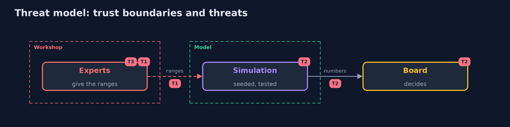

# Threat Model — Risk Management

A threat model answers four questions: what are we protecting, who or what could harm it, how, and what do we do about it. This one covers this project's own demo system, not a production deployment. Domain: a bank.

## Scope

The use of a risk model to decide where to spend a security budget. It does not cover the controls' own correctness.

## What we protect (assets)

- The risk register.
- The budget decision.

## Who and what acts on the system

- Experts who give the ranges.
- A committee that reads one number.
- A person who wants a control funded.

## Trust boundaries

A trust boundary is a line that data or a request crosses between parts that trust each other differently. Threats cluster where those lines are.

- The workshop: inputs enter the model here.

Each dashed box is a trust boundary. A rose tag such as T1 shows where the threat of that number, in the table below, applies.

## Threats, using STRIDE

STRIDE is a checklist of six kinds of threat: **Spoofing** (S), **Tampering** (T), **Repudiation** (R), **Information disclosure** (I), **Denial of service** (D), **Elevation of privilege** (E).

| Id | Kind | Threat | Where it shows up | Control in this project | What is left |
| --- | --- | --- | --- | --- | --- |
| T1 | Tampering | Ranges are chosen to get a control funded | the workshop | Record who gave each range, and show the sensitivity | Honest but wrong experts |
| T2 | Information disclosure | One number is trusted without its range | the report | Show the tail and the range with the mean | A reader who skips them |
| T3 | Repudiation | A decision cannot be explained later | the register | Keep the register, the seed and the inputs under version control | Decisions made outside the model |

## Assumptions

- The ranges are honest; the risks are independent.

## Out of scope

- Incidents nobody has imagined.
- Regulatory fines beyond the loss ranges.

## How the tests check this

- `SimulationTest` and `OptimizerTest` check the distributions, the simulation, the optimizer and the register with the JDK only.
- `DemoRunsTest` compares the whole demo with the golden output.

## Where this model goes next

The next project in the module is controls-and-evidence.
