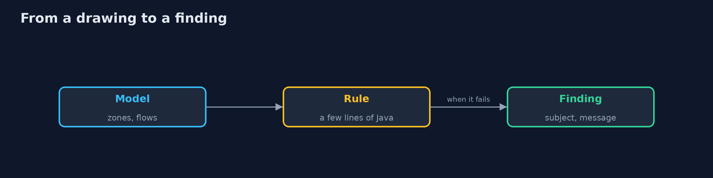

# Security Architecture Review

```
src/main/java/com/jk/explore/security/archreview/
├── Adr.java                     The architecture decision records of a design: a number, a title and a status
├── ArchitectureReviewDemo.java  
├── Design.java                  A design read from a Structurizr DSL file: the parts with their zone and properties, and the flows between them
├── Finding.java                 What a rule reports: the rule, the part or flow it is about, and a sentence
├── Planted.java                 A weakness put in the first design on purpose: what it is, which rule should report it and on what
└── Rules.java                   The review rules, each a few lines of Java over the design: trust zones, flows, data stores, owners and decisions
```

**A bank's online banking design is written in the Structurizr DSL with 9 parts in 6 trust zones and 9 flows, 8 of them crossing a zone, and 4 decision records of which 2 are accepted; 65 STRIDE questions follow from its parts and flows; 10 weaknesses are planted in it: the first 8 rules report 8 of the 10, the ninth rule (every flow encrypted and authenticated) reports 9 of 10, and the tenth, a web application that trusts a hidden form field, is in no model and needs a person; the reviewed design has 0 findings, no path from the web zone to confidential data, and 4 of 4 decisions accepted.**

A security review of a design asks where the trust boundaries are, which flows cross them, what the data stores hold and who decided what. This project writes a bank's online banking design in the **Structurizr DSL** (the C4 model as text), reads it in Java with the Structurizr library, and runs **rules** over it: a flow between zones must be encrypted and authenticated, nothing in the web zone may reach confidential data directly, confidential data must be encrypted at rest, every part has an owner, and every decision a part rests on is an **accepted** architecture decision record. Ten weaknesses are planted in the first design, so the rules can be scored. `./gradlew test`, then `./gradlew run`.

What it shows:
- **The design as drawn.** 9 parts, 9 flows in 6 zones (8 cross a zone), 4 decision records (2 accepted), and **65** STRIDE questions that follow from the kinds of its parts and flows.
- **Rules over the design.** The first 8 rules report **8 of 10** planted weaknesses; one more rule, every flow encrypted and authenticated, gets **9 of 10**.
- **What no rule finds.** A web application that trusts a hidden form field is not in the model; a person has to ask.
- **The reviewed design.** **0** findings, no path from the web zone to confidential data, **4 of 4** decisions accepted.
- **The bill.** Rules read the model, and the model is what the team drew.

**Maps to:** NIST CSF 2.0 ID.RA and GV.RM · OWASP Threat Modeling · STRIDE · NIST SP 800-160 (systems security engineering) · C4 model and ADRs (Nygard).

## The idea in everyday terms

An architect's plan check before building starts. A checker can measure that every fire door opens outward and every corridor is wide enough, because those are in the drawing. It cannot see that the builder will prop a door open with a brick, which nobody drew.

## The scenario

A bank's team has drawn the architecture of its online banking in a text file and recorded its decisions. A review has to find what is wrong before the system is built. The demo plants ten weaknesses and counts what the rules find.

## Run

```bash
./gradlew run
```

The demo tells the story in 5 acts, each printing exact numbers that the tests check:

| Act | What it shows |
| --- | --- |
| 1. The design as drawn | 9 parts, 9 flows in 6 zones, 4 decision records, and 65 STRIDE questions that follow from them. |
| 2. Rules over the design | The first 8 rules report 8 of the 10 planted weaknesses. |
| 3. One more rule | A rule that wants every flow encrypted and authenticated finds the internal ledger calls: 9 of 10. |
| 4. The reviewed design | After the review the design has 0 findings, no path from the web zone to confidential data, and 4 of 4 decisions accepted. |
| 5. The bill | Rules read the model, and the model is what the team drew; a design with no findings is not a safe one. |

## Test

```bash
./gradlew test
```

11 tests in `DemoRunsTest`, `ReviewTest`. The parsing, the rules, the decision records and the scoring are tested with the JDK and the Structurizr library only. The demo is compared with its golden output.

## What the simulation got right, and what it left out

The design, the zones and the decision records are made up for a bank. The Structurizr parser is the real library, and the rules are small Java methods over the model.

## Technologies and versions

Every version below is pinned in the project's build files and was the latest stable release when the project was built.

| Technology | Version | Used for |
| --- | --- | --- |
| Java | 25 | the language and runtime; a Gradle toolchain finds or downloads the JDK |
| Gradle | 9.8.1 (wrapper) | build and run; nothing to install, the wrapper downloads it |
| com.structurizr:structurizr-dsl | 6.2.3 | library the code uses |
| org.junit.jupiter:junit-jupiter | 6.1.3, set by junit-bom | JUnit 5: the tests (tests only) |
| org.junit.platform:junit-platform-launcher | 6.1.3, set by junit-bom | JUnit platform launcher, which Gradle needs to run the tests (tests only) |
| videokit | repository tool (`tools/videokit`) | the narrated video and animation: Piper `en_US-amy-medium`, speed 0.8, longer pauses (the amy-slow voice) |

## Learning Material

| Document | What it is for |
| --- | --- |
| [Problem statement](docs/problem-statement.md) | the situation and what the project must show |
| [Prerequisites](docs/prerequisites.md) | what you need to know first |
| [Security Architecture Review, explained](docs/security-architecture-review-explained.md) | the acts in prose |
| [Session guide](docs/session.md) | a one-hour lesson with exercises |
| [Animated walkthrough](docs/animation.html) | the acts step by step, narrated |
| [Threat model](docs/threat-model.md) | what is protected, who could harm it, and how, using STRIDE |
| [Spec](docs/spec.md) | what this project must be true of |
| [Expected output](docs/expected-output.txt) | the golden demo output every test and every port checks against |

### The idea in one picture

A design and its decisions are read by rules.


### Where each piece sits

The design, the rules and the truth.


### How the data moves

Zones and properties make rules possible.



### Who calls whom, in order


### Video

`video/security-architecture-review-explained.mp4` (with `.m4a` audio and `.srt` subtitles) is built by `video/build_video.sh`. Rendered media is not committed.

## What it costs

- **The model must be kept up to date,** or the review reviews a story.
- **Rules find what is in the model,** not what was left out.
- **Properties such as zone and owner must be filled in** by the team.
- **Decision records need discipline** to stay current.
- **A tool-generated list of questions is long** and needs people to answer.

## When this is too much

A one-page application with one database does not need a modelled review. Use it when several teams build parts of a system, when data is confidential, or when a regulator asks to see the design decisions.

## Where you have already met this

- A diagram on a whiteboard photographed once.
- A design document nobody has opened since approval.
- A decision made in chat and never written down.
- A review that checks the diagram but not the code.

## Where this sits

This is a project of the [governance-risk-and-compliance](..) module, with [risk-management](../risk-management) and [controls-and-evidence](../controls-and-evidence). The rules here are the design-time counterpart of the network and admission policies built earlier.
