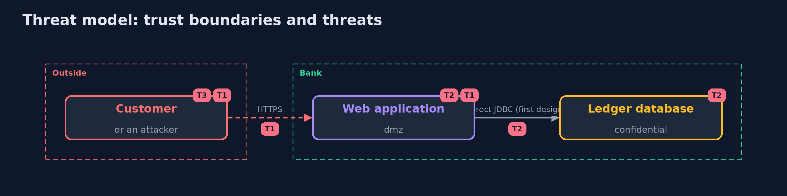

# Threat Model — Security Architecture Review

A threat model answers four questions: what are we protecting, who or what could harm it, how, and what do we do about it. This one covers this project's own demo system, not a production deployment. Domain: a bank.

## Scope

The design of the online banking system, as modelled. It does not cover the code or the running system.

## What we protect (assets)

- The ledger.
- The sessions.
- The decision records.

## Who and what acts on the system

- A developer who adds a flow.
- An attacker who reaches the web zone.
- A reviewer.

## Trust boundaries

A trust boundary is a line that data or a request crosses between parts that trust each other differently. Threats cluster where those lines are.

- The trust zones: internet, dmz, app, data, office and external.

Each dashed box is a trust boundary. A rose tag such as T1 shows where the threat of that number, in the table below, applies.

## Threats, using STRIDE

STRIDE is a checklist of six kinds of threat: **Spoofing** (S), **Tampering** (T), **Repudiation** (R), **Information disclosure** (I), **Denial of service** (D), **Elevation of privilege** (E).

| Id | Kind | Threat | Where it shows up | Control in this project | What is left |
| --- | --- | --- | --- | --- | --- |
| T1 | Elevation of privilege | An attacker in the web zone reaches confidential data | the flows | A rule against direct paths to data; calls go through an API that authenticates | Flaws in the API |
| T2 | Information disclosure | A flow or a store exposes data unencrypted | flows and stores | Rules for encryption in transit and at rest | Data in memory |
| T3 | Repudiation | A decision is forgotten or overturned without record | the decision records | A rule that a part rests on an accepted record | Records that are accepted but wrong |

## Assumptions

- The model matches what is built.

## Out of scope

- Implementation bugs.
- Supply chain.

## How the tests check this

- `ReviewTest` checks the parsing, the rules, the decision records and the scoring with the JDK and the Structurizr library.
- `DemoRunsTest` compares the whole demo with the golden output.

## Where this model goes next

The next project in the module is privacy-engineering.
