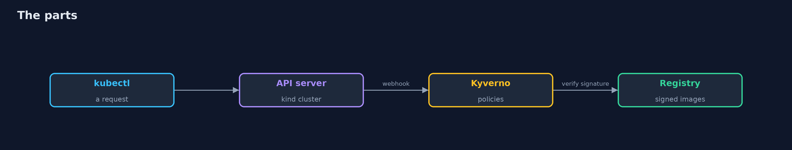
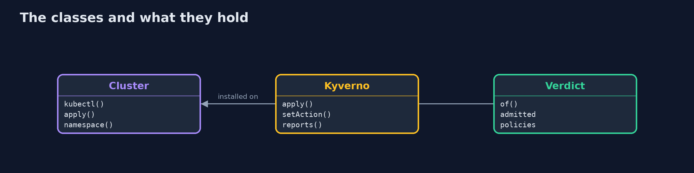
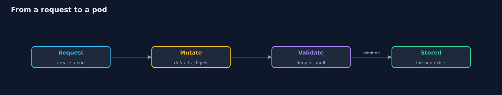
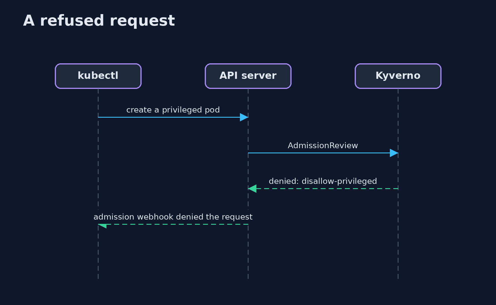

# Kubernetes Admission Control

```
src/main/java/com/jk/explore/security/k8sadmission/
├── Cluster.java                         A real Kubernetes cluster made by kind (one node, itself a container), with its own kubeconfig file, deleted on close
├── KubernetesAdmissionControlDemo.java  
├── Kyverno.java                         Kyverno, an admission controller, installed from its release manifest, and the bank's policies applied from the policies/ folder
├── Pods.java                            Pod and Deployment manifests for the requests, built as text
├── Registry.java                        A local image registry (a container on kind's Docker network), the bank's cosign key, and images pushed and signed in it
├── Sh.java                              Runs a program and returns what it printed, whether it worked or not
└── Verdict.java                         What the API server said to a request: admitted, or refused by which policies
```

**A real cluster (kind) with Kyverno as its admission controller refuses 6 of 10 requests for a bank's payments namespace, each by name (privileged, no limits, another registry, an image nobody signed with the bank's cosign key, and a Deployment checked through its pods); a signed image named by a tag is admitted and its tag is replaced by the digest that was signed; a rule starts in audit mode, the policy report shows the writable root filesystem and a privileged pod that was running before any policy, and the same rule then refuses a new pod; an exception for one pod is honoured only from the kyverno namespace and only until its date (1 of 4 requests admitted); and with the admission controller stopped Kyverno removes its webhooks (0 left) and the API server stops asking anyone.**

A request to create a pod passes the API server's authentication and authorization, and then the **admission controllers**: the last gate before the workload exists. This project runs a real cluster with **kind**, installs **Kyverno** (v1.19.2) as the admission controller and applies a bank's policies written in CEL. A Java program makes the cluster, a local registry and the bank's cosign key, and sends the requests (`brew install kind kubectl cosign`, Docker running); the demo makes a cluster, so it is tagged `integration`: `./gradlew integrationTest`. The policies are in [`policies/`](policies).

What it shows:
- **Policies that refuse.** Ten requests to a labelled namespace: **6 are refused**, each by the policies that name the reason (privileged, no limits, another registry, an image nobody signed); a privileged pod in a namespace without the label is admitted.
- **Audit first.** A privileged pod that was running before the policies keeps running. A rule in audit mode admits a writable root filesystem, the **policy report** lists it, and when the rule becomes a denial the next such pod is refused.
- **Mutation and signed images.** A pod that said nothing gets `allowPrivilegeEscalation: false`; the tag of a signed image is replaced by the **digest** that was signed; an image nobody signed is refused.
- **Exceptions.** One named pod may break one rule until a date, from the `kyverno` namespace only: **1 of 4** requests is admitted.
- **The bill.** With the admission controller stopped Kyverno removes its webhooks (**0 left**) and the API server admits what it is given.

**Maps to:** NIST CSF 2.0 Protect (PR.PS) · NIST SP 800-53 CM-7, CM-14 · CIS Kubernetes Benchmark 5.2 · Pod Security Standards · SLSA and signed images.

## The idea in everyday terms

A building's front desk. Every visitor is asked who they are, whether they may enter this floor, and then the desk checks the bag. The desk can also hand out a badge with the right colour. But it only sees people arriving: someone already inside is not checked, and if the desk is empty nobody is asked.

## The scenario

A bank runs its payments namespace on Kubernetes and wants no privileged pod, no pod without limits and no image that was not signed by its own build to be created there. The demo creates a real cluster and sends it good and bad requests.

## Run

```bash
./gradlew run
```

The demo tells the story in 5 acts, each printing exact numbers that the tests check:

| Act | What it shows |
| --- | --- |
| 1. Policies that refuse | Ten requests to a labelled namespace: 6 are refused, each by the policies that name the reason, and 4 are admitted. |
| 2. Audit first, then deny | A privileged pod that was running before the policies keeps running; the policy report lists it, and a new rule refuses only new pods once it is switched to deny. |
| 3. Mutation and signed images | A pod that said nothing gets allowPrivilegeEscalation false, and the tag of a signed image is replaced by its digest. |
| 4. Exceptions | An exception for one named pod is honoured from the kyverno namespace until its date, and in no other case. |
| 5. The bill | With the admission controller stopped, 0 policy webhooks are left and the API server admits what it is given. |

## Test

```bash
./gradlew test
```

12 tests in `DemoRunsTest`, `PodsAndPoliciesTest`, `VerdictTest`. The requests, the verdicts and the policy files are tested with no tools. The demo makes a cluster (./gradlew integrationTest).

## What the simulation got right, and what it left out

The cluster, Kyverno, the registry and the signatures are real. Only the images are tiny, built for the demo. The demo prints decisions and counts, never addresses, ids or timestamps.

## Technologies and versions

Every version below is pinned in the project's build files and was the latest stable release when the project was built.

| Technology | Version | Used for |
| --- | --- | --- |
| Java | 25 | the language and runtime; a Gradle toolchain finds or downloads the JDK |
| Gradle | 9.8.1 (wrapper) | build and run; nothing to install, the wrapper downloads it |
| tools.jackson.core:jackson-databind | 3.1.5 | library the code uses |
| org.junit.jupiter:junit-jupiter | 6.1.3, set by junit-bom | JUnit 5: the tests (tests only) |
| org.junit.platform:junit-platform-launcher | 6.1.3, set by junit-bom | JUnit platform launcher, which Gradle needs to run the tests (tests only) |
| videokit | repository tool (`tools/videokit`) | the narrated video and animation: Piper `en_US-amy-medium`, speed 0.8, longer pauses (the amy-slow voice) |

## Learning Material

| Document | What it is for |
| --- | --- |
| [Problem statement](docs/problem-statement.md) | the situation and what the project must show |
| [Prerequisites](docs/prerequisites.md) | what you need to know first |
| [Kubernetes Admission Control, explained](docs/kubernetes-admission-control-explained.md) | the acts in prose |
| [Session guide](docs/session.md) | a one-hour lesson with exercises |
| [Animated walkthrough](docs/animation.html) | the acts step by step, narrated |
| [Threat model](docs/threat-model.md) | what is protected, who could harm it, and how, using STRIDE |
| [Spec](docs/spec.md) | what this project must be true of |
| [Expected output](docs/expected-output.txt) | the golden demo output every test and every port checks against |

### The idea in one picture

The API server asks Kyverno before a pod exists.



### Where each piece sits

A cluster, the controller on it, and the answers.



### How the data moves

Mutation comes before validation.



### Who calls whom, in order




### Video

`video/kubernetes-admission-control-explained.mp4` (with `.m4a` audio and `.srt` subtitles) is built by `video/build_video.sh`. Rendered media is not committed.

## What it costs

- **An engine in the path of every request;** when it is down, its webhooks are gone and nothing is checked.
- **Admission sees requests, not what already runs.**
- **A namespace without the label is not covered.**
- **Mutation changes what the team wrote,** so the pod that runs differs from the file in git.
- **A first run needs a network** for the cluster images and Kyverno.

## When this is too much

A single team on a managed cluster can start with the built-in Pod Security Admission labels. Reach for a policy engine when the rules are the bank's own (a registry, signatures, an owner label), or when mutation, reports and exceptions are needed.

## Where you have already met this

- A cluster where every developer is an administrator.
- An image pulled by tag from any registry.
- A policy engine installed in audit mode and left there.
- An exception granted in a chat message.

## Where this sits

This is the first project of the [kubernetes-and-container-security](..) module. The rules as code and their tests are in [policy-as-code](../../infrastructure-as-code-security/policy-as-code); here an engine enforces them in a cluster.
