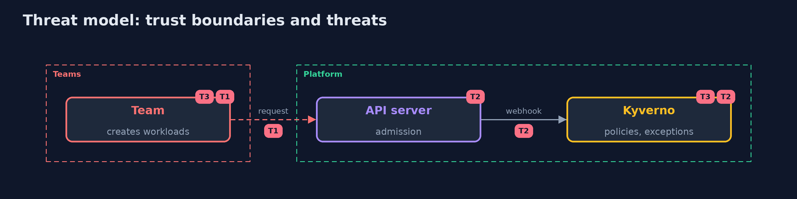

# Threat Model — Kubernetes Admission Control

A threat model answers four questions: what are we protecting, who or what could harm it, how, and what do we do about it. This one covers this project's own demo system, not a production deployment. Domain: a bank.

## Scope

The decision to create a workload in labelled namespaces. It does not cover what already runs, the nodes, or the images' contents.

## What we protect (assets)

- The payments namespace.
- The policies and the exceptions.
- The bank's signing key.

## Who and what acts on the system

- A developer who submits a pod.
- An attacker with a stolen image or kubectl access.
- A maintainer who writes an exception.

## Trust boundaries

A trust boundary is a line that data or a request crosses between parts that trust each other differently. Threats cluster where those lines are.

- The admission webhook: nothing is created without passing it.
- The kyverno namespace, where exceptions are read.

Each dashed box is a trust boundary. A rose tag such as T1 shows where the threat of that number, in the table below, applies.

## Threats, using STRIDE

STRIDE is a checklist of six kinds of threat: **Spoofing** (S), **Tampering** (T), **Repudiation** (R), **Information disclosure** (I), **Denial of service** (D), **Elevation of privilege** (E).

| Id | Kind | Threat | Where it shows up | Control in this project | What is left |
| --- | --- | --- | --- | --- | --- |
| T1 | Elevation of privilege | A workload that breaks the rules is created | a labelled namespace | Validating policies that deny, an audit period before each new rule | Namespaces without the label |
| T2 | Tampering | An image that was not built by the bank runs | the registry | Signature check by the bank's key, deployed by digest | A stolen signing key |
| T3 | Elevation of privilege | An exception or a gap lets a privileged pod in | the kyverno namespace and the controller | Exceptions only from kyverno and only until a date; keep the controller available | A controller that is down fails open |

## Assumptions

- The controller is running; the demo shows what is lost when it is not.

## Out of scope

- Compromise of the API server or etcd.
- Vulnerabilities inside signed images.

## How the tests check this

- `PodsAndPoliciesTest` and `VerdictTest` check the requests, the policy files and the verdicts with no tools.
- `DemoRunsTest` makes the cluster and compares the whole demo with the golden output (integrationTest).

## Where this model goes next

The next project, in the same module, is kubernetes-network-policies.
