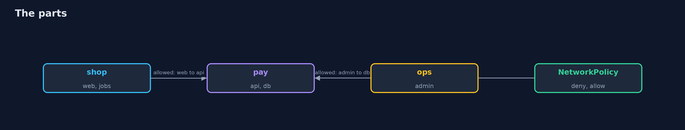
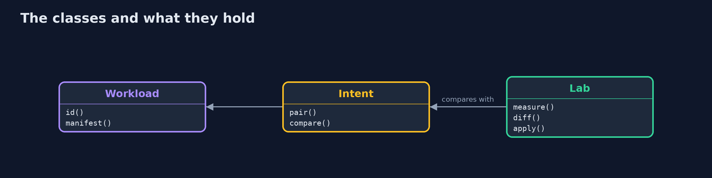
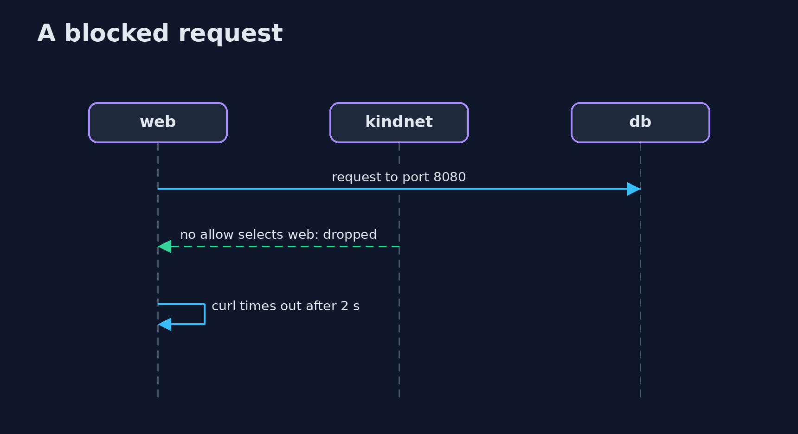

# Kubernetes Network Policies

```
src/main/java/com/jk/explore/security/k8snetpol/
├── Cluster.java                        A real Kubernetes cluster made by kind (one node, itself a container), with its own kubeconfig file, deleted on close
├── Intent.java                         Which pod may reach which pod, as the design says, and a measured matrix compared with it
├── KubernetesNetworkPoliciesDemo.java  A labelled section of an act: its header, then its lines
├── Lab.java                            The online store's five pods on a real cluster, a server outside it, and the measurement of who can reach whom
├── Policies.java                       The online store's network policies as manifests, one small builder for each shape
├── Policy.java                         One network policy: its name, its namespace, a one-line summary of what it does, and the manifest the API server gets
├── Report.java                         Turns pods, policies and measurements into the demo's lines
├── Sh.java                             Runs a program and returns what it printed, whether it worked or not
└── Workload.java                       A pod of the online store: where it runs, its name, the label that policies select it by, and what it does
```

**Five pods of an online store on a real cluster (kind) reach each other on 20 of 20 pairs with no policy, 17 of them unwanted; a default deny closes all 20 and one allow for each line of the design opens exactly the 3 that are meant, so the measurement equals the design; three mistakes that the API server accepts show up only in the measurement: an allow for a whole namespace (1 unwanted pair), a typo in the app label of an allow (1 missing pair) and a deny written for one app that leaves a pod with no policy (4 unwanted pairs); a default deny of egress also stops the name lookup until DNS is allowed, and stops calls to a server outside the cluster; and a pod relabelled app=web gets the store front's access.**

A Kubernetes cluster is a flat network: every pod can reach every other pod unless a **NetworkPolicy** says otherwise. This project runs a real cluster with **kind** (its default network plugin, kindnet, enforces policies), puts five pods of an online store in three namespaces and **measures** which pod can reach which. A Java program applies the policies and runs `curl` inside each pod against every other pod (`brew install kind kubectl`, Docker running); the demo makes a cluster, so it is tagged `integration`: `./gradlew integrationTest`. The kind node image is pinned by digest.

What it shows:
- **A flat network.** With no policy, **20 of 20** pairs of pods reach each other (5 pods make 5 x 4 = 20 pairs); the design allows 3, so **17 are unwanted**.
- **Default deny, then the design.** One deny in each namespace closes all 20 pairs; one allow for each line of the design opens exactly **3 of 20** and the measurement equals the design.
- **Three mistakes the API server accepts.** An allow for a whole namespace (**1 unwanted** pair), a typo in an app label (**1 missing** pair), a deny written for one app that leaves a pod with no policy (**4 unwanted** pairs). Only the measurement shows them.
- **Egress and DNS.** Denying egress also stops the name lookup until DNS is allowed, and stops the api from calling a server outside the cluster.
- **The label is the credential.** A pod relabelled `app=web` gets the store front's access.

**Maps to:** NIST CSF 2.0 Protect (PR.IR) · NIST SP 800-53 SC-7 · CIS Kubernetes Benchmark 5.3 · Zero trust microsegmentation.

## The idea in everyday terms

An office building where every door is unlocked. Locking them all is the easy part. The work is to cut a key for each line of the floor plan, and then to walk the building and try every door, because a key cut for the wrong room works just as well.

## The scenario

An online store runs a store front, nightly batch jobs, a payments api, a payments database and an operators' console in three namespaces. The design lists three allowed conversations and nothing else. The demo applies policies and then tries every pair of pods.

## Run

```bash
./gradlew run
```

The demo tells the story in 5 acts, each printing exact numbers that the tests check:

| Act | What it shows |
| --- | --- |
| 1. A flat network | With no policy 20 of 20 pairs of pods reach each other: 5 pods make 5 x 4 = 20 pairs, the design wants 3, so 17 are unwanted. |
| 2. Default deny, then the design | A default deny in each namespace closes all 20 pairs, the design's 3 too; one allow for each line of the design opens exactly those 3, and the measurement equals the design. |
| 3. Mistakes the API server accepts | An allow for a whole namespace (1 unwanted), a typo in a label (1 missing) and a deny for one app that leaves a pod with no policy (4 unwanted) are all accepted; only the measurement shows them. |
| 4. Egress and DNS | A default deny of egress in pay, with one allow from api to db, closes the outside server and also the lookup of the name db, until DNS is allowed. |
| 5. The label is the credential | With the design's policies in place, the jobs pod relabelled app=web passes the allow for web: 4 of 20 = 3 wanted + 1 unwanted, shop/jobs -> pay/api. |

## Test

```bash
./gradlew test
```

22 tests in `DemoRunsTest`, `IntentTest`, `PoliciesTest`, `ReportTest`. The design comparison, the report lines and the policy manifests are tested with no tools. The demo makes a cluster (./gradlew integrationTest).

## What the simulation got right, and what it left out

The cluster, the policies and the network plugin are real, and the pods are small web servers. The demo prints counts, pod names and policy names, never addresses or ids.

## Technologies and versions

Every version below is pinned in the project's build files and was the latest stable release when the project was built.

| Technology | Version | Used for |
| --- | --- | --- |
| Java | 25 | the language and runtime; a Gradle toolchain finds or downloads the JDK |
| Gradle | 9.8.1 (wrapper) | build and run; nothing to install, the wrapper downloads it |
| org.junit.jupiter:junit-jupiter | 6.1.3, set by junit-bom | JUnit 5: the tests (tests only) |
| org.junit.platform:junit-platform-launcher | 6.1.3, set by junit-bom | JUnit platform launcher, which Gradle needs to run the tests (tests only) |
| videokit | repository tool (`tools/videokit`) | the narrated video and animation: Piper `en_US-amy-medium`, speed 0.8, longer pauses (the amy-slow voice) |

## Learning Material

| Document | What it is for |
| --- | --- |
| [Problem statement](docs/problem-statement.md) | the situation and what the project must show |
| [Prerequisites](docs/prerequisites.md) | what you need to know first |
| [Kubernetes Network Policies, explained](docs/kubernetes-network-policies-explained.md) | the acts in prose |
| [Session guide](docs/session.md) | a one-hour lesson with exercises |
| [Animated walkthrough](docs/animation.html) | the acts step by step, narrated |
| [Threat model](docs/threat-model.md) | what is protected, who could harm it, and how, using STRIDE |
| [Spec](docs/spec.md) | what this project must be true of |
| [Expected output](docs/expected-output.txt) | the golden demo output every test and every port checks against |

### The idea in one picture

A policy selects pods; the plugin enforces it.



### Where each piece sits

Pods, the design and the lab.



### How the data moves

Every pod tries every other pod.


### Who calls whom, in order




### Video

`video/kubernetes-network-policies-explained.mp4` (with `.m4a` audio and `.srt` subtitles) is built by `video/build_video.sh`. Rendered media is not committed.

## What it costs

- **A policy that selects nothing is valid,** and does nothing.
- **Labels become credentials,** and whoever can set them chooses the policy.
- **Egress rules need DNS too,** or names stop working.
- **Enforcement depends on the network plugin;** some accept policies and ignore them.
- **Every pair must be tested** to know what the policies do.

## When this is too much

A cluster with one team and no sensitive data can start with namespaces and RBAC. Use network policies when a taken-over pod must not reach the database, or when a rule says which service may call which.

## Where you have already met this

- A cluster where every pod can reach the database.
- A policy copied from a blog post and never tested.
- An egress rule that broke DNS on a Friday.
- A label changed to get a pod working.

## Where this sits

This is the second project of the [kubernetes-and-container-security](..) module, after [kubernetes-admission-control](../kubernetes-admission-control). The same measuring of a design against a network was done with Docker networks in [network-isolation](../../cloud-security-without-a-cloud/network-isolation).
