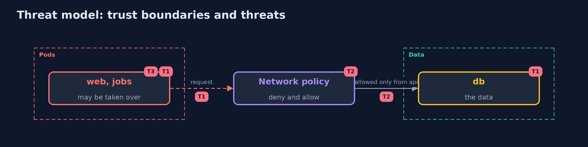

# Threat Model — Kubernetes Network Policies

A threat model answers four questions: what are we protecting, who or what could harm it, how, and what do we do about it. This one covers this project's own demo system, not a production deployment. Domain: a bank.

## Scope

Traffic between the pods of the cluster. It does not cover traffic from outside the cluster, the nodes, or what a permitted caller sends.

## What we protect (assets)

- The database.
- The payments api.
- The policies.

## Who and what acts on the system

- A taken-over pod in the shop.
- A developer who writes a policy.
- A person who can set labels.

## Trust boundaries

A trust boundary is a line that data or a request crosses between parts that trust each other differently. Threats cluster where those lines are.

- The namespace and the pod label: a policy selects by them.

Each dashed box is a trust boundary. A rose tag such as T1 shows where the threat of that number, in the table below, applies.

## Threats, using STRIDE

STRIDE is a checklist of six kinds of threat: **Spoofing** (S), **Tampering** (T), **Repudiation** (R), **Information disclosure** (I), **Denial of service** (D), **Elevation of privilege** (E).

| Id | Kind | Threat | Where it shows up | Control in this project | What is left |
| --- | --- | --- | --- | --- | --- |
| T1 | Elevation of privilege | A taken-over pod reaches the database | pod to pod | Default deny and an allow only from the api | The api itself |
| T2 | Tampering | A wrong policy is accepted and does nothing | the policies | Measure every pair against the design on every change | Pairs the design forgot |
| T3 | Spoofing | A pod is relabelled to take another pod's access | pod labels | Control who can set labels; admission rules on labels | Labels set by an administrator |

## Assumptions

- The network plugin enforces policies; the demo measures that it does.

## Out of scope

- Compromise of a node.
- Encrypting traffic between pods.

## How the tests check this

- `IntentTest` and `PoliciesTest` check the comparison and the manifests with no tools.
- `DemoRunsTest` makes the cluster and compares the whole demo with the golden output (integrationTest).

## Where this model goes next

The next project, in the same module, is runtime-security.
