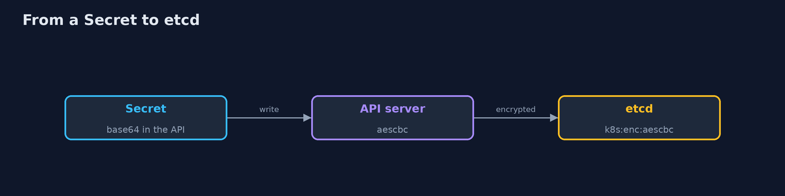
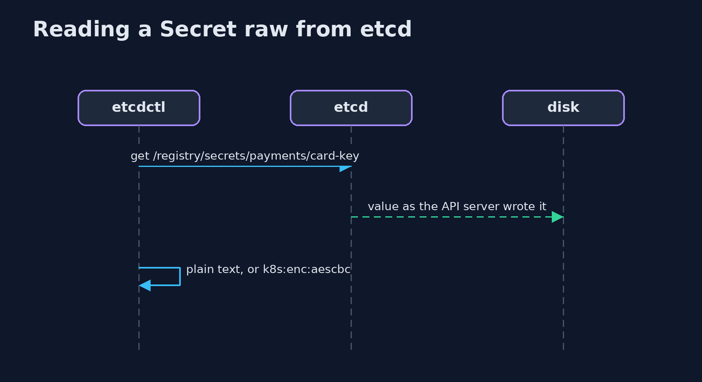

# Kubernetes Secrets

```
src/main/java/com/jk/explore/security/k8ssecrets/
├── Cluster.java                A real Kubernetes cluster made by kind (one node, itself a container), with its own kubeconfig file, deleted on close
├── Encryption.java             The EncryptionConfiguration file the API server reads, and the marker that an encrypted value carries in etcd
├── Http.java                   An HTTP answer from OpenBao: the status code and the JSON body (empty when there is none)
├── Jwt.java                    The claims of a ServiceAccount token
├── KubernetesSecretsDemo.java  Whether every Secret that etcd holds is encrypted
├── Manifests.java              The Kubernetes objects of the demo, as text
├── OpenBao.java                Sets up OpenBao in the cluster (policy, Kubernetes login) and talks to it from a pod, the way an application would
├── Sh.java                     Runs a program and returns what it printed, whether it worked or not
└── Stored.java                 A value read straight out of etcd: whether it is encrypted, and whether a given text can be found in it
```

**A card key in a Kubernetes Secret on a real cluster (kind) decodes with no key, and the auditor who may only list secrets reads it (yes), while a ServiceAccount with no rule cannot (no); read raw from etcd with etcdctl the value holds the key as plain text (yes) and not even as base64 (no); after the API server is restarted with an aescbc EncryptionConfiguration the old secret is still plain text, a new one is encrypted (yes) with no plain text, and only after every secret is rewritten is every secret in etcd encrypted (yes), the key being a file on the control-plane node and the auditor still reading the value; OpenBao holds the database password outside Kubernetes (none in any Secret, none in etcd): a pod logs in with its ServiceAccount token (HTTP 200), gets a token of 10 seconds, reads the password (HTTP 200), another ServiceAccount is refused (HTTP 403) and the same token is refused 12 seconds later (HTTP 403); a bound ServiceAccount token lives 600 seconds, has one audience and is tied to a pod and stops working when the pod is deleted (no), while the old token Secret has no expiry (no) and still works (yes).**

A Kubernetes **Secret** looks protected and is not: its values are only base64, and by default etcd stores them as they are. This project runs a real cluster with **kind**, puts a bank's card key in a Secret, reads it raw out of **etcd** (with `etcdctl` inside the etcd pod) before and after turning on **encryption at rest**, then moves a database password to **OpenBao** and compares a short-lived **bound token** with the old token Secret. A Java program drives `kind`, `kubectl` and `docker` (`brew install kind kubectl`, Docker running, a network for the images); the demo makes a cluster, so it is tagged `integration`: `./gradlew integrationTest`.

What it shows:
- **Base64 is an encoding.** The value decodes with no key, an auditor who may only **list** secrets reads it (yes), and an account with no rule cannot (no).
- **Raw etcd, before.** The stored value holds the card key as plain text (yes), not even as base64 (no).
- **Encryption at rest.** After the API server restarts with an `aescbc` EncryptionConfiguration, the old secret is still plain text, a new one is encrypted; only after a rewrite of every secret is **every secret in etcd encrypted**. The key is a file on the control-plane node, and the auditor still reads the value.
- **OpenBao and a short-lived token.** The database password is in no Secret and not in etcd. A pod logs in with its ServiceAccount token (HTTP 200), gets a token of **10 seconds**, reads the password (200); another ServiceAccount is refused (403) and the same token is refused 12 seconds later (403).
- **A bound ServiceAccount token.** 600 seconds, one audience, tied to a pod, and refused once the pod is gone; the old token Secret has no expiry and still works.

OpenBao runs in **development mode** (in memory, a known root token): it is the closest thing to a real server that runs on a laptop, and it speaks the same API. A KMS provider for the encryption key is not run here; the key sits on the control plane and the docs say so.

**Maps to:** NIST CSF 2.0 Protect (PR.DS) · NIST SP 800-53 SC-28 and IA-5 · CIS Kubernetes Benchmark 1.2.27 and 5.4 · OWASP Kubernetes Top 10 K08.

## The idea in everyday terms

A note in a safe-looking envelope that is only folded, not sealed. Anyone who is handed the envelope reads it, and so does anyone who finds it in the drawer. Sealing the drawer helps against a thief, not against the clerk with the key; the better way is to hand out a pass that works for ten seconds.

## The scenario

A bank keeps a card key and a database password for its payments service. The demo stores the key in a Secret, reads it from etcd, turns encryption on, moves the password to OpenBao and compares two kinds of ServiceAccount token.

## Run

```bash
./gradlew run
```

The demo tells the story in 5 acts, each printing exact numbers that the tests check:

| Act | What it shows |
| --- | --- |
| 1. Base64 is not encryption | A Secret's value decodes with no key and a role that may only list secrets reads it. |
| 2. Raw etcd, before | Read with etcdctl, the stored value holds the key as plain text. |
| 3. Encryption at rest | After a restart with aescbc only new secrets are encrypted; a rewrite encrypts the rest. |
| 4. OpenBao and a 10 second token | The password is outside Kubernetes; a pod logs in with its ServiceAccount token and gets 10 seconds. |
| 5. A bound ServiceAccount token | A token tied to a pod and an audience for 600 seconds, against the old token Secret that never expires. |

## Test

```bash
./gradlew test
```

14 tests in `DemoRunsTest`, `HttpAndManifestsTest`, `JwtTest`, `StoredAndEncryptionTest`. The token reader, the etcd value check, the encryption configuration and the manifests are tested with no tools. The demo makes a cluster (./gradlew integrationTest).

## What the simulation got right, and what it left out

The cluster, etcd, the encryption configuration, OpenBao and the tokens are real. OpenBao runs in development mode and the encryption key is a local file. The demo prints yes/no, counts and HTTP codes, never ids or tokens.

## Technologies and versions

Every version below is pinned in the project's build files and was the latest stable release when the project was built.

| Technology | Version | Used for |
| --- | --- | --- |
| Java | 25 | the language and runtime; a Gradle toolchain finds or downloads the JDK |
| Gradle | 9.8.1 (wrapper) | build and run; nothing to install, the wrapper downloads it |
| tools.jackson.core:jackson-databind | 3.1.5 | library the code uses |
| org.junit.jupiter:junit-jupiter | 6.1.3, set by junit-bom | JUnit 5: the tests (tests only) |
| org.junit.platform:junit-platform-launcher | 6.1.3, set by junit-bom | JUnit platform launcher, which Gradle needs to run the tests (tests only) |
| videokit | repository tool (`tools/videokit`) | the narrated video and animation: Piper `en_US-amy-medium`, speed 0.8, longer pauses (the amy-slow voice) |

## Learning Material

| Document | What it is for |
| --- | --- |
| [Problem statement](docs/problem-statement.md) | the situation and what the project must show |
| [Prerequisites](docs/prerequisites.md) | what you need to know first |
| [Kubernetes Secrets, explained](docs/kubernetes-secrets-explained.md) | the acts in prose |
| [Session guide](docs/session.md) | a one-hour lesson with exercises |
| [Animated walkthrough](docs/animation.html) | the acts step by step, narrated |
| [Threat model](docs/threat-model.md) | what is protected, who could harm it, and how, using STRIDE |
| [Spec](docs/spec.md) | what this project must be true of |
| [Expected output](docs/expected-output.txt) | the golden demo output every test and every port checks against |

### The idea in one picture

The API server, etcd and OpenBao.


### Where each piece sits

The cluster, OpenBao and the token reader.


### How the data moves

The API server encrypts on the way in.



### Who calls whom, in order




### Video

`video/kubernetes-secrets-explained.mp4` (with `.m4a` audio and `.srt` subtitles) is built by `video/build_video.sh`. Rendered media is not committed.

## What it costs

- **Base64 hides nothing,** and anyone who may list secrets reads them.
- **Encryption at rest protects a disk or an etcd backup,** not a person with the right to read secrets.
- **Existing secrets stay plain** until each one is rewritten.
- **The key sits on the control plane** unless a KMS provider keeps it outside.
- **An external secret store is one more system** to run, unseal and audit.

## When this is too much

A cluster with no sensitive data and one team can use plain Secrets with tight RBAC. Turn on encryption at rest when etcd backups or disks leave your control, and use an external store when a secret must be short-lived or audited.

## Where you have already met this

- A Secret committed to Git as base64.
- A role that allows list on secrets in every namespace.
- An etcd backup in a shared bucket.
- A service account token that never expires.

## Where this sits

This is the third project of the [kubernetes-and-container-security](..) module, after [kubernetes-admission-control](../kubernetes-admission-control) and [kubernetes-network-policies](../kubernetes-network-policies).
