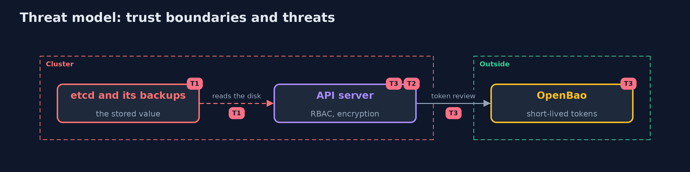

# Threat Model — Kubernetes Secrets

A threat model answers four questions: what are we protecting, who or what could harm it, how, and what do we do about it. This one covers this project's own demo system, not a production deployment. Domain: a bank.

## Scope

Secrets stored in the cluster, the API server and etcd, and the tokens pods use. It does not cover a taken-over node, a KMS or a production OpenBao.

## What we protect (assets)

- The card key.
- The database password.
- ServiceAccount tokens.

## Who and what acts on the system

- Someone with a copy of an etcd backup or disk.
- A user or account that may list secrets.
- A pod that leaks its token.

## Trust boundaries

A trust boundary is a line that data or a request crosses between parts that trust each other differently. Threats cluster where those lines are.

- The API server and RBAC: who may read a Secret.
- etcd: the disk.

Each dashed box is a trust boundary. A rose tag such as T1 shows where the threat of that number, in the table below, applies.

## Threats, using STRIDE

STRIDE is a checklist of six kinds of threat: **Spoofing** (S), **Tampering** (T), **Repudiation** (R), **Information disclosure** (I), **Denial of service** (D), **Elevation of privilege** (E).

| Id | Kind | Threat | Where it shows up | Control in this project | What is left |
| --- | --- | --- | --- | --- | --- |
| T1 | Information disclosure | An etcd backup or disk reveals the secrets | etcd | Encryption at rest, rewrite old secrets, a KMS for the key | The key on the control plane |
| T2 | Information disclosure | A role with list or get on secrets reads them in plain form | RBAC | Few readers, no list on secrets, audit | Anyone allowed to read |
| T3 | Elevation of privilege | A long-lived token or password is stolen and used for ever | tokens and passwords | Bound tokens, an external store with short TTLs | The seconds before expiry |

## Assumptions

- Encryption at rest is judged by reading etcd directly, as the demo does.

## Out of scope

- Compromise of the control-plane node.
- A KMS provider and key rotation.

## How the tests check this

- `JwtTest`, `StoredAndEncryptionTest` and `HttpAndManifestsTest` check the parts with no tools.
- `DemoRunsTest` makes the cluster and compares the whole demo with the golden output (integrationTest).

## Where this model goes next

The next project of the plan starts the devsecops-pipelines module.
