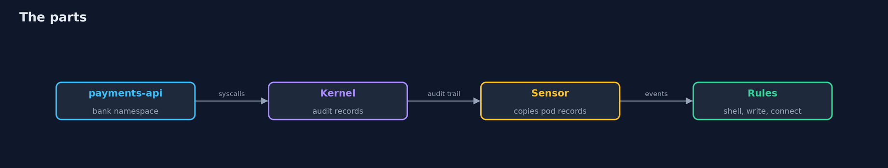
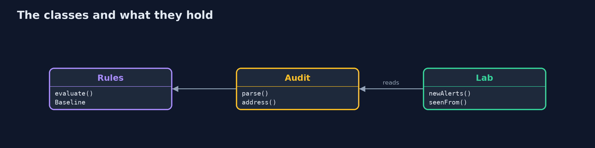
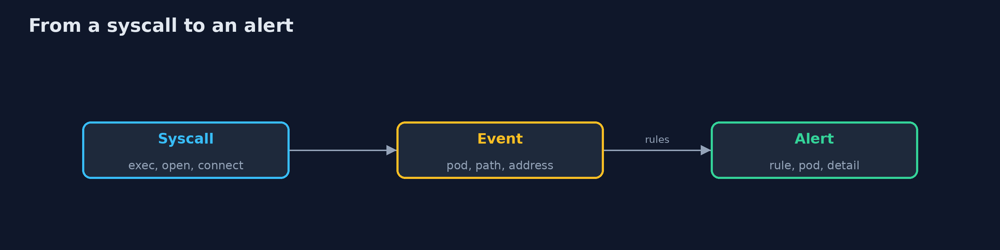

# Runtime Security

```
src/main/java/com/jk/explore/security/runtimesec/
├── Alert.java                One finding: which rule, in which pod, and what was seen
├── Audit.java                Reads the text records of Linux audit into events
├── Cluster.java              A real Kubernetes cluster made by kind (one node, itself a container), with its own kubeconfig file, deleted on close
├── Event.java                One audited syscall of a process in a container: what ran (key exec), what was opened for writing (key write) or what was connected to (key connect)
├── Falco.java                Falco, run as a container: first to check the rules file, then to try its driver on this machine's kernel
├── Lab.java                  The bank's cluster, an outside server and the sensor, and what the sensor saw
├── Pods.java                 The manifests of the bank's pods
├── Rules.java                The three tests of the bank's runtime rules, the same ones as rules/bank-runtime-rules.yaml
├── RuntimeSecurityDemo.java  
├── Sensor.java               The sensor that stands in for Falco on a kernel that cannot run Falco's driver: Linux audit, switched on by a privileged container that shares the kernel's process view, copying the records of Kubernetes containers to a file we read back
└── Sh.java                   Runs a program and returns what it printed, whether it worked or not
```

**On a real cluster (kind) a bank's payments pod does its normal work (a call to the ledger, a write to its log folder) and raises 0 alerts although the sensor saw all 3 kinds of syscall; then one shell opened with kubectl exec raises 1 alert, one program written to /usr/bin raises 1, one connection to a server outside the cluster raises 1, and the same write in a pod with a read-only root file system is refused and still raises 1; Falco 0.45.1 accepts the bank's 3 rules (falco --validate: yes) but its modern eBPF driver cannot start on Docker Desktop's kernel (no BTF: BPF_TRACE_RAW_TP is not supported), so the same 3 tests run on Linux audit records of that kernel.**

Admission control and network policies decide what may start and what may talk. **Runtime security** watches what a running container actually does. This project runs a real cluster with **kind**, puts a bank's payments pod and a ledger pod in it, and detects three behaviours that a payments service must not show: **a shell**, **a write where it never writes** and **a connection to an address it never calls**. The rules are written for **Falco** and checked by Falco itself; the demo's sensor applies the same three tests to Linux audit records (`brew install kind kubectl`, Docker running). The demo makes a cluster, so it is tagged `integration`: `./gradlew integrationTest`.

What it shows:
- **Falco on this machine.** Falco 0.45.1 accepts the bank's **3 rules**, but its modern eBPF driver cannot start on Docker Desktop's kernel (no BTF: `BPF_TRACE_RAW_TP` is not supported). The demo says so and uses Linux audit on the same kernel.
- **Normal work, 0 alerts.** A call to the ledger and a write to the log folder are seen by the sensor (3 of 3 kinds) and raise **0 alerts**.
- **Three behaviours, 1 alert each.** A shell opened with `kubectl exec`, a program written to `/usr/bin`, a connection to a server outside the cluster.
- **Prevent and detect.** The same write in a pod with a read-only root file system is refused and still raises **1 alert**.

**Maps to:** NIST CSF 2.0 Detect (DE.CM) · NIST SP 800-53 SI-4 · CIS Kubernetes Benchmark 5 · MITRE ATT&CK for Containers (execution, persistence, command and control).

## The idea in everyday terms

A bank branch with locks on the doors and a guest list at the entrance. Neither tells you that someone inside has opened the vault room, carried something out of the back door or phoned an unknown number. A camera that knows the normal routine tells you the moment it changes.

## The scenario

A bank runs a payments service that serves requests, writes its log to one folder and calls the ledger database. It never needs a shell, never writes to the program folders and never calls any other address. The demo does the normal work, then each of the three things it must never do.

## Run

```bash
./gradlew run
```

The demo tells the story in 6 acts, each printing exact numbers that the tests check:

| Act | What it shows |
| --- | --- |
| 1. Falco on this machine | Falco accepts the 3 rules, but its driver cannot start on this kernel. |
| 2. The service doing its work | A call to the ledger and a write to the log folder are seen and raise 0 alerts. |
| 3. A shell in the container | A shell opened with kubectl exec raises 1 alert. |
| 4. A write where it never writes | A program written to /usr/bin raises 1 alert. |
| 5. A connection it never makes | A connection to a server outside the cluster raises 1 alert. |
| 6. Prevent and detect | A read-only root refuses the write, and the attempt still raises 1 alert. |

## Test

```bash
./gradlew test
```

27 tests in `AuditTest`, `DemoRunsTest`, `PodsAndRulesFileTest`, `RulesTest`. The audit parsing, the three rules and the manifests are tested with no tools. The demo makes a cluster (./gradlew integrationTest).

## What the simulation got right, and what it left out

The cluster, the pods, the syscalls and the audit records are real, and Falco's own validator checks the rules. Falco's driver is the one thing that cannot run here, and the demo prints that instead of hiding it. The demo prints counts and pod names, never ids or addresses.

## Technologies and versions

Every version below is pinned in the project's build files and was the latest stable release when the project was built.

| Technology | Version | Used for |
| --- | --- | --- |
| Java | 25 | the language and runtime; a Gradle toolchain finds or downloads the JDK |
| Gradle | 9.8.1 (wrapper) | build and run; nothing to install, the wrapper downloads it |
| org.junit.jupiter:junit-jupiter | 6.1.3, set by junit-bom | JUnit 5: the tests (tests only) |
| org.junit.platform:junit-platform-launcher | 6.1.3, set by junit-bom | JUnit platform launcher, which Gradle needs to run the tests (tests only) |
| videokit | repository tool (`tools/videokit`) | the narrated video and animation: Piper `en_US-amy-medium`, speed 0.8, longer pauses (the amy-slow voice) |

## Learning Material

| Document | What it is for |
| --- | --- |
| [Problem statement](docs/problem-statement.md) | the situation and what the project must show |
| [Prerequisites](docs/prerequisites.md) | what you need to know first |
| [Runtime Security, explained](docs/runtime-security-explained.md) | the acts in prose |
| [Session guide](docs/session.md) | a one-hour lesson with exercises |
| [Animated walkthrough](docs/animation.html) | the acts step by step, narrated |
| [Threat model](docs/threat-model.md) | what is protected, who could harm it, and how, using STRIDE |
| [Spec](docs/spec.md) | what this project must be true of |
| [Expected output](docs/expected-output.txt) | the golden demo output every test and every port checks against |

### The idea in one picture

A pod is watched from the kernel.



### Where each piece sits

Records, rules and the lab.



### How the data moves

Each audit record becomes an event and meets three rules.



### Who calls whom, in order


### Video

`video/runtime-security-explained.mp4` (with `.m4a` audio and `.srt` subtitles) is built by `video/build_video.sh`. Rendered media is not committed.

## What it costs

- **A detector prevents nothing.** It tells you, after the fact.
- **Every rule needs a baseline** of what the service does, and a new feature makes the baseline wrong.
- **The driver needs the kernel's help.** Falco's eBPF driver cannot load on every kernel.
- **A sensor that looks up the container afterwards can miss a short process.**
- **Alerts need an owner,** or they become noise.

## When this is too much

A cluster with no sensitive workload can start with admission control and network policies. Add runtime detection when a taken-over container would do harm, or when a rule says suspicious activity must be detected.

## Where you have already met this

- A container that ran a miner for a month.
- A rule that fired a hundred times a day and was muted.
- A debug shell left in production.
- A log line nobody read.

## Where this sits

This is the third project of the [kubernetes-and-container-security](..) module, after [kubernetes-admission-control](../kubernetes-admission-control) and [kubernetes-network-policies](../kubernetes-network-policies). Those prevent; this one detects what gets through.
