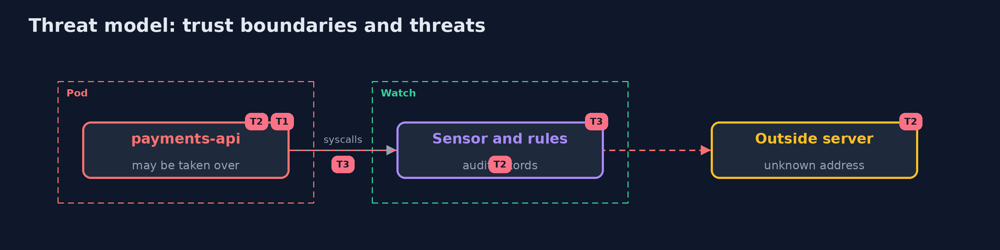

# Threat Model — Runtime Security

A threat model answers four questions: what are we protecting, who or what could harm it, how, and what do we do about it. This one covers this project's own demo system, not a production deployment. Domain: a bank.

## Scope

What a running pod does: processes started, files opened for writing and connections made. It does not cover the node's own processes, other namespaces, or what a permitted action does with its data.

## What we protect (assets)

- The payments service.
- The ledger database.
- The rules and the baseline.

## Who and what acts on the system

- An attacker with a shell in the pod.
- A developer who opens a debug shell.
- A person who changes the rules.

## Trust boundaries

A trust boundary is a line that data or a request crosses between parts that trust each other differently. Threats cluster where those lines are.

- The pod's cgroup: the sensor decides by it which records belong to a pod.

Each dashed box is a trust boundary. A rose tag such as T1 shows where the threat of that number, in the table below, applies.

## Threats, using STRIDE

STRIDE is a checklist of six kinds of threat: **Spoofing** (S), **Tampering** (T), **Repudiation** (R), **Information disclosure** (I), **Denial of service** (D), **Elevation of privilege** (E).

| Id | Kind | Threat | Where it shows up | Control in this project | What is left |
| --- | --- | --- | --- | --- | --- |
| T1 | Elevation of privilege | A shell is opened in the payments pod | the pod | Start without a shell; rule Shell in container | A shell not started by exec or run as another name |
| T2 | Information disclosure | A taken-over pod writes a program or calls an outside server | the pod | Rules for unexpected write and outbound connection; read-only root and network policy to prevent | Behaviour inside the baseline |
| T3 | Repudiation | The sensor misses a short process or the rules are out of date | the sensor | Read the container from the kernel event (Falco); keep the baseline with the service | A process that exits before the lookup |

## Assumptions

- The audit trail of the node's kernel is complete.
- The baseline matches what the service really does.

## Out of scope

- Compromise of the node or the sensor.
- Responding to an alert.

## How the tests check this

- `AuditTest` and `RulesTest` check the parsing and the three rules with no tools.
- `DemoRunsTest` makes the cluster and compares the whole demo with the golden output (integrationTest).

## Where this model goes next

The next project, in the same module, is kubernetes-secrets.
